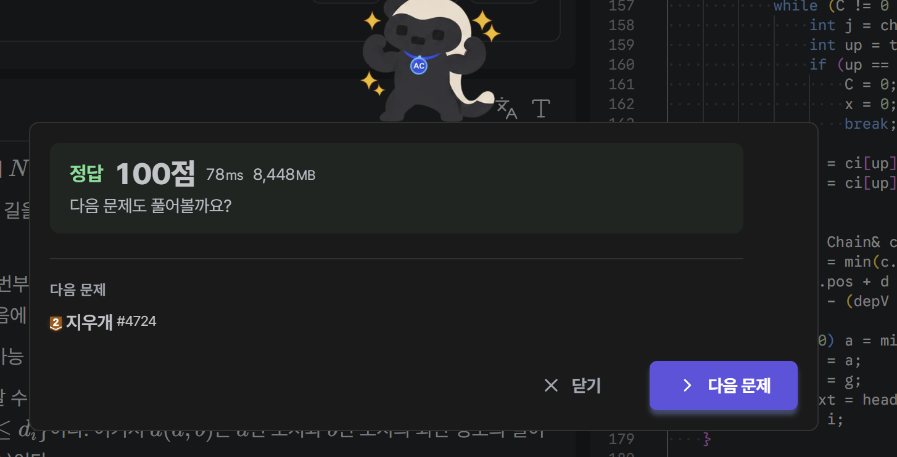

2021 KOI 2차 고등부 4번 문제입니다. 시간 제한은 3초이지만 99ms 이하로 줄이는 것을 목표로 잡았습니다. 결과는 정답 100점, 78ms입니다 :)



## 문제

도시 N개가 트리로 연결되어 있고 맛집이 M개 있습니다. 맛집 i는 도시 c에 있고 거리 d 이내의 모든 도시에 배달하며, 선호도는 g입니다. 어떤 도시도 고른 맛집 둘 이상의 배달 범위에 들어가지 않도록 맛집을 골라 선호도 합을 최대로 만들어야 합니다.

| 항목 | 범위 |
| --- | --- |
| N, M | 1 이상 100,000 이하 |
| d | 0 이상 N-1 이하 |
| g | 1 이상 10^9 이하, 합은 `long long` |

트리에서 두 범위가 겹치는지는 거리만 보면 됩니다.

```
겹침 ⇔ dist(ci, cj) ≤ di + dj
```

## 기본 DP, 도달표

정점 v의 서브트리에서 맛집을 고른다고 합시다. 고른 맛집 x가 v 기준으로 얼마나 더 위로 닿는지를 `a = dx - dist(cx, v)`로 정의합니다. a가 음수면 v까지 닿지 않습니다.

서로 다른 자식 서브트리의 맛집 두 개는 경로가 v를 지나므로 이렇게 바뀝니다.

```
겹치지 않음 ⇔ a1 + a2 ≤ -1
```

그래서 서브트리마다 `R(a)`를 들고 올라갑니다. 고른 맛집의 도달값이 모두 a 이하일 때 얻는 최대 선호도이고, a가 커질수록 값도 커집니다.

자식 두 개 X, Y를 합치는 규칙은 다음과 같습니다.

- a < 0이면 둘 다 v에 닿지 않아 서로 겹치지 않습니다. `R(a) = RX(a) + RY(a)`입니다.
- a ≥ 0이면 한쪽이 a만큼 닿을 때 다른 쪽은 거울값 `-1 - a` 이하여야 합니다. `new(a) = max(RX(a) + RY(-1-a), RY(a) + RX(-1-a))`로 계산하고, R(a)는 new의 누적 최댓값입니다.

맛집 (d, g)가 v에 있으면 `R(d) ← max(R(d), g + R(-1-d))`로 갱신합니다.

부모로 올라가면 a가 전부 1씩 줄어듭니다. 이걸 매번 옮기지 않으려고 절대 깊이 키 `h = 깊이(v) - a`를 씁니다. 범위가 닿는 가장 높은 깊이라서 부모로 가도 값이 그대로입니다. 깊이 D인 정점에서 거울 키는 `m(h) = 2D - h + 1`입니다.

이 표를 `std::map`에 담아 작은 쪽을 큰 쪽에 합칠 수도 있습니다. 99ms 이하를 노린다면 로그와 노드 할당 비용을 없애는 편이 낫다고 보고, 표를 배열에 담는 방법을 찾았습니다.

## 핵심, 서브트리를 다 덮는 맛집은 위로 옮기기

표가 커지는 원인은 도달값이 양수인 쪽입니다. 높이가 작은 서브트리에도 멀리 닿는 맛집이 얼마든지 있을 수 있습니다. 그런데 이런 맛집은 서브트리를 통째로 덮기 때문에 위치를 옮겨도 충돌 관계가 그대로입니다.

보조정리: 정점 u의 반지름 a인 맛집을 부모 p의 반지름 a-1인 맛집으로 바꿔도, `a - 1 ≥ hgt(u) + 1`이면 다른 모든 맛집과의 겹침 여부가 변하지 않습니다.

다른 맛집 (x, b)를 위치별로 나누어 확인합니다.

- x가 u의 서브트리 밖이면 `dist(x, p) = dist(x, u) - 1`이라 조건식의 양변이 똑같이 1 줄어듭니다.
- x가 u의 서브트리 안이면 `dist(x, u) ≤ hgt(u) ≤ a`라서 옮기기 전에도 겹칩니다. 옮긴 뒤에도 `dist(x, p) ≤ hgt(u) + 1 ≤ a - 1`이라 겹칩니다.

정점 v의 반지름 r인 맛집 기준으로 옮기는 조건을 다시 쓰면 `e(x) ≤ T`입니다. 여기서 `e(x) = hgt(x) - dep(x)`, `T = r - dep(v) - 2`입니다. e는 조상으로 갈수록 커지므로, e(x) > T를 만족하는 가장 가까운 조상이 맛집이 멈출 자리입니다.

루트에서는 더 올라갈 곳이 없으니 반지름을 `hgt(루트)`로 줄입니다. 이미 트리 전체를 덮고 있어서 결과는 같습니다.

옮기고 나면 정점 u에 남은 맛집은 모두 `a ≤ hgt(u) + 1`을 만족합니다. 도달값의 범위가 서브트리 높이 안으로 들어온 것입니다.

## 긴 경로 배열 하나로 합치기

범위가 높이로 제한되니 긴 경로 분해를 그대로 쓸 수 있습니다. 긴 경로마다 깊이 키로 접근하는 배열을 하나 두고, 긴 자식은 그 배열을 물려받습니다. 꼭대기 t의 배열은 키 `dep(t) - hgt(t) - 1`부터 `dep(t) + hgt(t) + 2`까지입니다.

배열 하나를 현재 깊이 D 기준으로 나누어 씁니다.

- `x > D`는 확정된 R(x)입니다.
- `x ≤ D`는 아직 닿아 있는 맛집이 남긴 대기값입니다. R(x)는 D부터 x까지의 누적 최댓값으로 읽습니다.

한 칸 올라갈 때는 키 하나만 확정합니다.

```cpp
A[D + 1] = max(A[D + 1], A[D + 2]);
```

높이 H인 짧은 자식 S는 긴 쪽 A에 이렇게 합칩니다. 대기값을 누적 최댓값으로 읽으며 거울 키와 짝짓고, 그다음 확정 구역을 더합니다.

```cpp
ll rl = A[D + 1], rs = S[D + 1];
for (int a = 0; a <= H; a++) {
    int h = D - a, mir = D + 1 + a;
    rl = max(rl, A[h]);
    rs = max(rs, S[h]);
    A[h] = max(rl + S[mir], rs + A[mir]);
}
for (int h = D + 1; h <= D + 1 + H; h++) A[h] += S[h];
```

맛집 처리는 확정 구역만 읽기 때문에 처리 순서를 신경 쓰지 않아도 됩니다.

```cpp
ll val = g + A[D + a + 1];
if (val > A[D - a]) A[D - a] = val;
```

답은 루트에서 `A[1]`과 대기값들의 최댓값입니다.

S가 도달값 H까지만 가지는 이유는 앞의 보조정리입니다. S의 꼭대기에 남은 맛집은 `a ≤ H + 1`이고 부모 기준으로는 `a ≤ H`입니다. a > H 구간은 누적 최댓값이 알아서 처리해 줍니다. 값을 물려받은 배열을 O(H)에 직접 고치므로 펜윅 트리도 필요 없었습니다.

여기까지 구현해서 낸 첫 제출이 116ms입니다. 목표에는 17ms가 모자랐습니다.

## 116ms에서 78ms로

알고리즘은 이미 충분히 빨라서, 남은 시간은 메모리 접근에 있다고 보고 구간별로 시간을 쟀습니다. 입력의 정점 번호가 무작위라 배열 곳곳을 뛰어다니는 비용이 컸고, 메모리도 약 15MB를 쓰고 있었습니다. 다음을 바꿨습니다.

1. 인접 리스트를 없앴습니다. 정점마다 차수와 이웃의 XOR만 저장하고 리프부터 벗기면 부모, 높이, 긴 자식이 한 번에 나옵니다. BFS와 전위 순회도 함께 사라졌습니다.
2. 번호를 긴 경로 단위로 다시 붙였습니다. 뒤 경로부터 아래에서 위로 돌기만 하면 자식이 항상 부모보다 먼저 끝납니다.
3. 맛집을 옮기는 계산을 O(1)로 줄였습니다. 긴 경로 안에서는 `e(x) = bot - 2 * dep(x)`라서 멈출 깊이가 `(bot - T - 1) / 2`의 내림으로 바로 나옵니다. 경로를 건널 때만 경로 트리의 점프 포인터를 씁니다.
4. 맛집마다 여러 배열을 읽던 것을 `nb` 한 칸으로 모았습니다. 옮길 필요가 없는 맛집은 경로 정보를 읽지도 않습니다.
5. 입력 파서를 8바이트 단위로 바꿨습니다. 자릿수에 따른 분기가 없어집니다. 파싱과 처리를 떼어 놓고 쟀을 때 맛집 처리 시간이 대략 절반으로 줄었는데, 정확한 원인까지 측정하지는 못했지만 자릿수 분기의 예측 실패가 메모리 접근을 끊는 것으로 보고 있습니다.
6. 입력 버퍼를 64KB로 줄였습니다. 입력 전체를 메모리에 올리지 않아도 됩니다.

제 PC에서는 트리 모양에 따라 빨라지기도 하고 비슷하기도 해서 결과를 확신하지 못했는데, 저지에서는 116ms가 78ms로 줄었습니다. 메모리도 약 15MB에서 약 8MB로 줄었습니다.

## 복잡도

병합 비용의 합은 긴 경로 길이의 합이라 O(N)입니다. 배열 크기의 합은 `Σ(2H + 4) ≤ 4N`이고, 맛집 옮기기는 맛집 하나에 O(log N)입니다. 전체는 O(N + M log N)입니다.

## 코드

`nb`는 입력 번호 기준의 정점 정보입니다. 리프를 벗기는 동안에는 `xr`이 남은 이웃의 XOR이고, 벗겨지고 나면 부모가 됩니다. 경로를 만든 뒤에는 `deg`가 새 번호 + 1, `xr`이 경로 번호, `lc`가 깊이로 바뀝니다.

`ch`와 `ci`는 긴 경로 정보입니다. `pos`는 시작 번호, `dep`는 꼭대기 깊이, `bot`은 맨 아래 깊이, `jump`는 경로 트리의 점프 포인터입니다. `off`를 쓰면 깊이 키 x의 값이 `pool[off + x]`에 있습니다.

```cpp
#include <cstdio>
#include <cstdint>
#include <cstring>
#include <algorithm>
using namespace std;
typedef long long ll;

const int MAXN = 100005;
const size_t IBUF = 1 << 16;

static char ibuf[IBUF + 16];
static char* ip = ibuf;
static char* iend = ibuf;
static bool ieof = false;

static void refill() {
    size_t rest = iend - ip;
    memmove(ibuf, ip, rest);
    size_t k = fread(ibuf + rest, 1, IBUF - rest, stdin);
    if (k == 0) ieof = true;
    ip = ibuf;
    iend = ibuf + rest + k;
    *iend = 0;
}

static inline int readInt() {
    if (iend - ip < 64 && !ieof) refill();
    while (*ip && (*ip < '0' || *ip > '9')) ip++;
    uint64_t w;
    memcpy(&w, ip, 8);
    w ^= 0x3030303030303030ULL;
    uint64_t bad = ((w + 0x7676767676767676ULL) | w) & 0x8080808080808080ULL;
    int len = bad ? __builtin_ctzll(bad) >> 3 : 8;
    if (len == 0) return 0;
    w <<= (8 - len) * 8;
    w = (w * 10 + (w >> 8)) & 0x00FF00FF00FF00FFULL;
    w = (w * 100 + (w >> 16)) & 0x0000FFFF0000FFFFULL;
    w = (w * 10000 + (w >> 32)) & 0xFFFFFFFFULL;
    ip += len;
    int x = (int)w;
    while (*ip >= '0' && *ip <= '9') x = x * 10 + *ip++ - '0';
    return x;
}

struct Node {
    int deg, xr, hgt, lc;
} nb[MAXN];

struct Chain {
    int pos, dep, bot;
    int jump;
} ch[MAXN];

struct ChainInfo {
    int par;
    int pc;
    int cdep;
    int off;
    int sib;
} ci[MAXN];

struct Rest {
    int a, g, nxt;
} rest[MAXN];

int ord_[MAXN], fc[MAXN], head[MAXN];

ll pool[MAXN * 4 + 16];

static inline int topE(int c) { return ch[c].bot - 2 * ch[c].dep; }

int main() {
    int n = readInt();
    int m = readInt();
    for (int i = 0; i < n - 1; i++) {
        int u = readInt() - 1, v = readInt() - 1;
        nb[u].deg++;
        nb[u].xr ^= v;
        nb[v].deg++;
        nb[v].xr ^= u;
    }

    int t = 0;
    for (int i = 1; i < n; i++) {
        int v = i;
        while (v != 0 && nb[v].deg == 1) {
            Node& a = nb[v];
            Node& b = nb[a.xr];
            a.deg = 0;
            ord_[t++] = v;
            b.deg--;
            b.xr ^= v;
            if (a.hgt + 1 > b.hgt) {
                b.hgt = a.hgt + 1;
                b.lc = v;
            }
            v = a.xr;
        }
    }
    ord_[t] = 0;

    int cc = 0, cnt = 0, cur = 0;
    for (int i = n - 1; i >= 0; i--) {
        int v = ord_[i];
        if (nb[v].deg != 0) continue;

        Chain& c = ch[cc];
        ChainInfo& info = ci[cc];
        int H = nb[v].hgt;
        c.pos = cnt;
        if (v != 0) {
            const Node& q = nb[nb[v].xr];
            int pp = q.deg - 1, pc = q.xr;
            c.dep = q.lc + 1;
            info.par = pp;
            info.pc = pc;
            info.cdep = ci[pc].cdep + 1;
            int j = ch[pc].jump;
            c.jump = ci[pc].cdep - ci[j].cdep == ci[j].cdep - ci[ch[j].jump].cdep ? ch[j].jump : pc;
            info.sib = fc[pp];
            fc[pp] = cc;
        }
        c.bot = c.dep + H;
        info.off = cur + H + 1 - c.dep;
        cur += 2 * H + 4;

        for (int u = v, k = 0; k <= H; k++) {
            Node& s = nb[u];
            u = s.lc;
            s.deg = ++cnt;
            s.xr = cc;
            s.lc = c.dep + k;
        }
        cc++;
    }

    for (int i = 1; i <= m; i++) {
        const Node& s = nb[readInt() - 1];
        int r = readInt();
        int g = readInt();

        int x = s.deg - 1, depV = s.lc, a = r;
        int T = r - depV - 2;
        if (s.hgt - depV <= T) {
            int C = s.xr;
            while (C != 0 && topE(C) <= T) {
                int j = ch[C].jump;
                int up = topE(j) <= T ? j : C;
                if (up == 0) {
                    C = 0;
                    x = 0;
                    break;
                }
                x = ci[up].par;
                C = ci[up].pc;
            }

            const Chain& c = ch[C];
            int d = min(c.dep + x - c.pos, max((c.bot - T - 1) >> 1, c.dep));
            x = c.pos + d - c.dep;
            a = r - (depV - d);
        }
        if (x == 0) a = min(a, ch[0].bot);
        rest[i].a = a;
        rest[i].g = g;
        rest[i].nxt = head[x];
        head[x] = i;
    }

    for (int c = cc - 1; c >= 0; c--) {
        const Chain& k = ch[c];
        ll* A = pool + ci[c].off;
        for (int D = k.bot, v = k.pos + k.bot - k.dep; D >= k.dep; D--, v--) {
            if (D < k.bot) A[D + 1] = max(A[D + 1], A[D + 2]);

            for (int w = fc[v]; w != 0; w = ci[w].sib) {
                ll* S = pool + ci[w].off;
                int H = ch[w].bot - ch[w].dep;
                S[D + 1] = max(S[D + 1], S[D + 2]);
                ll rl = A[D + 1], rs = S[D + 1];
                for (int a = 0; a <= H; a++) {
                    int h = D - a, mir = D + 1 + a;
                    rl = max(rl, A[h]);
                    rs = max(rs, S[h]);
                    A[h] = max(rl + S[mir], rs + A[mir]);
                }
                for (int h = D + 1; h <= D + 1 + H; h++) A[h] += S[h];
            }

            for (int i = head[v]; i != 0; i = rest[i].nxt) {
                int a = rest[i].a;
                ll val = rest[i].g + A[D + a + 1];
                if (val > A[D - a]) A[D - a] = val;
            }
        }
    }

    ll* A = pool + ci[0].off;
    ll ans = A[1];
    for (int a = 0; a <= ch[0].bot; a++) ans = max(ans, A[-a]);
    printf("%lld\n", ans);
    return 0;
}
```

## 검증

제출 전에 정답기를 따로 만들어 대조했습니다. 불일치는 모두 0건입니다.

| 대조 대상 | 입력 | 건수 |
| --- | --- | --- |
| 부분집합 전수 조사 | 작은 무작위 입력 | 190,000 |
| 코달 그래프 그리디 | N 200 이하 | 10,000 |
| 코달 그래프 그리디 | N = M = 3000, 트리 모양 8종 | 24 |
| 116ms 버전의 답 | N = M = 100,000 | 12 |

배달 범위의 교차 그래프는 트리의 부분 트리들이 이루는 교차 그래프라서 코달 그래프입니다. 그래서 최대 가중 독립 집합을 깊은 범위부터 처리하는 그리디(Frank 알고리즘)로 구할 수 있고, DP와 다른 방식의 정답기로 쓰기 좋았습니다.

## 결과

| 제출 | 내용 | 정올 시간 | 메모리 |
| --- | --- | --- | --- |
| 첫 번째 | 긴 경로 배열 + 조상 옮기기 | 116ms | 약 15MB |
| 두 번째 | XOR 벗기기 + 경로 번호 + 8바이트 파서 | 78ms | 약 8MB |

표의 크기를 서브트리 높이로 묶는 관찰 하나가 `map`을 없애 줬습니다. 두 제출 사이의 38ms는 계산량이 아니라 메모리 접근을 줄여서 얻었습니다.
