안드로이드 모바일 보안을 공부하면서 가장 답답했던 건, 블로그마다 나오는 "고전 취약점"이 정작 최신 단말에서는 그대로 재현되지 않는다는 점이었습니다. 평문 로그를 옆 앱이 읽어간다거나 외부 저장소에 떨군 파일을 아무나 긁어간다는 설명은 많은데, API 33 단말에 올려 보면 상당수가 기본값으로 막혀 있습니다. 그래서 연습용 취약앱 AndroGoat을 API 33 에뮬레이터에 올리고, 카테고리를 하나씩 눌러 발화시킨 다음 adb와 Frida로 값을 뽑아 봤습니다. 되는 건 왜 되고 막힌 건 왜 막히는지를 한 번에 정리하는 게 목표였습니다.

AndroGoat은 학습 목적으로 일부러 취약하게 만든 오픈소스 Kotlin 앱입니다. 실제 서비스가 아니라 연습 과녁이라, 아래 실습은 전부 제 에뮬레이터 안의 이 앱만을 대상으로 합니다.

## 세 줄 요약

- 로깅, 하드코딩, SQL 인젝션, 저장소 평문, 클립보드, WebView, 콘텐츠 프로바이더, 커맨드 인젝션은 **최신 안드로이드에서도 그대로 뚫립니다.** 플랫폼이 아니라 앱 코드의 문제라 그렇습니다.
- 루트와 에뮬레이터 탐지, 자바로 짠 생체 인증, 자바 레벨 인증서 핀 고정(피닝)은 **Frida 같은 후킹 도구로 되뚫립니다.** 다만 뚫리는 건 어디까지나 로컬 신호에만 기대는 느슨한 구현입니다.
- 서버가 기기 자체를 검증하는 Play Integrity, 키가 하드웨어에 묶인 생체 인증, 네이티브 코드로 짠 핀 고정은 **에뮬레이터와 자바 후킹만으로는 못 뚫습니다.** 이게 이번 실습에서 확인한 로컬 공격의 한계선입니다.

## 실습 환경

실행 환경은 이렇게 맞췄습니다.

```
에뮬레이터: API 33 (Android 13), Google APIs x86_64 이미지
앱: AndroGoat v2.0.1 (debuggable 빌드, 패키지 owasp.sat.agoat)
호스트: Windows 11 + platform-tools(adb) + frida-tools
우회: Frida (앱이 실행되는 동안 코드를 가로채 동작을 바꾸는 도구, frida-server 16.6.6)
프록시: mitmproxy (앱과 서버 사이 트래픽을 가로채 내용을 보여주는 도구)
```

이미지 선택에서 먼저 한 번 막힙니다. 흔히 받는 Google Play 이미지는 production으로 서명돼 있어 `adb root`가 거부됩니다. `run-as`(디버그 빌드에서 앱 자신의 권한으로 셸을 여는 adb 명령)나 root로 앱 내부 저장소를 들여다보려면 Google APIs(userdebug) 이미지를 써야 합니다. 이미지 하나 잘못 고르면 이후 추출이 전부 막히니, 여기서부터가 사실상 첫 관문입니다.

```bash
adb root
adb shell whoami   # root
adb install -r AndroGoat.apk
adb shell dumpsys package owasp.sat.agoat | findstr "targetSdk debuggable"
```

Frida는 호스트에 frida-tools를 올리고 단말에는 아키텍처가 맞는 frida-server를 밀어 넣어 root 쉘에서 띄웁니다. 여기서 함정이 하나 있었습니다. frida-server 17로 돌리면 스크립트가 `ReferenceError: 'Java' is not defined`로 멈춥니다. 17부터 자바 코드를 다루는 `Java` 브리지가 기본 번들에서 빠졌기 때문입니다. 클라이언트와 서버를 16대로 맞추니 해결됐습니다.

## 저장소에 평문으로 남는 것들

안드로이드 앱은 로그, 내부 저장소, 외부 저장소, 임시 파일, 클립보드 중 어디에든 민감정보를 쓸 수 있는데, 암호화하지 않으면 전부 같은 방식으로 뚫립니다. adb로 권한을 얻어 그 자리를 그대로 읽으면 됩니다.

**로그**: 로그인 화면에 아이디와 비밀번호를 넣고 제출하면, 앱이 `Log.i`(태그 `Info:`)로 입력을 그대로 남깁니다.

```bash
adb logcat -d | findstr /i "Info password"
# I Info:   : Username: victimUser and Password: SuperSecret123 are verified
```

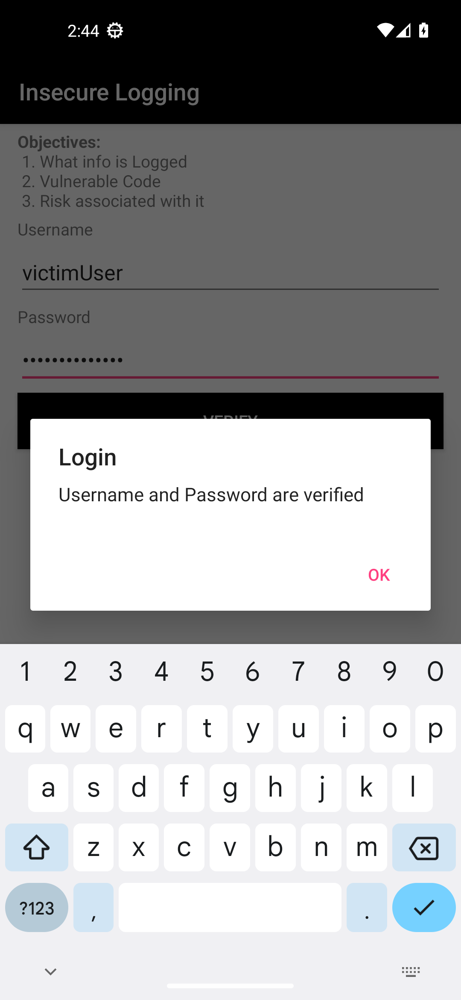

**하드코딩된 시크릿**: 디컴파일해 보면 프로모코드 화면 뒤의 코드에 `promoCode = "NEW2019"`라는 값이 상수로 박혀 있습니다. 이 값을 입력란에 그대로 넣으니 가격 2000이 0으로 바뀌고 무료로 처리됐습니다.

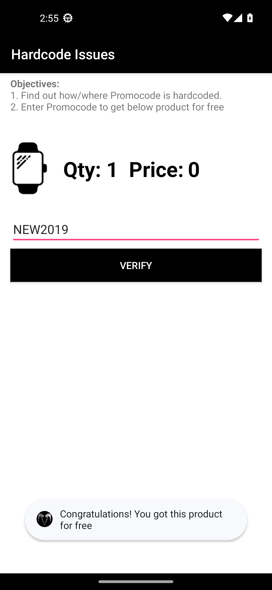

난독화를 해도 문자열 상수는 형태만 바뀔 뿐 `strings` 명령이나 Frida로 그대로 꺼낼 수 있어서, 이 항목은 막히는 게 없다는 게 정직한 결론입니다.

**내부와 외부 저장소, 임시 파일**: SharedPreferences, SQLite, 외부(SD카드) 저장, 임시 파일, 전부 같은 결과였습니다. 저장 직후 run-as로 해당 파일을 읽으면 아이디와 비밀번호가 평문으로 나옵니다. 대표로 콘텐츠 프로바이더에 쌓인 PIN 테이블을 adb 한 줄로 긁은 결과입니다.

```bash
adb shell content query --uri content://owasp.sat.agoat.provider.userpinsprovider/user_pins
# Row: id=3 Admin/Admin, id=1 AndroGoat/AndroGoat, id=2 root/toor
```

여기서 중요한 대조군이 있습니다. `EncryptedSharedPreferences`나 SQLCipher로 암호화한 저장소는 **파일은 똑같이 뽑히지만 내용은 암호문**이라 읽을 수 없습니다. 암호화 키가 안드로이드 Keystore(하드웨어에 가까운 영역에 키를 보관하는 시스템)에 묶여 있으면, 파일 접근만으로는 복호가 안 됩니다. 저장소 암호화가 실제로 막는 건 "파일 탈취"가 아니라 "탈취한 파일을 읽는 것"이라는 뜻입니다.

**클립보드**: 신용카드 번호를 넣으면 OTP를 만들어 클립보드에 복사하는 화면이 있습니다. OTP `3397`이 복사되자 시스템 클립보드 미리보기에도 그대로 떴습니다.

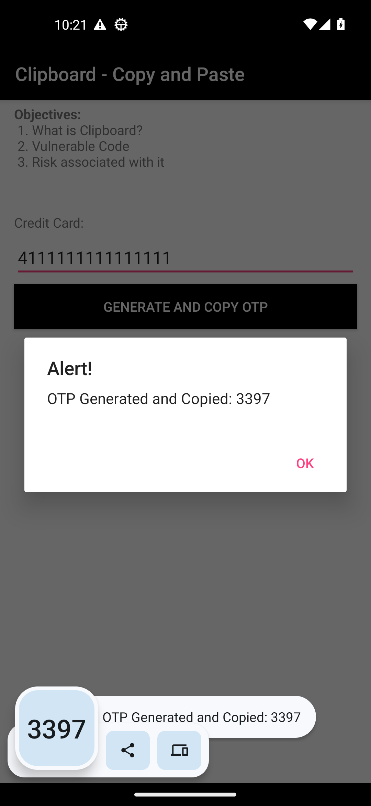

API 29부터 백그라운드 앱의 클립보드 읽기는 차단됐고 Android 13은 민감정보 자동 삭제까지 더했습니다. 그래서 몰래 백그라운드에서 훔쳐가는 고전적인 공격은 막혔지만, 지금 화면에 떠 있는 다른 앱은 여전히 이 OTP를 읽을 수 있습니다.

**키보드 캐시**: 비밀번호 입력란에 `inputType="textPassword"` 같은 속성이 빠지면, 입력한 문자열이 키보드 앱의 예측 사전에 남을 수 있습니다. 실제로 화면을 열어 레이아웃을 뜯어보니, 아이디 칸과 비밀번호 칸 둘 다 `inputType` 속성 자체가 없었습니다.

```
res/layout/activity_keyboard_cache.xml
  EditText (id=username)  ← inputType 속성 없음
  EditText (id=password)  ← "Password" 레이블 아래인데도 inputType 속성 없음
```

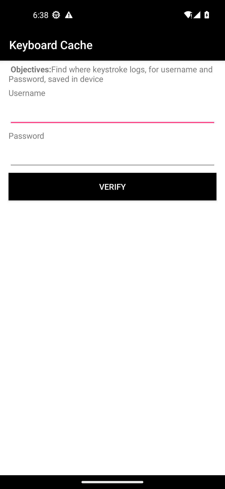

다만 실제로 캐시된 단어를 꺼내는 건 쉽지 않습니다. 그 데이터는 키보드 앱 자신의 샌드박스(`/data/data/<키보드 패키지>`) 안에 있어서, 루팅된 adb로도 다른 앱 데이터처럼 바로 열리지 않습니다. 그래서 이 항목은 "입력이 캐시될 수 있는 설정"까지는 코드로 확인했지만, 실제 사전 파일을 꺼내는 건 이번 실습의 한계로 남았습니다.

## 입력을 코드처럼 실행시키는 것들

**SQL 인젝션**: 검색창에 `' OR '1'='1`을 넣으면 전체 레코드가 돌아옵니다. 디컴파일해 보면 `SELECT * FROM users WHERE username='` 뒤에 입력을 그냥 이어 붙여 쿼리에 넘깁니다. 미리 두 사용자를 넣어 두고 넣어 보니, 두 명의 아이디와 비밀번호가 전부 반환됐습니다.

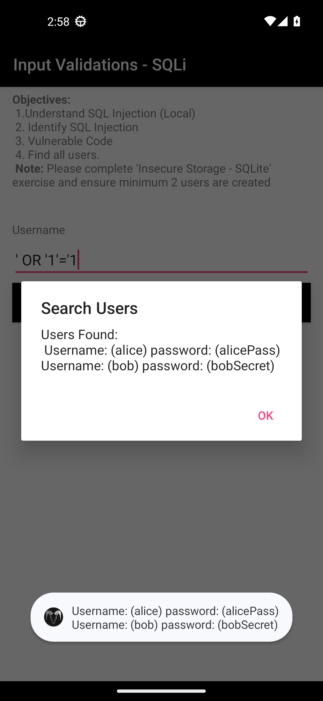

방어는 입력을 값으로만 다루는 파라미터 바인딩 하나뿐인데, 그게 빠져 있으니 입력이 통째로 쿼리 문법이 되어 버립니다.

**OS 커맨드 인젝션**: 핑 테스트 화면은 `Runtime.getRuntime().exec("ping " + 입력)`을 그대로 씁니다. 안드로이드의 `ping` 명령은 플래그가 호스트 주소보다 앞에 와야 해서, 입력란에 `-c 2 127.0.0.1`을 넣으니 실제 실행되는 명령이 `ping -c 2 127.0.0.1`이 되어 핑 통계가 결과창에 그대로 찍혔습니다. 입력값 하나로 실행되는 명령 자체를 바꾼 셈입니다.

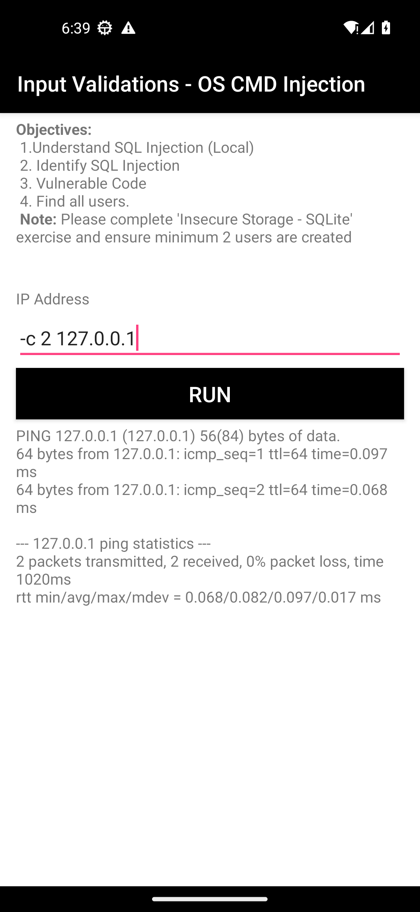

**WebView 파일 접근과 XSS**: WebView는 안드로이드 앱 안에서 웹페이지를 띄우는 부품입니다. 한 화면은 `setAllowFileAccess(true)`까지 켜져 있어서, 주소창에 `file:///system/etc/hosts`를 넣으니 기기 안의 로컬 파일을 그대로 렌더링했습니다.

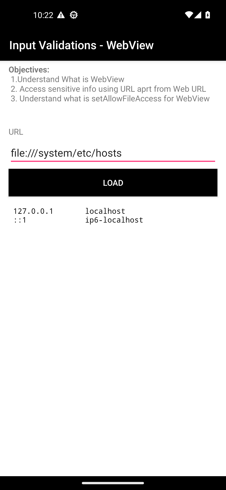

다른 화면은 `document.write(입력)`으로 입력을 그대로 문서에 써 넣습니다. 입력란에 `<h1>XSS777</h1>`를 넣으니 이스케이프 없이 HTML로 렌더링되어 큰 글씨 제목이 그대로 떴습니다. 입력한 문자열이 데이터가 아니라 코드로 실행되는 전형적인 XSS입니다.

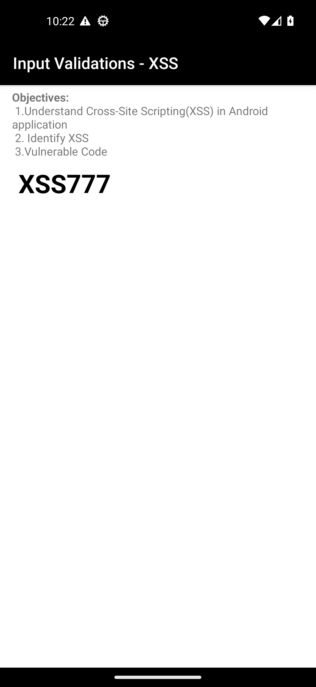

다만 JS 브리지(웹페이지의 자바스크립트에서 앱의 자바 코드를 직접 부르는 통로) 쪽은 좀 다릅니다. API 17부터 `@JavascriptInterface`를 붙인 메서드만 노출되도록 바뀌어서, 과거처럼 아무 메서드나 리플렉션으로 부르던 공격은 막혔습니다.

**노출 액티비티와 딥링크**: 매니페스트에서 `exported="true"`로 켜져 있는 화면은 로그인 같은 정상 경로를 거치지 않고 바로 열립니다. 아래 딥링크 하나로 내부 화면이 그대로 열렸습니다.

```bash
adb shell am start -a android.intent.action.VIEW -d "androgoat://vulnapp" owasp.sat.agoat
```

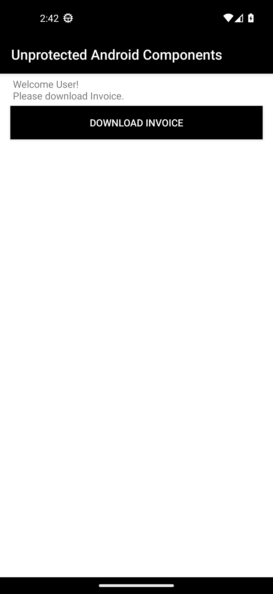

API 31부터 화면 등록 정보(인텐트 필터)가 있는 컴포넌트는 노출 여부를 반드시 코드에 명시해야 빌드됩니다. 개발자가 실수로 깜빡 열어 두는 경우는 줄었지만, 일부러 열어 두면 여전히 그대로 뚫립니다.

## 앱의 자체 방어를 Frida로 무력화하기

여기서부터는 앱이 스스로를 지키려는 장치를 Frida로 깨는 영역입니다. 어디까지 뚫리고 어디서부터는 안 뚫리는지, 그 경계를 보는 게 핵심입니다.

**루트와 에뮬레이터 탐지**: 루트 탐지는 `su` 파일이 있는지 확인하는 식의 로컬 검사라, 그 파일 확인 함수 하나만 가로채면 전부 우회됩니다. 핵심은 이 세 줄입니다.

```javascript
// Frida: File.exists()가 su 관련 경로를 검사할 때 결과를 false로 바꿔치기
var File = Java.use("java.io.File");
File.exists.implementation = function () {
    if (this.getAbsolutePath().indexOf("su") !== -1) return false;
    return this.exists();
};
```

실제로 su 경로 하나를 심어 "Device is rooted"를 띄운 뒤 이 후킹만으로 "Device is not rooted"로 바꿨습니다.

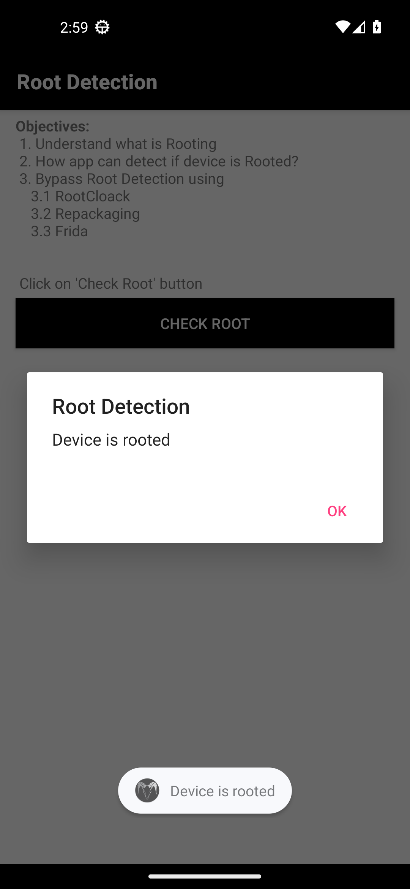

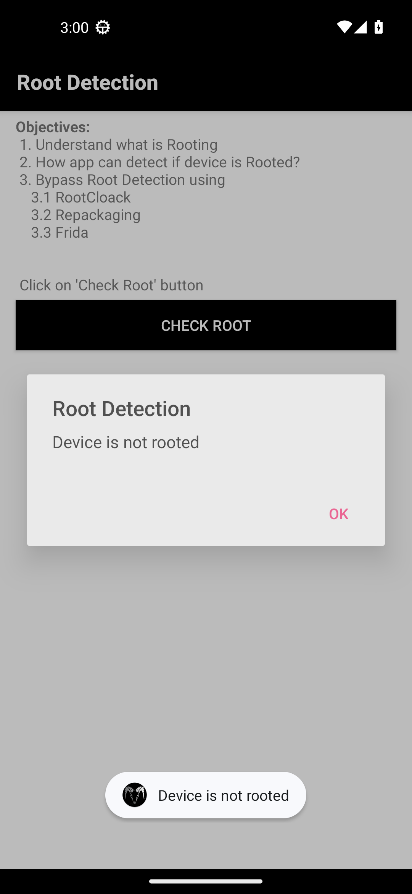

에뮬레이터 탐지도 원리가 같습니다. `Build.FINGERPRINT`나 `MODEL` 같은 기기 정보 문자열에서 `x86`, `goldfish`, `sdk` 같은 토큰을 찾는 방식이라, 그 필드값만 실제 기기(Pixel 5) 값으로 바꾸면 통과합니다.

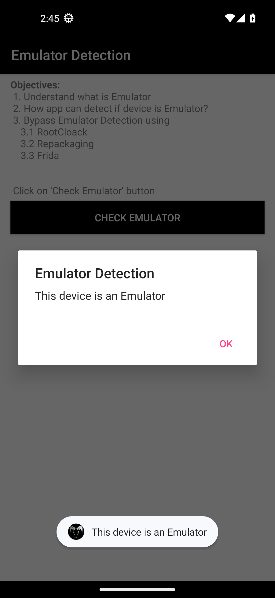

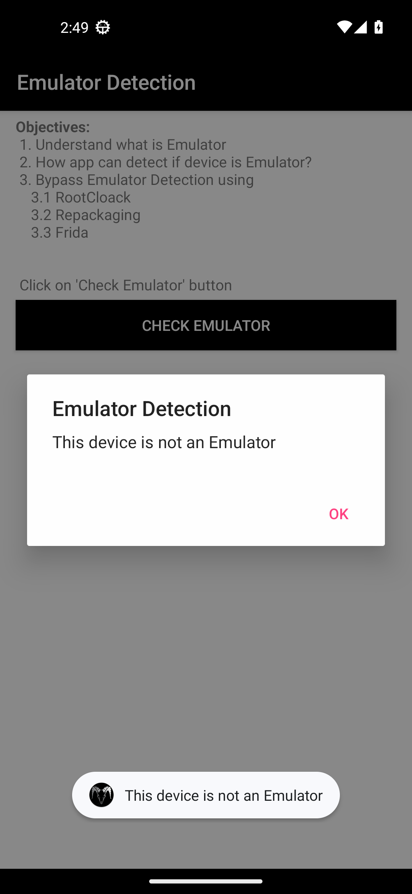

두 탐지 모두 기기 안의 값만 보고 판단하기 때문에 Frida 혼자서 넘어갑니다. 반대로 구글의 Play Integrity처럼 **서버가** 기기의 하드웨어 증명서를 받아 진위를 가리면, 에뮬레이터 자체가 가짜 증명서를 못 만드니 자바 후킹만으로는 넘기 어렵습니다.

**바이너리 패칭**: 관리자 기능 화면은 `isAdmin`이라는 값이 false로 박혀 있어서 평소엔 잠겨 있습니다. 이번엔 실행 중에 가로채는 대신, APK 파일 자체를 뜯어 고쳤습니다. apktool로 APK를 스말리(dex 바이트코드를 사람이 읽을 수 있게 바꾼 형태) 코드로 풀어서, `isAdmin` 값을 읽어오는 한 줄을 바꿨습니다.

```
원본:  iget-boolean v2, p0, ...BinaryPatchingActivity;->isAdmin:Z   # 필드값(false)을 그대로 읽음
패치:  const/4 v2, 0x1                                              # 무조건 1(true)을 넣음
```

고친 스말리를 다시 APK로 묶고, 테스트용 서명 키로 재서명해서 깔았습니다. 서명이 원본과 달라지니 기존 앱을 지우고 새로 설치해야 했는데, 그 뒤로는 잠겨 있던 화면이 "You are Admin Now"로 바뀌고 관리자 버튼이 열렸습니다.

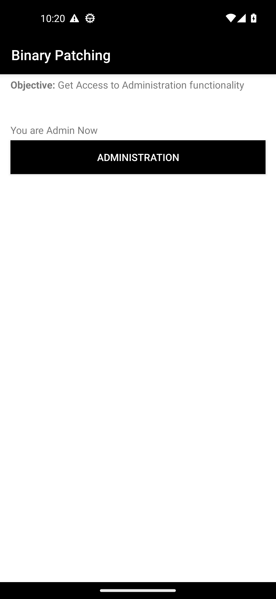

**생체 인증**: 이 항목이 가장 조심해서 읽어야 할 결론을 냅니다. 생체 인증 API를 쓰는 방식은 두 가지입니다.

1. "지문이 맞았다"는 결과만 콜백으로 받아 그걸 믿고 다음 로직을 실행하는 방식입니다.
2. 지문 인증이 성공해야만 풀리는 암호화 키(CryptoObject)를 같이 써서, 인증이 진짜로 성공해야 그 키로 데이터를 복호할 수 있게 만드는 방식입니다.

AndroGoat은 1번이었습니다. 디컴파일해 보니 `authenticate()`를 CryptoObject 없이 호출하고, 성공 콜백은 다이얼로그만 띄울 뿐 어떤 암호 연산도 하지 않았습니다.

그래서 실제 지문 대신 콜백 자체를 강제로 불러 봤습니다. 먼저 에뮬레이터에 지문을 등록해 정상 인증이 되는 걸 확인한 다음, `Java.choose`(현재 메모리에 떠 있는 특정 클래스의 인스턴스를 찾는 Frida 함수)로 살아 있는 콜백 객체를 찾아, 그 객체의 성공 처리 함수를 직접 불렀습니다.

```javascript
// Frida: 메모리에 떠 있는 콜백 인스턴스를 찾아 성공 함수를 직접 호출
Java.choose("owasp.sat.agoat.BioMetricAuthActivity$onCreate$1", {
    onMatch: function (callback) {
        var Result = Java.use("androidx.biometric.BiometricPrompt$AuthenticationResult");
        callback.onAuthenticationSucceeded(Result.$new(null, 2));
    }
});
```

버튼도 지문도 건드리지 않았는데 "Authentication succeeded!"가 떴습니다.

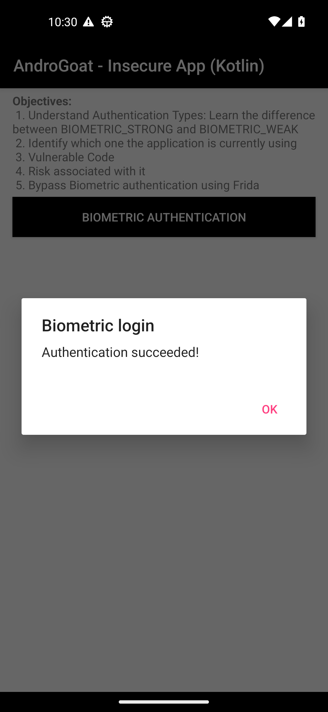

이 우회가 통한 이유는 성공 콜백 뒤에 암호 연산이 전혀 없었기 때문입니다. CryptoObject로 Keystore 키와 묶었다면, 콜백을 아무리 강제로 불러도 그 키로 데이터를 열 수는 없습니다. 콜백은 속일 수 있어도 키 연산 자체는 속일 수 없기 때문입니다. 되뚫리는 범위는 정확히 "콜백만 믿고 암호 연산은 하지 않는" 구현까지입니다.

**SSL 피닝(인증서 핀 고정)**: 먼저 앱의 네트워크 설정을 봐야 합니다. targetSdk 28부터 평문 HTTP는 기본 차단, API 24부터 사용자가 설치한 인증서는 기본 불신인데, 이 앱은 설정 파일에서 둘 다 일부러 풀어 놨습니다. 그래서 평문 통신은 그냥 나가고, 일반 HTTPS 통신은 mitmproxy 인증서를 기기에 설치하는 것만으로 복호됩니다.

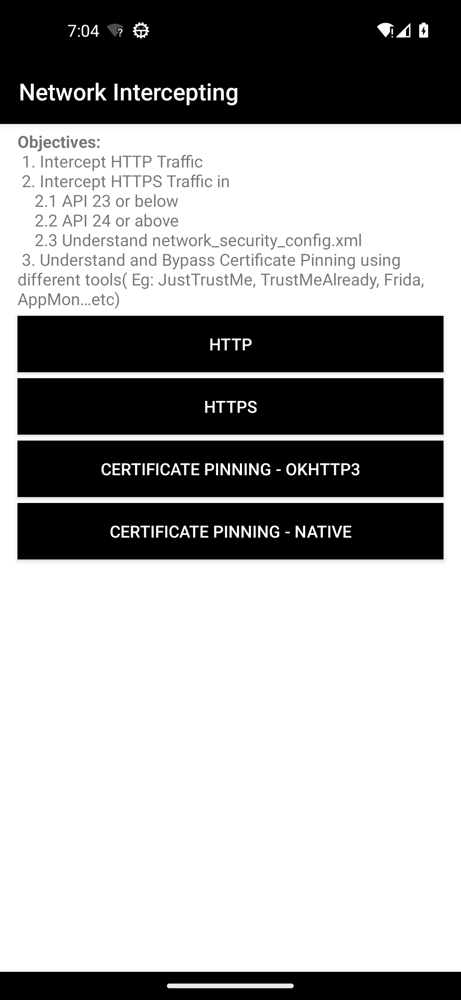

문제는 "핀 고정"이 걸린 버튼이었습니다. 앱이 서버 인증서의 지문값을 코드에 미리 박아 두고, 실제 통신에서 받은 인증서 지문이 그 값과 다르면 통신 자체를 끊어 버리는 방식입니다. 처음 눌렀을 때는 이렇게 끊겼습니다.

```
javax.net.ssl.SSLPeerUnverifiedException: Certificate pinning failure!
  at okhttp3.CertificatePinner.check$okhttp(CertificatePinner.kt:200)
```

여기서 함정이 하나 있었습니다. OkHttp(안드로이드에서 널리 쓰는 네트워크 라이브러리)는 공개된 `check` 함수가 아니라 내부용 `check$okhttp` 함수에서 실제 검증을 합니다. 그래서 `check$okhttp`까지 아무 일도 안 하도록 바꿔치기해야 했습니다.

```javascript
// Frida: OkHttp 피닝 검증 함수(공개 check와 내부 check$okhttp 둘 다)를 무력화
var Pinner = Java.use("okhttp3.CertificatePinner");
["check", "check$okhttp"].forEach(function (name) {
    Pinner[name].overloads.forEach(function (ov) {
        ov.implementation = function () { /* 아무것도 하지 않음 = 검증 통과 처리 */ };
    });
});
```

이걸 걸자 같은 요청이 mitmproxy를 거쳐 서버의 전체 응답을 평문으로 받았습니다. mitmproxy의 웹 UI로 확인해 보니, 핀 고정이 걸려 있던 `https://owasp.org/`가 `200 OK`로 통과하고 응답 헤더까지 평문으로 보였습니다.

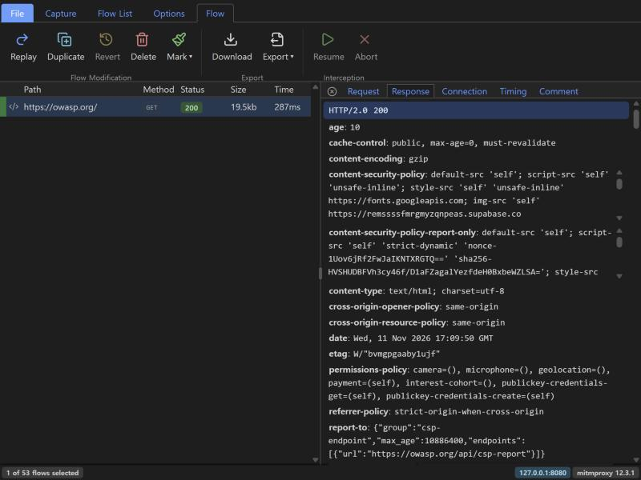

다만 이 핀 고정이 자바 코드가 아니라 네이티브(C/C++) 코드로 들어 있거나, 기기 무결성 검증과 엮여 있으면 자바 후킹만으로는 부족하고 네이티브 코드 레벨의 후킹이 더 필요합니다.

## API 33이 막는 것과 못 막는 것

실습을 정리하면 이렇게 됩니다.

1. 플랫폼이 기본값으로 막아 줍니다. 타 앱의 로그 열람, 공용 외부 저장소 무단 접근, 백그라운드 클립보드 읽기, 사용자 인증서 신뢰, 평문 HTTP 전송, 설정을 안 해도 생기던 묵시적 컴포넌트 노출이 여기 듭니다. 예전 블로그의 재현 절차가 지금 안 먹는 이유가 대부분 이쪽입니다.
2. 플랫폼이 손대지 못하고 개발자 책임으로 남습니다. 하드코딩된 시크릿, 파라미터 바인딩 없는 SQL, 암호화 없는 저장, 검증 없는 커스텀 딥링크, 위험하게 열어 둔 WebView 설정은 SDK 버전이 아무리 올라가도 코드가 틀리면 그대로 터집니다.
3. Frida로 되뚫리긴 하지만 경계가 있습니다. 기기 안의 값만 보는 로컬 탐지, 자바 코드로 짠 핀 고정, 암호 연산 없는 생체 인증은 넘어갔습니다. 반대로 서버가 기기를 검증하는 방식, 하드웨어 키에 묶인 생체 인증, 네이티브 코드의 핀 고정은 에뮬레이터와 자바 후킹만으로는 넘지 못했습니다. 이 경계가 이번 실습에서 확인한 로컬 공격의 상한선입니다.

| 보호 장치 | 뚫은 방법 | 못 뚫는 경계 |
|---|---|---|
| 루트 탐지 | 로컬 파일 검사 후킹 | 서버가 하드웨어 증명서를 검증 |
| 에뮬레이터 탐지 | 기기 정보 값 바꿔치기 | 서버가 하드웨어 증명서를 검증 |
| 생체 인증 | 성공 콜백 강제 호출 | 콜백이 하드웨어 키 연산과 묶여 있음 |
| 인증서 핀 고정 | 자바 검증 함수 무력화 | 검증이 네이티브 코드 안에 있음 |

최신 정책이 데이터 격리와 전송 보안, 컴포넌트 노출을 상당 부분 기본으로 막아 주다 보니, 오래된 공격 레시피는 그대로는 재현되지 않습니다. 그렇지만 개발자가 저장을 평문으로 하고, 쿼리를 문자열로 잇고, 생체 인증을 콜백만 믿고 느슨하게 엮는 순간 취약점은 되살아나고, adb와 run-as, Frida 조합으로 전부 추출되고 우회됩니다. 플랫폼이 많이 올라온 만큼, 이제 남은 위험은 대부분 코드를 쓰는 사람 쪽에 있다는 걸 다시 확인한 실습이었습니다 :)
