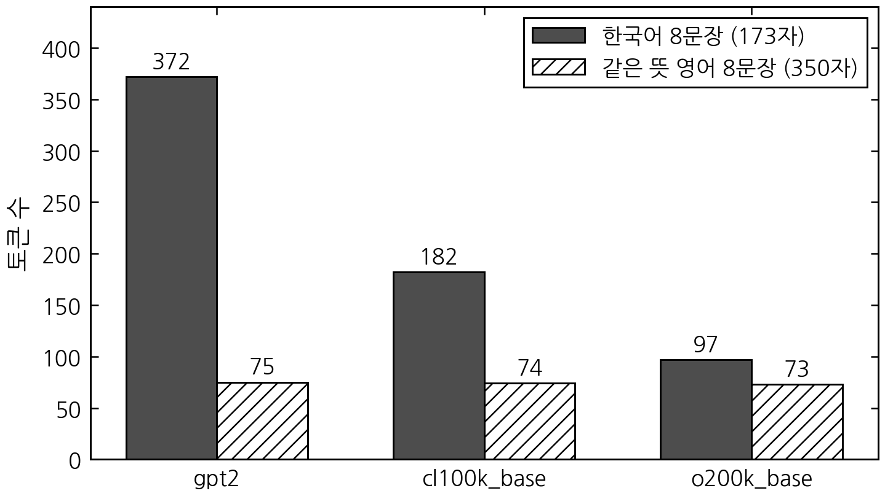
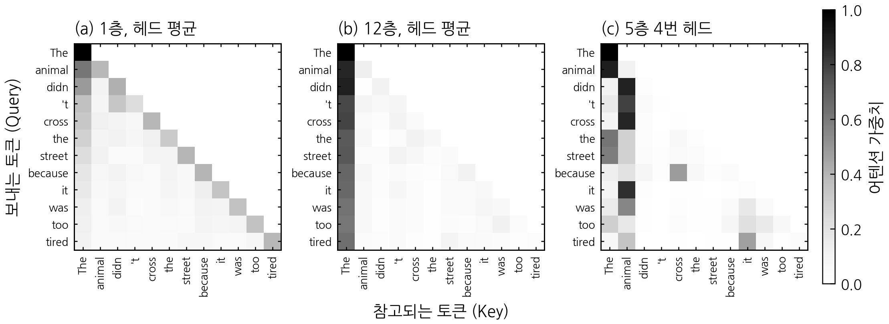
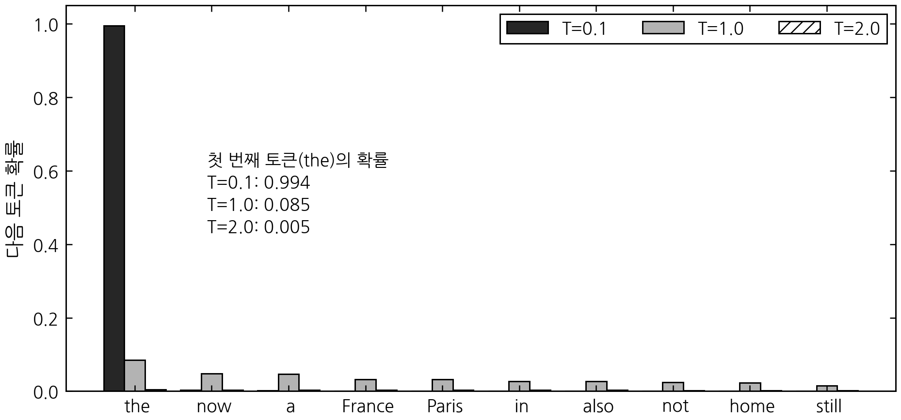
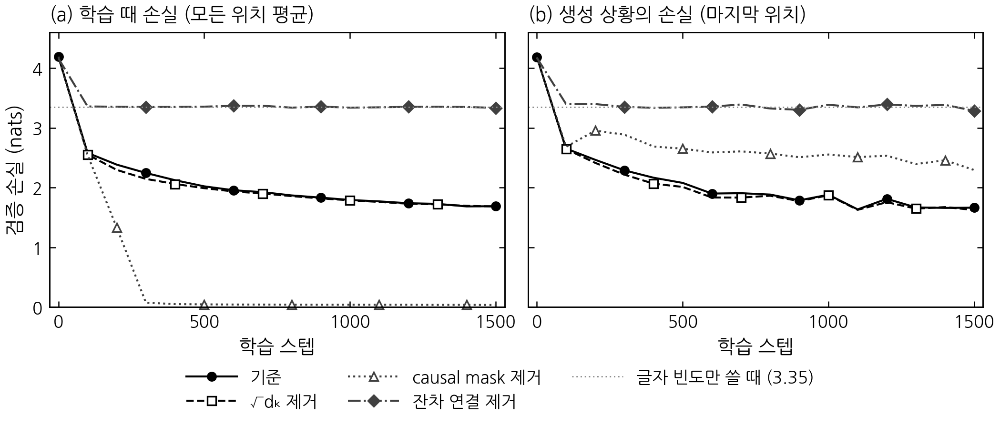
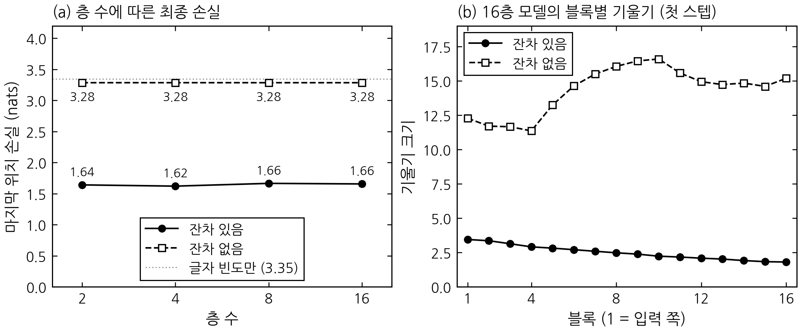
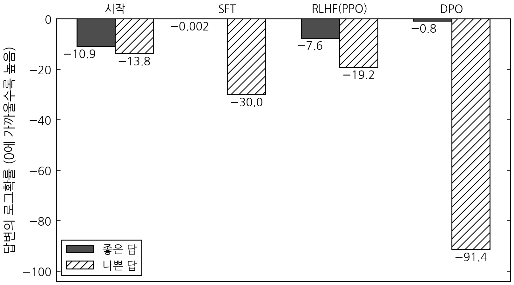

ChatGPT 같은 언어 모델은 결국 "다음에 올 토큰 하나"를 계속 고르는 기계라고 합니다. 이 말이 실제 계산으로는 어떻게 이어지는지 따라가 보고 싶어서, 2019년에 공개된 작은 모델 GPT-2를 NumPy만으로 구현했습니다. NumPy는 파이썬의 행렬 계산 라이브러리라서 딥러닝 프레임워크 없이 손으로 짜는 셈입니다. 학습이 끝난 공개 가중치(숫자 묶음)를 넣어 Hugging Face와 같은 값이 나오는지 확인한 뒤, 같은 코드로 여러 실험을 했습니다.

코드는 `gpt2.py`(모델), `bpe.py`(토크나이저), `sampling.py`(샘플링)와 실험 스크립트로 나눴고, 전체 코드는 [GitHub 폴더](https://github.com/Grace0409/grace0409.github.io/tree/main/gpt2-numpy)에 올려 두었습니다. [Colab 노트북](https://colab.research.google.com/github/Grace0409/grace0409.github.io/blob/main/gpt2-numpy/gpt2_numpy.ipynb)을 위에서부터 실행하면 아래 숫자와 그림이 다시 만들어집니다. 그림은 이 노트북을 Colab에서 실행해 얻은 것이고, 8장의 처음부터 학습한 실험은 Colab의 T4 GPU에서 다시 돌린 결과입니다. GPT-2 순전파는 전부 NumPy이고, 기울기 계산(역전파)이 필요한 8장의 소형 모델 학습과 9장의 파인튜닝만 PyTorch를 썼습니다. 구조는 GPT-2 논문 2.3절([Radford 외, 2019](https://cdn.openai.com/better-language-models/language_models_are_unsupervised_multitask_learners.pdf))과 Hugging Face의 [openai-community/gpt2](https://huggingface.co/openai-community/gpt2) 가중치 파일을 기준으로 맞췄습니다. NumPy로 GPT-2를 구현한 글로는 Jay Mody의 [GPT in 60 Lines of NumPy](https://jaykmody.com/blog/gpt-from-scratch/)(코드는 [picoGPT](https://github.com/jaymody/picoGPT))도 있습니다.

만들면서 예상과 달랐던 일이 세 번 있었습니다. 첫 비교에서 오차가 컸던 원인이 활성화 함수 한 줄이었던 것(6장), 어텐션 맵이 교과서 예시처럼 깔끔하지 않았던 것(4장), 잔차 연결을 빼면 기울기가 사라져서가 아니라 다른 이유로 학습이 멈췄던 것(8장)입니다. 이 셋을 따라가며 읽으시면 됩니다. 용어는 되도록 풀어 썼고, 자세한 표는 접어 두었습니다.

| 항목 | 결과 |
|---|---|
| logits 최대 오차 (float64, 1,024토큰) | 4.29×10⁻¹² |
| 자체 BPE와 tiktoken 비교 | 40,030건 모두 일치 |
| 같은 뜻의 한국어/영어 8문장 토큰 수 (gpt2) | 372 대 75 |
| 가장 큰 구현 실수 | GELU를 다른 식으로 구현해 logits 오차 2.05 발생 |
| 탐구 질문 3개 | 8장 끝에서 표로 정리 |

---

## 1. 전체 구조

GPT-2는 앞에 나온 글을 읽고 다음에 올 토큰 후보 5만여 개에 점수를 매기는 함수입니다. 토큰은 모델이 읽는 글자 조각이고, 후보별 점수는 logits라고 부릅니다. 흐름은 한 줄로 쓸 수 있습니다.

```
문자열 → 토큰 ID → 임베딩 → 트랜스포머 블록 × 12 → LayerNorm → logits → 다음 토큰
```

GPT-2 small의 크기는 어휘 50,257개, 최대 길이 1,024토큰, 임베딩 차원 768, 층 12개, 헤드 12개입니다. 파라미터를 직접 세면 124,439,808개입니다(논문 표 2에는 117M으로 적혀 있습니다). 글을 만들 때는 logits의 마지막 행만 씁니다. "The capital of France is" 다음에 올 토큰 상위 5개는 이렇습니다.

| 토큰 | 확률 |
|---|---|
| ␣the | 8.46% |
| ␣now | 4.79% |
| ␣a | 4.62% |
| ␣France | 3.24% |
| ␣Paris | 3.22% |

토큰 앞의 ␣는 공백입니다. GPT-2에서는 단어 앞의 공백도 토큰의 일부입니다. Paris는 5위인데, GPT-2가 질문에 답하는 모델이 아니라 웹 문서의 다음 토큰을 예측하는 모델이기 때문입니다.

<small>참고: [The Illustrated GPT-2](https://jalammar.github.io/illustrated-gpt2/), [Transformer Explainer](https://poloclub.github.io/transformer-explainer/), [위키독스 트랜스포머](https://wikidocs.net/31379), [Hugging Face GPT-2 문서](https://huggingface.co/docs/transformers/model_doc/gpt2)</small>

---

## 2. 토크나이저와 한국어 토큰 수

한국어 문장 8개를 tiktoken의 gpt2 인코딩에 넣었더니 372토큰이 나왔고, 같은 뜻의 영어 8문장은 75토큰이었습니다. 토크나이저는 글을 토큰으로 자르고 번호를 붙이는 도구이고, tiktoken은 OpenAI가 공개한 토크나이저 라이브러리입니다. 비교한 인코딩은 gpt2, cl100k\_base, o200k\_base로, 모두 BPE 계열이고 어휘가 점점 커진 세 세대입니다. 문장이 8쌍뿐이라 비율은 대략의 감으로만 읽어야 합니다.



| 인코딩 | 한국어 | 영어 | 비율 |
|---|---:|---:|---:|
| gpt2 | 372 | 75 | 4.96배 |
| cl100k\_base | 182 | 74 | 2.46배 |
| o200k\_base | 97 | 73 | 1.33배 |

이유를 찾으려고 한글 음절 11,172개를 전부 넣어 봤습니다. GPT-2 어휘 50,257개 중 완성된 한글 음절 토큰은 0개였고, 음절 하나는 266개가 2토큰, 10,906개가 3토큰이 됩니다. 한글 한 글자는 UTF-8로 3바이트인데 그 바이트가 합쳐지지 못한 채 토큰이 되는 것입니다. 8문장의 한국어 토큰 372개 중 95.7%는 혼자서는 글자도 아닌 바이트 조각이었습니다. 왜 병합되지 않았는지는 학습 데이터를 보지 못해 확정하지 못합니다.

### BPE 직접 구현

BPE(Byte Pair Encoding)는 글을 바이트로 쪼갠 뒤 가장 자주 붙어 나오는 쌍을 하나로 합치기를 반복하는 방법입니다. 합친 순서가 `merges.txt`이고, 인코딩할 때 이 순서대로 다시 합칩니다. GPT-2는 `dog.`, `dog!`, `dog?`가 따로 어휘를 차지하지 않도록 글자 종류를 넘는 병합을 막는데(논문 2.2절), 구현에서는 정규식으로 단어를 먼저 나누는 부분이 이 규칙입니다. 그래서 ` the`와 `the`는 다른 토큰입니다.

구현이 맞는지는 tiktoken의 gpt2 인코딩과 비교해 확인했습니다. Tiny Shakespeare 4만여 줄과 한국어, 이모지, 공백 같은 경계 사례까지 40,030건이 모두 일치했고, 말뭉치 전체(338,025토큰)도 같았습니다. 병합을 직접 학습하는 것도 해 봤습니다. Shakespeare 20만 자로 학습해서, 학습에 쓰지 않은 10만 바이트에 적용한 결과입니다.

| 병합 횟수 | 토큰 수 |
|---:|---:|
| 0 | 100,000 |
| 100 | 62,871 |
| 500 | 47,231 |
| 1,000 | 40,328 |

이 병합을 한국어 문장에 적용하면 433바이트가 433토큰 그대로입니다. 병합 1,000개 중 한국어에 쓸 수 있는 것이 하나도 없었습니다. 토크나이저의 효율은 언어보다 학습 말뭉치에 무엇이 많았느냐로 정해진다는 것을 작은 규모로 확인한 셈입니다.

<small>참고: [Hugging Face LLM 강의 BPE](https://huggingface.co/learn/llm-course/chapter6/5), [위키독스 BPE](https://wikidocs.net/22592), [minbpe](https://github.com/karpathy/minbpe), [tiktoken](https://github.com/openai/tiktoken)</small>

---

## 3. 토큰 임베딩과 위치 임베딩

모델은 토큰 번호를 그대로 쓰지 못합니다. 번호만으로는 "king"과 "queen"이 가깝다는 정보가 없기 때문입니다. 그래서 토큰 번호를 768개의 숫자(좌표)로 바꾸고, 몇 번째 위치인지도 768개의 숫자로 만들어 더합니다.

```python
def embed(self, ids, start=0):
    positions = np.arange(start, start + ids.shape[1])
    return self.p["wte.weight"][ids] + self.p["wpe.weight"][positions]
```

`wte`는 토큰마다 한 줄씩 있는 표(50257 × 768), `wpe`는 위치마다 한 줄씩 있는 표(1024 × 768)입니다. 원조 트랜스포머는 위치를 사인과 코사인 함수로 만들었지만 GPT-2는 학습하는 방식이라 `wpe`가 계산식이 아니라 표입니다. 안에 무엇이 들어 있는지 직접 재 봤습니다.

| 단어 쌍 | 코사인 유사도 |
|---|---:|
| king와 queen | 0.657 |
| Paris와 London | 0.579 |
| cat와 dog | 0.550 |
| cat와 Paris | 0.272 |

비슷한 뜻일수록 값이 큽니다. 위치 벡터의 평균 크기(3.39)는 토큰 벡터(3.96)와 비슷해서 위치 정보가 토큰 정보와 대등하게 섞입니다. 같은 ` the`라도 위치 0과 위치 100에서 입력 벡터의 유사도는 0.386까지 떨어집니다.

<small>참고: [The Illustrated Transformer](https://jalammar.github.io/illustrated-transformer/), [Vaswani 외(2017)](https://arxiv.org/abs/1706.03762) 표 3</small>

---

## 4. Self-attention과 어텐션 맵

어텐션은 각 토큰이 앞에 나온 토큰 중 누구를 얼마나 참고할지 점수를 매겨 정보를 섞는 장치입니다. 토큰마다 세 가지를 만듭니다. Q는 "내가 찾는 것", K는 "내가 가진 꼬리표", V는 "내가 줄 내용"이고, Q와 K를 곱한 점수가 높을수록 그 토큰의 V를 많이 가져옵니다.

```python
q, k, v = np.split(linear(h, w, b), 3, axis=-1)
split = lambda t: t.reshape(B, T, n_head, d_k).transpose(0, 2, 1, 3)
q, k, v = split(q), split(k), split(v)                 # 12개 헤드로 나눈다

scores = q @ k.transpose(0, 1, 3, 2) / math.sqrt(d_k)  # 점수 계산
mask = np.tril(np.ones((T, T), dtype=bool))
scores = np.where(mask, scores, -np.inf)               # 미래 위치를 지운다
weights = softmax(scores, axis=-1)                     # 합이 1인 가중치로
out = (weights @ v).transpose(0, 2, 1, 3).reshape(B, T, D)
```

핵심은 두 가지입니다. 멀티헤드는 768차원을 64차원씩 12개로 나눠 따로 계산하는 것이고, causal mask는 아직 오지 않은 뒤쪽 토큰을 못 보도록 점수를 −∞로 만드는 것입니다. 위쪽 삼각형의 최댓값은 12개 층 모두 0.0이었습니다.

### 어텐션 맵

교과서에는 "The animal didn't cross the street because it was too tired"에서 어텐션이 `it`을 `animal`과 연결한다는 예시가 자주 나옵니다. 이 문장을 넣어 `it`이 누구를 보는지 그렸습니다.



예상만큼 깔끔하지 않았습니다.

- 12개 헤드 평균에서 `it`이 `animal`에 준 가중치는 최대 9.4%(5층)였고, 12개 층 중 4개 층에서는 `street`보다 낮았습니다.
- 144개 헤드 중 5층 4번 헤드가 `animal`에 84.6%를 줬지만, 이 헤드는 `didn`, `cross`, `was`도 `animal`을 봅니다. 대명사 해석보다는 주어를 계속 참고하는 패턴에 가깝습니다.
- 12층 평균에서는 대부분의 토큰이 첫 토큰 `The`로 몰립니다. attention sink라고 불리는 현상과 비슷한데, 원인은 확인하지 못했습니다.
- 마지막 단어를 `tired`에서 `wide`로 바꿔도 `it` 행의 값은 소수 넷째 자리까지 같았습니다. 마스크 때문에 `it`은 뒤에 오는 단어를 볼 수 없습니다.

그래서 단일 헤드의 높은 값을 곧바로 "모델이 이해했다"로 읽으면 안 된다고 정리했습니다.

<small>참고: [3Blue1Brown 어텐션 강의](https://www.3blue1brown.com/lessons/attention), [The Illustrated Transformer](https://jalammar.github.io/illustrated-transformer/), [Vaswani 외(2017)](https://arxiv.org/abs/1706.03762), [Attention Sinks 글](https://huggingface.co/blog/tomaarsen/attention-sinks)</small>

---

## 5. 블록 조립: LayerNorm, 잔차 연결, FFN

GPT-2의 한 층(블록)은 어텐션으로 서로 정보를 섞고, FFN으로 토큰마다 따로 계산하는 일의 반복입니다. 각 단계 앞에는 값의 크기를 맞추는 LayerNorm이, 각 단계 뒤에는 원래 값을 그대로 더해 주는 지름길(잔차 연결)이 있습니다.

```python
def block(x, ...):
    a, weights, present = attention(layer_norm(x, ...), ...)
    x = x + a                                   # 잔차 연결 1
    m = layer_norm(x, ...)
    m = gelu(linear(m, c_fc_w, c_fc_b))         # 768 → 3072
    m = linear(m, c_proj_w, c_proj_b)           # 3072 → 768
    return x + m                                # 잔차 연결 2
```

LayerNorm은 토큰 벡터 하나를 평균 0, 분산 1로 맞춘 뒤 학습된 배율을 곱합니다. 정규화를 단계 앞에 두는 구조(Pre-LN)는 GPT-2 논문이 택한 방식입니다. 마지막에는 벡터에 `wte`의 전치를 곱해 logits를 만듭니다. 입력 임베딩 표를 출력에도 다시 쓰는 것이고 weight tying이라고 부릅니다.

```python
out.logits = x @ self.p["wte.weight"].T
```

<small>참고: [The Illustrated GPT-2](https://jalammar.github.io/illustrated-gpt2/), [GPT in 60 Lines of NumPy](https://jaykmody.com/blog/gpt-from-scratch/), [GPT-2 논문](https://cdn.openai.com/better-language-models/language_models_are_unsupervised_multitask_learners.pdf) 2.3절</small>

---

## 6. Hugging Face와 logits 비교

가중치를 올리고 처음 비교했을 때 오차는 5토큰에서 0.075, 256토큰에서 2.05, 1,024토큰에서 4.34였고 가장 높은 후보도 달랐습니다. float64로 바꿔도 줄지 않아서 반올림이 아니라 수식이 다르다고 판단했습니다. 원인은 FFN 안의 활성화 함수 GELU였습니다. 설정 파일의 `activation_function`은 `"gelu_new"`인데, 저는 이것을 정확한 식(`erf` 사용)으로 구현했습니다. Hugging Face 코드를 확인해 보니 `gelu_new`는 같은 함수를 빠르게 근사한 tanh 식이었습니다.

```python
def gelu(x):
    return 0.5 * x * (1 + np.tanh(math.sqrt(2 / math.pi) * (x + 0.044715 * x**3)))
```

그래프로 그리면 거의 겹치는 두 함수인데, 이 작은 차이가 12개 층을 지나며 logits 2.05 차이로 커졌습니다. 이름만 보고 짐작하지 말고 가중치를 학습할 때 쓴 식을 그대로 따라야 한다는 것이 이번 구현에서 가장 크게 배운 점입니다.

고친 뒤 결과입니다.

| 입력 | float32 최대 오차 | float64 최대 오차 |
|---|---:|---:|
| 짧은 영어 5토큰 | 1.14×10⁻⁴ | 2.27×10⁻¹³ |
| 한국어 32토큰 | 1.14×10⁻⁴ | 2.13×10⁻¹³ |
| Shakespeare 1,024토큰 | 4.16×10⁻³ | 4.29×10⁻¹² |

입력 7가지(짧은 영어, 토큰 1개, 한국어, 한영 혼합, 긴 영어 문장, Shakespeare 256토큰과 1,024토큰) 모두 가장 높은 후보가 같았습니다. float32의 오차는 구현 차이가 아니라, 같은 코드를 float64로 바꾸면 약 10억 분의 1로 줄어드는 반올림 오차입니다. 이 값은 실행 환경에 따라 달라져서, 환경을 새로 만들어 다시 돌렸을 때 긴 입력의 float32 오차가 2~3배 차이 났고 float64 오차는 같았습니다. logits만 같고 중간 값이 다를 수도 있어서 13개 은닉 상태(4.95×10⁻¹²), 12개 층의 어텐션 가중치(3.72×10⁻¹⁴), K/V 캐시를 쓴 점진 생성(2.56×10⁻¹³), 다음 토큰 손실(5.33×10⁻¹⁵)도 함께 맞춰 봤습니다. 손실 비교에는 함정이 하나 더 있었습니다. float64인데 1.3×10⁻⁵ 차이가 났는데, Hugging Face의 손실 함수가 계산 전에 logits를 float32로 내리기 때문이었습니다.

<small>참고: [Hugging Face GPT-2 문서](https://huggingface.co/docs/transformers/model_doc/gpt2), `gelu_new`가 정의된 [transformers의 activations.py](https://github.com/huggingface/transformers/blob/main/src/transformers/activations.py), [GPT in 60 Lines of NumPy](https://jaykmody.com/blog/gpt-from-scratch/)</small>

---

## 7. 샘플링 전략 비교

같은 점수표라도 어떻게 고르느냐에 따라 전혀 다른 글이 나옵니다. greedy는 항상 1등만 고르고, temperature는 점수를 T로 나눠 분포를 뾰족하게(T가 작을 때) 또는 평평하게(T가 클 때) 만듭니다. top-k는 상위 k개 안에서만, top-p는 확률이 큰 것부터 더해 p(예: 0.9)가 될 때까지만 후보로 남깁니다.



세 프롬프트에서 전략마다 64개씩, 50토큰을 생성해 비교했습니다. 샘플 하나로는 분포의 성질을 알 수 없어서 64개씩 뽑았습니다. 반복률은 같은 4개 토큰 묶음이 되풀이되는 비율이고, 평균 로그확률은 원래 모델이 그 글을 얼마나 그럴듯하게 보는지입니다.

| 전략 | 4-gram 반복률 | 토큰당 평균 로그확률 |
|---|---:|---:|
| greedy | 0.589 | −0.82 |
| T=0.1 | 0.533 | −0.88 |
| T=1.0 | 0.003 | −3.71 |
| T=2.0 | 0.000 | −11.10 |
| top-k=40 | 0.002 | −2.55 |
| top-p=0.9 | 0.005 | −3.02 |

greedy는 안전해 보이지만 한번 들어간 패턴을 빠져나오지 못해 같은 문장이 되풀이됩니다. T=2.0은 분포가 너무 평평해져 의미 없는 토큰이 나오고, top-k와 top-p는 확률이 낮은 꼬리를 잘라 그런 사고를 줄입니다. top-p는 후보 수가 분포에 맞춰 달라져서, 항상 40개를 남기는 top-k와 달리 다음 토큰이 뻔한 프롬프트에서는 91개, 불확실한 "The capital of France is"에서는 1,503개를 남겼습니다. 만든 필터는 Hugging Face의 `TemperatureLogitsWarper`, `TopKLogitsWarper`, `TopPLogitsWarper`와 남기는 토큰이 정확히 같았습니다.

<details markdown="1">
<summary>실제 출력 예시 보기</summary>

| 전략 | "Once upon a time, there was a little girl who" 이후 |
|---|---|
| greedy | was a little girl. She was a little girl. She was a little girl. ... |
| T=2.0 | \_\_\_\~Know\|\| HavingU Darling rejoifestovesfolk huggingMachero Perl Ver TT ... |
| top-p=0.9 | sang, "Let it be LOVE!" And this kind of situation can change of course," she said. ... |

</details>

<small>참고: [How to generate text](https://huggingface.co/blog/how-to-generate), [Holtzman 외(2020)](https://arxiv.org/abs/1904.09751)</small>

---

## 8. 구성요소 제거 실험

부품을 하나씩 빼고 모델이 어떻게 망가지는지 보면 그 부품의 역할이 보입니다. 탐구 질문은 세 가지로 잡았습니다.

1. 어텐션 점수를 √d\_k로 나누는 이유는 무엇인가
2. causal mask가 없으면 무슨 일이 생기는가
3. 잔차 연결이 없으면 무슨 일이 생기는가

실험은 두 가지로 했습니다. 하나는 학습이 끝난 GPT-2에서 부품을 끄는 것, 다른 하나는 부품을 뺀 채 소형 모델을 처음부터 학습하는 것입니다. 앞의 것은 가중치가 그 부품에 맞춰 이미 학습되어 있어 무엇을 빼도 나빠지는 것이 당연하므로, "왜 필요한가"는 뒤의 것이 답합니다.

### 학습된 GPT-2에서 끈 결과

Tiny Shakespeare에서 128토큰 창 16개로 쟀습니다. 손실은 낮을수록 좋고, 무작위로 찍으면 ln 50257 = 10.82입니다.

| 변형 | 손실 | 다음 토큰 맞힌 비율 |
|---|---:|---:|
| 기준 | 4.836 | 27.1% |
| √d\_k 제거 | 6.952 | 9.5% |
| causal mask 제거 | 5.482 | 13.7% |
| 잔차 연결 제거 | 11.111 | 1.0% |
| 위치 임베딩 제거 | 8.535 | 5.9% |

잔차 연결을 빼면 무작위 추측보다도 나쁩니다.

### 처음부터 학습하는 실험의 설정

- 데이터: Tiny Shakespeare를 글자 단위로 읽음(어휘 65개). 앞 90%로 학습, 뒤 10%로 검증
- 모델: 8층, 헤드 4개, 임베딩 128차원(d\_k=32), 문맥 64글자
- 학습: AdamW, 학습률 1e-3, 배치 64, 1,500스텝, 시드 3개 평균
- 초기화: 표준편차 0.02의 정규분포, 잔차 경로 가중치는 1/√(2×층 수)배(GPT-2 논문 방식)
- 구현: 학습에는 역전파가 필요해서 이 실험만 PyTorch로 같은 구조를 만들었습니다(NumPy 구현은 순전파만 합니다)

손실은 두 가지로 쟀습니다. 학습 때 손실은 모든 위치의 평균이고, 마지막 위치 손실은 맨 뒤 한 칸만 잰 값입니다. 글을 생성할 때는 마지막 위치 뒤에 아무것도 없으니 이쪽이 실제 성능에 가깝습니다. 비교 기준도 두 개 계산했습니다. 글자 빈도만으로 예측하면 3.347이고, 바로 앞 글자만 보는 모델은 2.482입니다.



### 질문 1. √d\_k로 나누는 이유

점수가 너무 커지지 않게 하는 안전장치라고 보면 됩니다. 어텐션 점수는 Q와 K의 내적이라 차원 d\_k가 클수록 값이 커지고, 값이 너무 크면 softmax가 한 칸에 점수를 몰아줘서 기울기(학습 신호)가 거의 흐르지 않습니다. √d\_k로 나누면 차원과 상관없이 크기가 일정해집니다. Vaswani 외(2017)가 각주에서 이렇게 설명하면서 "그럴 것이라 추측한다"고만 적어서, 학습 없이 순수한 난수로 직접 재 봤습니다(키 16개, 4,000회).

| d\_k | 내적의 표준편차 | softmax 기울기 크기 (나누지 않음 → 나눔) |
|---:|---:|---:|
| 4 | 1.99 | 0.33 → 0.29 |
| 64 | 7.97 | 0.11 → 0.30 |
| 1,024 | 31.93 | 1.8×10⁻⁵ → 0.30 |

표준편차는 이론값 √d\_k와 거의 같았습니다. 나누지 않으면 d\_k=1,024에서 기울기가 1.8×10⁻⁵로, 나눴을 때(0.30)의 1만 분의 1 수준까지 작아집니다.

그런데 학습에서는 차원에 따라 결과가 달랐습니다. d\_k=32에서는 최종 손실이 거의 같았습니다(1.683 대 1.690). 논문도 d\_k가 작을 때는 스케일 없는 내적과 다른 방식(additive attention)의 성능이 비슷하다고 적었습니다. 모델이 Q, K, V 가중치를 18% 작게 학습해(RMS 0.0381 대 0.0467) 스스로 보정한 것으로 보입니다. 마지막 위치 손실은 오히려 나누지 않은 쪽이 낮았지만(1.626 대 1.665) 이 값은 곡선이 들쭉날쭉해서 차이로 보기는 어렵습니다. d\_k=256(임베딩 512차원, 헤드 2개)으로 키우면 나누지 않은 쪽이 세 시드 모두 나빴습니다(마지막 위치 손실 2.736 대 2.592). 다만 이 설정은 기준 모델부터 불안정해서(손실 2.613) 조심해서 읽어야 하고, 학습률을 낮춰 다시 비교하는 것이 다음 실험입니다.

### 질문 2. causal mask가 없을 때 생기는 일

비유하면 시험지에 정답이 적혀 있는 상태입니다. 글은 모든 위치의 "다음 토큰"을 한꺼번에 맞히며 학습하는데, 마스크가 없으면 정답이 입력에 이미 보입니다. 문장의 9번째 토큰을 바꾸고 그 앞 위치의 logits가 변하는지 봤더니, 마스크가 있으면 변화가 정확히 0.0이고 없으면 최대 8.32였습니다.

처음부터 학습해 보니 마스크를 뺀 모델은 300스텝 만에 학습 손실이 0.06~0.10까지 떨어졌고, 최종 학습 손실은 0.037로 기준(1.690)보다 훨씬 좋아 보였습니다. 하지만 정답이 없는 마지막 위치 손실은 2.293으로 기준(1.665)보다 0.63 나쁩니다. 다음 글자를 예측하지 않고 입력에서 베끼는 법을 배운 것입니다. 베끼기를 배우는 200~300스텝 구간에서는 마지막 위치 손실이 오히려 올랐습니다(세 시드 모두 2.7 근처에서 3.0~3.2로). 손실을 두 가지로 쟀기 때문에 보인 차이입니다. 생성 결과도 다릅니다.

```
기준:            ROMEO:\nAy, you no all Clifford, you weepy.
causal mask 제거: ROMEO:\nOMOMOMMMOOMOMOMAMOOLOOOMAMAMEMAMOOMM
```

### 질문 3. 잔차 연결이 필요한 이유

한마디로 원래 값을 그대로 더해 주는 지름길(`x = x + a`)입니다. 층이 새로 계산한 값을 원래 값에 덧붙이는 구조라서 앞 층의 정보가 사라지지 않습니다. 이 지름길을 빼면 층마다 이전 입력을 새 값으로 덮어씁니다.

8층 모델에서 잔차를 빼면 손실이 100스텝 만에 3.36 근처에서 멈추고 1,500스텝까지 그대로였습니다(최종 3.335). 글자 빈도 기준선 3.347과 거의 같으니, 문맥은 못 쓰고 어떤 글자가 자주 나오는지만 배운 셈입니다. 생성 결과도 글자 빈도를 닮은 무작위 나열입니다.

```
잔차 연결 제거: ROMEO:\nfuar  Ibnheee  Ctnti eobsyuiLy m c ithdeuN
```

저는 처음에 층이 깊어서 기울기가 사라지는 문제일 거라고 생각했습니다. 그래서 층 수를 바꿔 학습해 봤습니다.



| 층 수 | 잔차 있음 | 잔차 없음 |
|---:|---:|---:|
| 2 | 1.640 | 3.284 |
| 4 | 1.620 | 3.284 |
| 8 | 1.665 | 3.284 |
| 16 | 1.655 | 3.284 |

예상과 달랐습니다! 2층짜리 얕은 모델도 잔차가 없으면 똑같이 3.28에서 멈췄습니다. 학습 첫 스텝의 기울기도 오히려 컸습니다(8층 기준 첫 블록 10.8, 잔차가 있을 때는 3.08). 기울기 소실이 원인이 아니라는 뜻입니다. 단서는 어텐션 엔트로피(0.993~1.000)였습니다. 학습이 끝나도 어텐션이 앞 글자 전체에 똑같이 퍼져 있었고, 이것은 앞 글자들의 평균만 넘겨주는 상태입니다. 지름길이 없으면 "지금 이 글자가 무엇인지"가 평균에 묻혀서 빠져나오지 못하는 것으로 추정합니다. 직접 검증하지는 못했습니다.

### 탐구 질문과 답

| 탐구 질문 | 답 | 근거 |
|---|---|---|
| √d\_k로 나누는 이유 | 차원이 커질수록 내적이 커져 softmax가 포화되고, 기울기가 거의 0으로 줄어듭니다. 나누면 이를 막습니다. | d\_k=1,024에서 softmax 기울기 크기 1.8×10⁻⁵(나누면 0.30). 학습에서는 d\_k=256일 때만 나누지 않은 쪽이 나빴습니다(마지막 위치 손실 2.736 대 2.592) |
| causal mask가 없으면 | 다음 글자를 베끼는 법을 배웁니다. 학습 손실은 좋아지지만 생성에는 쓸 수 없는 모델이 됩니다. | 학습 손실 0.037(기준 1.690), 마지막 위치 손실 2.293(기준 1.665) |
| 잔차 연결이 없으면 | 글자 빈도만 배우고 멈춥니다. 층 수를 줄여도 같습니다. | 2~16층 모두 마지막 위치 손실 3.28(글자 빈도 기준선 3.347), 어텐션 엔트로피 0.993~1.000. 원인은 추정이며 검증하지 못했습니다 |

<small>참고: [Vaswani 외(2017)](https://arxiv.org/abs/1706.03762) 3.2절, [Let's build GPT](https://www.youtube.com/watch?v=kCc8FmEb1nY), [nanoGPT](https://github.com/karpathy/nanoGPT), [tinyshakespeare](https://github.com/karpathy/char-rnn/tree/master/data/tinyshakespeare), [3Blue1Brown 어텐션 강의](https://www.3blue1brown.com/lessons/attention)</small>

---

## 9. 사전학습, SFT, RLHF, DPO의 손실

네 방법은 모델에게 무엇을 점수로 줄지가 다릅니다. 사전학습은 웹 문서를 이어 쓰게 하고, SFT는 지시와 모범 답을 따라 쓰게 하고, RLHF는 점수가 높은 답을 내게 하고, DPO는 좋은 답과 나쁜 답을 비교해 좋은 쪽을 높입니다.

### 사전학습: 다음 토큰 맞히기

손실은 정답 토큰 확률에 −ln을 취한 값입니다. 정답에 높은 확률을 줄수록 작습니다. 4토큰 어휘에서 logits가 `[2, 1, 0, −1]`이고 정답이 0번이면 확률은 `[0.644, 0.237, 0.087, 0.032]`, 손실은 `−ln 0.644 = 0.440`입니다. 실제 GPT-2로 "The capital of France is Paris."를 계산하면 평균 3.7983이고, float64로 계산한 PyTorch 값과 5.33×10⁻¹⁵ 차이입니다.

| 모델 | Shakespeare 손실 |
|---|---:|
| 이론값 ln 50257 (모든 토큰에 같은 확률) | 10.825 |
| 무작위 초기화 (시드 3개) | 10.96 ~ 11.06 |
| 사전학습 GPT-2 | 4.924 |

사전학습은 이 10.8에서 4.9까지 내리는 과정이고, 인터넷 문서의 통계를 가중치에 저장하는 셈입니다. GPT-2의 학습 데이터 WebText는 카르마 3 이상을 받은 Reddit 외부 링크를 모은 것으로, 800만 개를 조금 넘는 문서에 40GB입니다.

<details markdown="1">
<summary>문장 한 개의 토큰별 손실 보기</summary>

| 문맥 | 정답 | 확률 | −ln p |
|---|---|---:|---:|
| The | capital | 0.0001 | 9.070 |
| The capital | of | 0.1642 | 1.807 |
| The capital of | France | 0.0065 | 5.030 |
| The capital of France | is | 0.1216 | 2.107 |
| The capital of France is | Paris | 0.0322 | 3.434 |
| The capital of France is Paris | . | 0.2612 | 1.343 |

</details>

### SFT: 답변 부분만 채점하기

SFT(Supervised Fine-Tuning)는 수식이 사전학습과 같고 데이터가 다릅니다. "지시 + 좋은 답변" 쌍을 주고, 지시 부분의 라벨을 `-100`으로 가려 답변 토큰만 채점합니다.

```python
labels = [-100] * len(prompt) + response   # 답변만 손실에 들어간다
```

전체를 채점하면 손실이 2.726이고, 답변만 채점하면 1.362입니다. 시작 시점의 GPT-2는 정답 ` Paris`에 7.6%, 답변을 끝내는 `<|endoftext|>`에 0.45%만 줍니다. 답변을 끝내는 법도 학습 대상입니다.

### RLHF와 PPO: 점수 잘 받게 하기

RLHF는 정답 문장이 없습니다. 모델이 답변을 만들면 보상 모델이 점수를 매기고, 평균보다 좋은 답의 확률을 높입니다. PPO는 한 번에 너무 멀리 가지 않도록 "새 확률 ÷ 옛 확률" 비율 r을 `[1−ε, 1+ε]`로 자릅니다.

```
L = −min(r·A, clip(r, 1−ε, 1+ε)·A)      (A: 평균보다 얼마나 좋은 답인가)
```

ε=0.2로 계산하면, A가 +1일 때 r이 1.5여도 1.2까지만 인정되어(손실 −1.2) 좋은 방향으로 너무 멀리 가도 추가 이득이 없습니다. A가 −1이고 r이 1.5이면 벌점 1.5가 줄지 않고 그대로입니다.

<details markdown="1">
<summary>PPO-clip 계산표 보기</summary>

| 비율 r | A | r×A | clip(r)×A | 손실 |
|---:|---:|---:|---:|---:|
| 1.0 | +1 | 1.0 | 1.0 | −1.0 |
| 1.1 | +1 | 1.1 | 1.1 | −1.1 |
| 1.5 | +1 | 1.5 | 1.2 | −1.2 (잘림) |
| 0.5 | +1 | 0.5 | 0.8 | −0.5 |
| 1.5 | −1 | −1.5 | −1.2 | +1.5 |
| 0.5 | −1 | −0.5 | −0.8 | +0.8 (잘림) |

</details>

### DPO: 좋은 답과 나쁜 답 비교하기

DPO는 RLHF의 목표를 정리하면 보상 모델 없이 "좋은 답 y\_w, 나쁜 답 y\_l" 쌍만으로 학습할 수 있다는 결과입니다. 기준 모델 π\_ref는 고정해 두고, 기준보다 좋은 답을 얼마나 더 높였는지에서 나쁜 답을 얼마나 높였는지를 뺀 값(margin)으로 채점합니다.

```
margin = [log π(y_w|x) − log π_ref(y_w|x)] − [log π(y_l|x) − log π_ref(y_l|x)]
L = −log σ(β · margin)
```

시작할 때는 π와 π\_ref가 같아 margin이 0이고, 손실은 정확히 `ln 2 = 0.6931`입니다. 실제 실행의 첫 손실도 0.69314718이었습니다.

### 세 방법을 같은 조건에서 비교

같은 GPT-2에서 시작해 30스텝씩 학습했습니다(Adam, lr=2×10⁻⁵). 역전파에만 PyTorch를 쓰고, 학습된 가중치는 다시 NumPy 구현에 올려 측정했습니다. 프롬프트는 `Question: What is the capital of France?\nAnswer:`, 좋은 답은 ` The capital of France is Paris.`, 나쁜 답은 ` I don't know.`입니다. RLHF의 보상은 "답변에 Paris가 있으면 1, 없으면 0"이라는 단순한 규칙으로 했습니다.



| 측정값 | 시작 | SFT | RLHF(PPO) | DPO |
|---|---:|---:|---:|---:|
| 좋은 답의 로그확률 | −10.89 | −0.00 | −7.63 | −0.84 |
| 나쁜 답의 로그확률 | −13.77 | −30.03 | −19.19 | −91.43 |
| Shakespeare 손실 | 4.924 | 5.107 | 4.978 | 5.170 |
| 가중치 변화량 | 0 | 0.119% | 0.110% | 0.121% |

가장 눈에 띈 것은 구조가 하나도 바뀌지 않는다는 점입니다. 세 방법 모두 숫자만 0.12% 정도 바뀌는데 행동은 크게 달라지고, 같은 NumPy 코드로 그대로 실행됩니다. 방법마다 바뀐 모습은 이렇습니다.

- SFT는 정답 확률을 거의 1로 끌어올립니다.
- DPO는 두 답의 차이를 벌립니다. 나쁜 답이 −91까지 떨어졌습니다. 손실이 차이만 보기 때문에 내리기 쉬운 쪽을 크게 내린 것입니다. 대신 다른 나라 수도를 묻는 프롬프트에서 달라진 정도(첫 토큰 KL)도 가장 큽니다(DPO 3.97, SFT 1.25, RLHF 0.94).
- RLHF는 보상을 올립니다. 평균 보상이 0.06에서 0.91로 올랐는데 출력은 "The capital of Paris is the Paris Convention"입니다. 규칙이 "Paris가 있으면 만점"이라 모델은 그것만 맞춘 것입니다. 보상이 허술하면 생기는 문제(reward hacking)를 아주 작게 재현한 셈입니다.
- 세 방법 모두 Shakespeare 손실이 올라 원래 능력을 조금씩 잃었습니다. 예시 하나에 과적합한 결과이기도 합니다.

<small>참고: [Illustrating RLHF](https://huggingface.co/blog/rlhf), [Spinning Up의 PPO](https://spinningup.openai.com/en/latest/algorithms/ppo.html), [Preference Tuning with DPO](https://huggingface.co/blog/pref-tuning), [Rafailov 외(2023)](https://arxiv.org/abs/2305.18290)</small>

---

## 10. 정리

문장이 다음 토큰이 되기까지의 과정은 전부 행렬 연산입니다. 글을 번호로 바꾸고, 벡터로 만들고, 내적으로 서로를 참고하게 하고, 임베딩 표와 곱해 점수를 내고, 그중 하나를 고릅니다. NumPy로 전부 쓸 수 있고 값은 10⁻¹² 수준까지 일치합니다 :)

직접 구현하며 남은 교훈은 세 가지입니다.

- 값이 일치할 때까지 비교해야 이해한 것입니다. GELU가 틀렸다는 것은 코드를 읽어서는 알 수 없었고 float64 비교에서야 드러났습니다.
- 부품을 빼는 실험에는 범위가 있습니다. 학습된 가중치에서 빼면 의존성만 보이고, 필요한 이유는 처음부터 학습해야 보입니다. 해 보니 "잔차 연결은 기울기 소실을 막으려고 있다"는 익숙한 설명도 이번 규모에서는 맞지 않았습니다.
- 파인튜닝은 구조를 두고 가중치만 바꿉니다. 0.1% 남짓한 변화가 행동을 바꿨고, 무엇을 점수로 주느냐가 결과를 정했습니다.

한계도 적어 둡니다.

- 파인튜닝 비교는 예시 한 쌍으로 30스텝 돌린 시연입니다. RLHF는 규칙 기반 보상을 썼고 가치 함수는 넣지 않았습니다.
- 어텐션 해석은 한 문장, 샘플링 표는 세 프롬프트의 결과입니다. 사전학습 모델 제거 실험은 Shakespeare로 쟀으므로 손실의 절대값은 현대 영어와 다릅니다.
- 처음부터 학습한 모델은 글자 단위의 작은 모델을 1,500스텝, 시드 3개로 돌렸습니다. d\_k=256 설정은 기준 모델부터 불안정했고.
