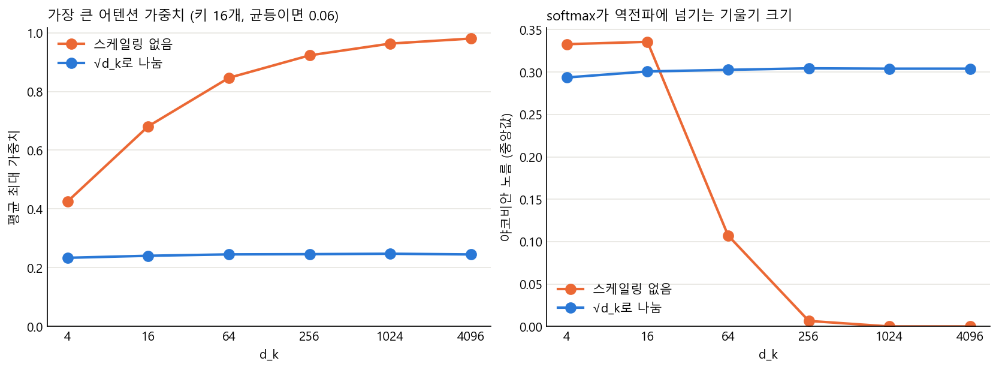

"The capital of France is"를 넣으면 GPT-2는 어떤 과정을 거쳐 다음 토큰을 내놓을까요? 이 질문을 따라가려고 GPT-2 small의 순전파를 NumPy 행렬 연산으로 구현하고, 공개 가중치를 올려 Hugging Face와 값을 비교했습니다. 그다음 같은 구현으로 토크나이저, 어텐션, 샘플링을 실험하고 사전학습, SFT, RLHF, DPO의 손실을 직접 계산했습니다.

먼저 결과부터 정리합니다.

| 항목 | 결과 |
|---|---|
| logits 최대 오차 (float64, 1024 토큰) | 4.29×10⁻¹² |
| logits 최대 오차 (float32, 1024 토큰) | 4.16×10⁻³ (반올림 오차) |
| 자체 BPE와 tiktoken 비교 | 40,030건 불일치 0건, 말뭉치 전체 338,025토큰 일치 |
| 같은 뜻의 한국어/영어 8문장 토큰 수 (gpt2) | 372 대 75 |
| 구현 중 가장 큰 실수 | GELU를 정확한 erf로 구현해 logits 오차 2.05 발생 |

코드는 `gpt2.py`(모델), `bpe.py`(토크나이저), `sampling.py`(샘플링) 세 모듈과 실험 스크립트로 나뉩니다.

구현은 세 가지를 기준으로 맞췄습니다. 모델 구조는 GPT-2 논문 2.3절([Radford 외, 2019](https://cdn.openai.com/better-language-models/language_models_are_unsupervised_multitask_learners.pdf))과 원조 트랜스포머 논문([Vaswani 외, 2017](https://arxiv.org/abs/1706.03762))이고, 가중치는 Hugging Face의 [openai-community/gpt2](https://huggingface.co/openai-community/gpt2)입니다. 토크나이저는 OpenAI가 공개한 [tiktoken](https://github.com/openai/tiktoken)을 정답으로 두고 비교했습니다. 논문 문장만으로 정해지지 않는 세부 사항은 값을 직접 비교해 확인했고, 그 과정에서 6장의 GELU 실수가 드러났습니다.

NumPy로 GPT-2 순전파를 짧게 구현한 사례로는 [picoGPT](https://github.com/jaymody/picoGPT)가 있습니다. 이 글은 구현 자체보다 비교와 실험(토크나이저, 어텐션, 샘플링, 구성요소 제거, 파인튜닝 손실)에 비중을 두었습니다. 각 장에는 실험을 그렇게 설계한 이유와 결과를 설명하는 자료를 붙였고, 마지막 장에 참고 자료를 모았습니다.

---

## 1. 전체 구조

GPT-2가 다음 토큰을 고르는 과정은 한 줄로 쓸 수 있습니다.

```
문자열 → 토큰 ID → 임베딩(wte + wpe) → 트랜스포머 블록 × 12 → LayerNorm → logits → 다음 토큰
```

GPT-2 small의 숫자는 이렇습니다. 어휘 50,257개, 최대 길이 1,024, 임베딩 차원 768, 층 12개, 헤드 12개, 파라미터 약 1억 2,444만 개(124,439,808)입니다. 입력이 T개 토큰이면 출력 logits는 `(T, 50257)` 행렬입니다. 각 행은 "이 위치 다음에 올 토큰"의 점수이고, 생성할 때는 마지막 행만 씁니다.

논문 표 2에는 가장 작은 모델이 117M으로 적혀 있습니다. 공개 가중치의 텐서를 직접 세면 124,439,808개이고, 이 글은 이 값을 씁니다. 논문은 모델이 OpenAI GPT를 거의 따르되 몇 가지를 바꿨다고 밝힙니다. 레이어 정규화는 각 서브 블록의 입력으로 옮겨졌고, 마지막 셀프 어텐션 블록 뒤에 정규화가 하나 더 붙었으며, 잔차 경로에 들어가는 가중치는 초기화 때 1/√N배로 줄입니다. N은 잔차 층의 수입니다. 원조 트랜스포머는 LayerNorm(x + Sublayer(x))처럼 서브 층 뒤에서 정규화했으므로(Vaswani 외, 2017), 정규화의 위치가 반대입니다. 이 세 가지는 5장과 8장 실험의 배경이 됩니다.

실제로 "The capital of France is"의 마지막 행에서 확률이 높은 토큰 다섯 개는 다음과 같습니다.

| 토큰 | 확률 |
|---|---|
| ` the` | 8.46% |
| ` now` | 4.79% |
| ` a` | 4.62% |
| ` France` | 3.24% |
| ` Paris` | 3.22% |

Paris는 5위입니다. GPT-2는 질문에 답하는 모델이 아니라 웹 문서의 다음 토큰을 예측하는 모델이라서 그렇습니다. 이 차이는 9장에서 다시 다룹니다.

---

## 2. 토크나이저와 한국어 토큰 수

### 토큰 수 비교

같은 뜻의 한국어, 영어 문장 8쌍을 tiktoken으로 세었습니다. 비교 대상은 gpt2, cl100k\_base, o200k\_base입니다. 모두 BPE 계열이고 어휘가 점점 커진 세 세대의 인코딩이라, 세대가 바뀌며 한국어 비용이 얼마나 줄었는지 볼 수 있습니다. 문장은 직접 고른 8쌍이라 표본이 작습니다. 비율은 정확한 값보다 대략의 감으로 읽는 것이 맞습니다.


| 인코딩 | 한국어 | 영어 | 비율 | 한국어 토큰당 글자 수 |
|---|---:|---:|---:|---:|
| gpt2 | 372 | 75 | 4.96배 | 0.47 |
| cl100k\_base | 182 | 74 | 2.46배 | 0.95 |
| o200k\_base | 97 | 73 | 1.33배 | 1.78 |

영어는 세 인코딩이 거의 같은데 한국어만 크게 달라집니다. gpt2에서 한국어는 토큰 하나가 평균 1.16바이트입니다. 사실상 바이트 단위로 쪼개진다는 뜻입니다.

한글 음절 11,172개를 전수 조사하면 이유가 분명해집니다.

- GPT-2 어휘 50,257개 중 완성된 한글 음절을 포함한 토큰은 0개입니다.
- 음절 하나를 단독으로 인코딩하면 266개가 2토큰, 나머지 10,906개가 3토큰입니다.
- 한글 음절은 UTF-8로 3바이트이므로, 최대치인 3토큰이 대부분입니다.

"서울은"의 `서`는 `ec`, `84`, `9c` 세 토큰이 됩니다. 8문장의 한국어 토큰 372개 중 95.7%는 혼자서는 유효한 UTF-8 문자도 아닙니다. 영어는 0%입니다. 모델은 글자를 이루는 바이트 조각을 하나씩 예측해야 하는 셈입니다.

왜 한국어만 이렇게 비쌀까요. 병합 규칙은 학습 말뭉치에서 자주 붙어 나오는 쌍부터 정해지는데([Sennrich 외, 2016](https://arxiv.org/abs/1508.07909)), GPT-2 어휘에는 완성된 한글 음절이 하나도 없습니다. 한글 한 글자의 UTF-8 3바이트가 병합되지 못하고 그대로 3토큰이 되는 이유입니다. 왜 병합되지 않았는지는 GPT-2의 학습 데이터를 직접 보지 않았으므로 확정하지 못합니다. 아래에서 영어 말뭉치로 병합을 직접 학습해 같은 현상이 재현되는지 확인했습니다.

언어에 따라 같은 내용의 토큰 수가 달라지는 문제는 [Petrov 외(2023)](https://arxiv.org/abs/2305.15425)가 17개 토크나이저로 체계적으로 측정했습니다. 토큰 단위로 요금을 받는 서비스에서는 같은 내용을 보내도 언어에 따라 비용이 달라진다고 지적하고, 예로 아랍어가 영어의 3배라고 적었습니다. 이 절의 8문장 실험은 같은 문제를 한국어로, 아주 작은 규모로 확인한 것입니다.

### BPE 직접 구현

BPE는 원래 데이터 압축 알고리즘이고, [Sennrich 외(2016)](https://arxiv.org/abs/1508.07909)가 희귀 단어를 부분 단어로 쪼개 번역하는 데 가져왔습니다. GPT-2는 이를 바이트 단위로 확장했습니다([Radford 외, 2019](https://cdn.openai.com/better-language-models/language_models_are_unsupervised_multitask_learners.pdf)). 알고리즘의 핵심은 짧습니다. 텍스트를 바이트로 쪼갠 뒤, 가장 자주 붙어 나오는 쌍을 하나로 합치기를 반복합니다. 합치는 순서를 기록한 것이 `merges.txt`입니다.

```python
def bpe(self, token):
    parts = list(token)
    while len(parts) > 1:
        pairs = set(zip(parts, parts[1:]))
        best = min(pairs, key=lambda pair: self.ranks.get(pair, float("inf")))
        if best not in self.ranks:
            break
        parts = merge(parts, best)   # best 쌍을 모두 하나로 합친다
    return parts
```

인코딩에서는 가장 먼저 학습된 쌍부터 합칩니다. 빈도가 아니라 학습 순서가 기준이라는 점이 중요합니다. 공백을 포함한 정규식으로 먼저 단어를 나누기 때문에 ` the`와 `the`는 다른 토큰입니다. 이 사전 분할은 GPT-2 논문이 말한 규칙을 구현한 정규식입니다. `dog.`, `dog!`, `dog?`처럼 같은 단어에 문장부호가 붙은 변형이 어휘를 따로 차지하는 것을 막으려고 글자 범주를 넘는 병합을 금지하고, 공백만 예외로 둔다고 적혀 있습니다.

자체 구현을 tiktoken의 gpt2 인코딩과 비교했습니다. Tiny Shakespeare의 40,000여 줄과 한국어, 이모지, 공백 같은 경계 사례까지 40,030건에서 불일치와 복원 실패가 모두 0건이었고, 말뭉치 전체(338,025토큰)도 동일했습니다.

학습 쪽도 직접 돌렸습니다. merges.txt가 어떻게 만들어지는지 보고, 영어 말뭉치로 만든 병합이 한국어에 얼마나 쓸모 있는지 확인하려는 목적이었습니다. Shakespeare 20만 자로 병합을 학습하면 첫 병합은 공백+t, h+e, o+u 순이고, 아홉 번째에 ` t`+`he`로 ` the`가 만들어집니다. 학습에 쓰지 않은 10만 바이트에 적용한 결과입니다.

| 병합 횟수 | 토큰 수 | 토큰당 바이트 |
|---:|---:|---:|
| 0 | 100,000 | 1.00 |
| 100 | 62,871 | 1.59 |
| 500 | 47,231 | 2.12 |
| 1,000 | 40,328 | 2.48 |

이렇게 영어로 학습한 병합을 한국어 문장에 적용하면 433바이트가 그대로 433토큰으로 남습니다. 병합 1,000개 중 한국어에 쓸 수 있는 것이 하나도 없었습니다. 토크나이저의 효율은 언어 자체보다 학습 말뭉치에 무엇이 많았느냐로 정해진다는 것을 작은 규모로 확인했습니다.

---

## 3. 토큰 임베딩과 위치 임베딩

토큰 ID는 번호일 뿐이므로 벡터로 바꿉니다. GPT-2는 토큰 임베딩 `wte (50257, 768)`와 위치 임베딩 `wpe (1024, 768)`를 학습해 두고, 둘을 더합니다. 위치 임베딩은 원조 트랜스포머에서 사인과 코사인 함수로 만들었습니다. Vaswani 외(2017)는 학습하는 방식도 시험해 보고 두 방식의 결과가 거의 같았다고 적었습니다(표 3의 E행). GPT-2는 학습하는 쪽을 택해 위치마다 768차원 벡터를 가중치로 가집니다. 그래서 `wpe`는 계산식이 아니라 표이고, 표에 무엇이 들어 있는지는 직접 재 볼 수밖에 없었습니다. 아래 크기와 유사도 측정은 그 목적입니다.

```python
def embed(self, ids, start=0):
    positions = np.arange(start, start + ids.shape[1])
    return self.p["wte.weight"][ids] + self.p["wpe.weight"][positions]
```

학습된 `wte`에는 의미가 담겨 있습니다.

| 단어 쌍 | 코사인 유사도 |
|---|---:|
| king – queen | 0.657 |
| Paris – London | 0.579 |
| cat – dog | 0.550 |
| cat – Paris | 0.272 |

` Paris`의 가장 가까운 이웃은 `Paris`, ` France`, ` French`, ` London` 순입니다.

위치 벡터의 평균 크기(3.39)는 토큰 벡터(3.96)와 비슷합니다. 위치 정보가 토큰 정보와 대등한 크기로 섞인다는 뜻입니다. 같은 ` the`라도 위치 0과 100에서의 입력 벡터는 코사인 유사도가 0.386까지 떨어집니다. 8장에서 보듯 위치 임베딩을 빼면 손실이 4.84에서 8.54로 크게 나빠집니다.

---

## 4. Self-attention과 어텐션 맵

어텐션의 수식은 한 줄입니다.

```
Attention(Q, K, V) = softmax(Q Kᵀ / √d_k) V
```

Q는 "내가 찾는 것", K는 "내가 가진 꼬리표", V는 "내가 줄 내용"입니다. 구현은 그대로 옮기면 됩니다.

```python
q, k, v = np.split(linear(h, w, b), 3, axis=-1)        # 768 → 2304 → 768씩 3개
split = lambda t: t.reshape(B, T, n_head, d_k).transpose(0, 2, 1, 3)
q, k, v = split(q), split(k), split(v)                 # (B, 12, T, 64)

scores = q @ k.transpose(0, 1, 3, 2) / math.sqrt(d_k)  # (B, 12, T, T)
mask = np.tril(np.ones((T, T), dtype=bool))
scores = np.where(mask, scores, -np.inf)               # 미래 위치를 지운다
weights = softmax(scores, axis=-1)
out = (weights @ v).transpose(0, 2, 1, 3).reshape(B, T, D)
```

세 가지가 핵심입니다.

- Multi-head: 768차원을 64차원씩 12개로 나눠 병렬로 계산합니다. 헤드마다 다른 관계를 볼 수 있습니다.
- Causal mask: softmax 전에 미래 위치를 −∞로 만들어 확률을 정확히 0으로 만듭니다. 실제로 위쪽 삼각형의 최댓값은 12개 층 모두 0.0이었고, 각 행의 합은 1과 4.4×10⁻¹⁶ 이내로 일치했습니다.
- Conv1D 표현: GPT-2 가중치는 `(입력, 출력)` 모양으로 저장되어 있어 `x @ w`에 전치가 필요 없습니다. PyTorch `nn.Linear`와 반대라서 처음 볼 때 혼동하기 쉽습니다.

수식과 마스킹 방식은 Vaswani 외(2017)의 설명을 그대로 옮긴 것입니다. 디코더에서 뒤쪽 위치의 정보가 앞쪽으로 새면 자기회귀 성질이 깨지므로, 소프트맥스 입력에서 허용되지 않는 연결에 해당하는 값을 −∞로 둔다고 적혀 있습니다. `np.where(mask, scores, -np.inf)` 한 줄이 그 문장입니다.

### 어텐션 맵 시각화

"The animal didn't cross the street because it was too tired"의 어텐션 맵입니다.


흔히 이 문장은 "it이 animal을 가리키는 것을 어텐션이 학습한다"는 예시로 쓰입니다. 실제로 재 보니 그렇게 단순하지 않았습니다.

- 12개 헤드 평균에서 `it`이 `animal`에 준 가중치는 최대 9.4%(5층)이고, 12개 층 중 4개 층에서는 `street`보다 낮습니다. 3층에서는 `street`가 8.2%, `animal`이 2.1%입니다.
- 144개 층/헤드 조합 중 최댓값을 찾으면 5층 4번 헤드가 `animal`에 84.6%를 줍니다. 하지만 이 헤드는 `didn`, `'t`, `cross`, `was`도 `animal`을 봅니다. 대명사 해석보다는 문장의 주어를 계속 참고하는 패턴에 가깝습니다. 게다가 144개 중 최댓값을 고른 것이므로 이것만으로 일반화할 수는 없습니다.
- 12층 평균은 대부분의 토큰이 첫 토큰 `The`에 몰려 있습니다. [Xiao 외(2023)](https://arxiv.org/abs/2309.17453)가 attention sink라고 부른 현상과 비슷한 모습입니다. 이 논문은 첫 토큰들이 내용과 상관없이 큰 어텐션 점수를 받는다고 보고하고, 모든 뒤 토큰에게 보이는 첫 토큰이 싱크 역할을 학습하기 쉽다는 설명을 붙였습니다. 이 글의 실험은 현상을 확인했을 뿐 원인을 검증한 것은 아닙니다.
- 마지막 단어를 `tired`에서 `wide`로 바꿔도 `it` 행의 값은 소수 넷째 자리까지 전부 같습니다. causal mask 때문에 `it` 위치는 뒤에 오는 단어를 볼 수 없습니다.

어텐션 맵은 흥미롭지만, 단일 헤드의 높은 값을 곧바로 "모델이 이해했다"로 읽으면 안 된다는 것을 배웠습니다.

어텐션 가중치를 설명으로 읽어도 되는지는 논쟁이 있습니다. [Jain과 Wallace(2019)](https://arxiv.org/abs/1902.10186)는 어텐션 가중치가 기울기 기반 중요도와 자주 맞지 않고, 예측은 같은데 어텐션 분포만 전혀 다른 경우를 찾을 수 있다고 보였습니다. [Wiegreffe와 Pinter(2019)](https://arxiv.org/abs/1908.04626)는 이에 반박해, 설명을 무엇으로 정의하고 어떻게 검증하느냐에 달린 문제라고 주장합니다. 이 글이 단일 헤드의 값으로 일반화하지 않은 것도 같은 이유입니다.

---

## 5. 블록 조립: LayerNorm, 잔차 연결, FFN

블록은 짧습니다. GPT-2는 정규화를 먼저 하는 Pre-LN 구조입니다.

```python
def block(x, ...):
    a, weights, present = attention(layer_norm(x, ...), ...)
    x = x + a                                   # 잔차 연결 1

    m = layer_norm(x, ...)
    m = gelu(linear(m, c_fc_w, c_fc_b))         # 768 → 3072
    m = linear(m, c_proj_w, c_proj_b)           # 3072 → 768
    return x + m                                # 잔차 연결 2
```

- 어텐션은 토큰끼리 정보를 섞고, FFN은 각 토큰을 혼자 변환합니다. 둘이 번갈아 나옵니다.
- LayerNorm은 토큰 벡터 하나를 평균 0, 분산 1로 맞춘 뒤 학습된 배율과 편향을 적용합니다. 값의 크기가 층마다 튀지 않게 합니다.
- 출력은 임베딩 행렬을 재사용합니다. 마지막 벡터에 `wte`의 전치를 곱하면 logits입니다(weight tying). 각 logit은 "출력 벡터와 해당 토큰 벡터의 내적"입니다.

```python
out.logits = x @ self.p["wte.weight"].T
```

### 구조를 이렇게 쓰는 이유

정규화를 앞에 두는 Pre-LN은 GPT-2가 택한 방식이고, 이유는 학습 안정성에 있습니다. [Xiong 외(2020)](https://arxiv.org/abs/2002.04745)는 원래의 Post-LN 구조에서는 출력층 가까운 파라미터의 기울기가 초기에 커서 큰 학습률로 바로 시작하면 불안정하고, 그래서 학습률 워밍업이 필요하다고 분석했습니다. Pre-LN은 초기 기울기가 안정적이라 워밍업 없이도 학습된다고 보였습니다.

잔차 연결(`x = x + a`)은 [He 외(2016)](https://arxiv.org/abs/1512.03385)가 깊은 망을 학습하기 쉽게 하려고 쓴 구조이고, GPT-2 논문도 정규화 위치를 pre-activation residual network에 빗대어 설명합니다. [Elhage 외(2021)](https://transformer-circuits.pub/2021/framework/index.html)의 관점으로 읽으면 코드가 더 분명해집니다. 각 어텐션과 FFN은 잔차 흐름(residual stream)에서 선형 사영으로 입력을 읽고, 결과에 선형 사영을 거쳐 그 흐름에 더해 씁니다. 블록 12개가 하나의 흐름을 공유하며 차례로 덧쓰는 구조입니다. 8장의 잔차 제거 실험이 이 그림과 맞아떨어집니다.

레이어 정규화는 [Ba 외(2016)](https://arxiv.org/abs/1607.06450)가 제안했고, 한 학습 샘플의 층 입력 전체에서 평균과 분산을 구하므로 배치 크기와 무관하며 학습과 추론의 계산이 같습니다. 이 글의 구현도 토큰 벡터 하나(768차원)에서 평균과 분산을 구합니다.

출력 임베딩 재사용(weight tying)은 [Press와 Wolf(2017)](https://arxiv.org/abs/1608.05859)가 언어 모델에서 perplexity를 낮춘다고 보인 방식입니다. 입력용과 출력용 행렬을 따로 두는 것보다 파라미터가 약 3,860만 개(50,257 × 768) 줄기도 합니다.

잔차 경로 가중치를 1/√N배로 줄이는 초기화는 사전학습된 가중치를 올리는 6장까지는 필요하지 않습니다. 처음부터 학습하는 8장의 소형 모델에만 적용했습니다.

---

## 6. Hugging Face와 logits 비교

### 첫 비교의 실패와 GELU

공개 가중치를 올려 처음 비교했을 때 float32와 float64 모두 오차가 비슷하게 컸습니다.

| 첫 시도 | 최대 오차 |
|---|---:|
| 5토큰 | 0.075 |
| 256토큰 | 2.05 |
| 1024토큰 | 4.34 (argmax도 불일치) |

float64에서도 줄지 않았으니 반올림으로는 설명되지 않습니다. 수식 자체가 달랐습니다. 설정의 `activation_function`은 `"gelu_new"`인데, 저는 이것을 정확한 GELU인 `0.5 * x * (1 + erf(x / √2))`로 구현했습니다. Hugging Face 소스를 확인해 보니 실제 정의는 tanh 근사식이었습니다.

```python
def gelu(x):
    return 0.5 * x * (1 + np.tanh(math.sqrt(2 / math.pi) * (x + 0.044715 * x**3)))
```

그래프로 그리면 거의 겹치는 두 함수인데, 이 작은 차이가 12개 층을 지나며 logit 2.05 차이로 커졌습니다. 설정 파일의 이름만 보고 짐작하면 안 되고, 가중치가 학습될 때 쓰인 수식을 그대로 따라야 합니다. 이번 구현에서 가장 크게 배운 점입니다.

`gelu_new`의 정체는 [Hendrycks와 Gimpel(2016)](https://arxiv.org/abs/1606.08415)의 논문에 있습니다. GELU의 정의는 x×Φ(x)이고 erf로 쓸 수 있는데, 같은 논문이 빠른 근사로 tanh 식(상수 0.044715 포함)을 함께 제시합니다. Hugging Face의 `gelu_new`는 이 근사식 쪽입니다. 같은 논문에 두 식이 나란히 있으니 이름만으로는 어느 쪽인지 알 수 없었던 것입니다.

### 수정 후 결과

| 입력 | 토큰 수 | float32 최대 오차 | float64 최대 오차 | argmax 일치 |
|---|---:|---:|---:|---|
| 짧은 영어 | 5 | 1.14×10⁻⁴ | 2.27×10⁻¹³ | 일치 |
| 토큰 1개 | 1 | 1.03×10⁻⁴ | 7.11×10⁻¹⁴ | 일치 |
| 한국어 | 32 | 1.14×10⁻⁴ | 2.13×10⁻¹³ | 일치 |
| 한영 혼합 | 33 | 1.07×10⁻⁴ | 2.27×10⁻¹³ | 일치 |
| 긴 영어 문장 | 18 | 1.22×10⁻⁴ | 2.27×10⁻¹³ | 일치 |
| Shakespeare | 256 | 2.08×10⁻³ | 1.31×10⁻¹² | 일치 |
| Shakespeare | 1024 | 4.16×10⁻³ | 4.29×10⁻¹² | 일치 |

float32의 오차는 구현 차이가 아닙니다. 같은 코드를 float64로 바꾸면 약 10억 분의 1로 줄어듭니다. 두 프레임워크의 연산 순서가 조금만 달라도 float32에서는 그만큼의 반올림 차이가 납니다.

logits만 비교하면 중간에서 오차가 상쇄됐을 가능성이 남으므로, 다음도 함께 확인했습니다.

- 13개 은닉 상태 전부: float64 최대 오차 4.95×10⁻¹²
- 12개 층의 어텐션 가중치 전부: float64 최대 오차 3.72×10⁻¹⁴
- 배치 입력과 개별 입력의 차이: 0.0
- K, V 캐시를 쓴 점진 생성과 전체 재계산의 차이: 2.56×10⁻¹³
- 다음 토큰 손실: 5.33×10⁻¹⁵

손실 비교에서도 작은 함정이 있었습니다. 처음에는 float64인데도 1.3×10⁻⁵ 차이가 났습니다. Hugging Face의 손실 함수가 계산 전에 `logits.float()`로 float32로 내리기 때문이었습니다. float64 logits로 교차 엔트로피를 직접 계산하니 차이가 사라졌습니다.

비교를 이렇게 설계한 이유는 두 가지입니다. 같은 코드를 float32와 float64로 모두 돌린 것은 오차의 출처를 가리기 위해서입니다. float64에서 오차가 함께 줄면 반올림이고, 줄지 않으면 수식이 다른 것입니다. 첫 시도의 오차가 float64에서도 그대로여서 수식 문제라는 판단이 섰습니다. 입력을 5토큰부터 1,024토큰까지, 영어와 한국어와 한영 혼합까지 넓힌 것은 길이나 문자에 따라 깨지는 곳이 없는지 보려는 것입니다.

---

## 7. 샘플링 전략 비교

같은 logits도 고르는 규칙에 따라 전혀 다른 글이 됩니다. 온도는 softmax 전에 logits를 나눕니다.

```
p_i = exp(z_i / T) / Σ_j exp(z_j / T)
```


세 프롬프트에서 전략마다 64개 샘플을 50토큰씩 생성했습니다. 샘플 하나로는 분포의 성질을 알 수 없어서 프롬프트마다 64개씩 뽑았습니다. 평균 로그확률은 원래 모델(T=1)이 그 글을 얼마나 그럴듯하게 보는지를 뜻하고, 반복률은 4-gram이 겹치는 비율입니다.

| 전략 | 서로 다른 출력 / 64 | 4-gram 반복률 | 토큰당 평균 로그확률 |
|---|---:|---:|---:|
| greedy | 1, 1, 1 | 0.589 | −0.82 |
| T=0.1 | 32, 60, 9 | 0.533 | −0.88 |
| T=1.0 | 64, 64, 64 | 0.003 | −3.71 |
| T=2.0 | 64, 64, 64 | 0.000 | −11.10 |
| top-k=40 | 64, 64, 64 | 0.002 | −2.55 |
| top-p=0.9 | 64, 64, 64 | 0.005 | −3.02 |

실제 출력을 보면 숫자의 뜻이 더 분명합니다.

| 전략 | "Once upon a time, there was a little girl who" 이후 |
|---|---|
| greedy | was a little girl. She was a little girl. She was a little girl. ... |
| T=1.0 | dribbles open with her oatmeal chestnut feet and lashes out at others. ... |
| T=2.0 | \_\_\_\~Know\|\| HavingU Darling rejoifestovesfolk huggingMachero Perl Ver TT ... |
| top-k=40 | liked the music of the time period and did not even recognize it. ... |
| top-p=0.9 | sang, "Let it be LOVE!" And this kind of situation can change of course," she said. ... |

- greedy는 안전해 보이지만 반복에 빠집니다. 매번 최고 확률만 고르다 보니 한번 들어간 패턴을 빠져나오지 못합니다. 토큰별 확률은 가장 높아도 글로서는 가장 나쁩니다.
- T=0.1은 거의 greedy입니다. 첫 토큰 최고 확률이 99.3~100%로 올라갑니다.
- T=2.0은 분포를 평평하게 만듭니다. "실효 후보 수"(엔트로피의 지수)가 France 프롬프트에서 403개에서 12,399개로 늘고, 의미 없는 토큰이 뽑히기 시작합니다.
- top-k와 top-p는 꼬리를 잘라 냅니다. T=1.0보다 평균 로그확률이 높습니다. 드물지만 이상한 토큰이 뽑히는 사고를 막는 것입니다.
- top-p는 분포에 맞춰 후보 수가 바뀝니다. top-k는 항상 40개지만, top-p=0.9는 다음 토큰이 뻔한 unicorn 프롬프트에서 91개, 불확실한 France 프롬프트에서 1,503개를 남겼습니다.

자체 필터는 Hugging Face의 `TemperatureLogitsWarper`, `TopKLogitsWarper`, `TopPLogitsWarper`와 남기는 토큰이 정확히 같았습니다.

이 비교의 문제의식은 [Holtzman 외(2020)](https://arxiv.org/abs/1904.09751)에서 왔습니다. 이 논문은 같은 모델이라도 디코딩 방식만으로 글의 품질이 크게 달라진다고 보였고, 확률의 꼬리를 잘라 내는 nucleus 샘플링(top-p)을 제안했습니다. 후보 수를 고정하지 않고 확률 질량으로 정하기 때문에 분포에 맞춰 후보가 늘고 줄어듭니다. 위의 91개와 1,503개가 그 예입니다. top-k는 Holtzman 외가 [Fan 외(2018)](https://arxiv.org/abs/1805.04833)의 방식으로 소개한 것입니다.

---

## 8. 구성요소 제거 실험

세 가지 설계를 왜 쓰는지 알아보기 위해 각각을 제거했습니다. 방법은 두 가지입니다.

1. 사전학습 가중치에서 제거: 이미 학습된 GPT-2에서 그 부분만 끕니다.
2. 제거한 채 처음부터 학습: 소형 모델을 처음부터 학습합니다.

첫 번째만으로는 부족합니다. 가중치가 그 구성요소에 맞춰 학습됐기 때문에, 무엇을 빼도 나빠지는 것이 당연합니다. "왜 필요한가"는 두 번째 실험이 답합니다.

탐구 질문은 세 가지로 잡았습니다.

1. 어텐션 점수를 √d\_k로 나누는 이유는 무엇인가
2. causal mask가 없으면 무슨 일이 생기는가
3. 잔차 연결이 없으면 무슨 일이 생기는가

아래에서 질문마다 이론과 사전학습 모델의 결과를 보고, 처음부터 학습한 결과로 이어 간 뒤, 끝에서 답을 표로 모았습니다.

### 사전학습 GPT-2에서 제거한 결과

Tiny Shakespeare에서 128토큰 창 16개로 평가했습니다. 무작위로 찍을 때의 손실은 ln 50257 = 10.82입니다.

| 변형 | 손실 | top-1 정확도 | 마지막 층 어텐션 엔트로피 | greedy 출력 |
|---|---:|---:|---:|---|
| 기준 | 4.836 | 27.1% | 0.539 | the capital of the French Republic, and ... |
| √d\_k 제거 | 6.952 | 9.5% | 0.069 | France, the capital of the world, ... |
| causal mask 제거 | 5.482 | 13.7% | 0.736 | the United States is the United States of France ... |
| 잔차 연결 제거 | 11.111 | 1.0% | 0.999 | -------------------- |
| 위치 임베딩 제거 | 8.535 | 5.9% | 0.788 | all all all all all all ... |

잔차 연결을 빼면 무작위 추측(10.82)보다도 나쁩니다.

### 질문 1. √d\_k로 나누는 이유

평균 0, 분산 1인 두 벡터의 내적은 분산이 d\_k입니다. 차원이 커지면 내적의 표준편차가 √d\_k로 커지고, softmax가 한 키에 몰립니다. 이 설명은 [Vaswani 외(2017)](https://arxiv.org/abs/1706.03762)의 각주에 그대로 있습니다. 성분이 독립이고 평균 0, 분산 1이면 내적의 평균은 0, 분산은 d\_k라는 것입니다. 본문은 d\_k가 크면 내적이 커져 softmax가 기울기가 매우 작은 영역으로 밀려날 것이라고 추측한다(suspect)고만 적었습니다. 추측으로 남은 이 부분을 직접 재 보려고 난수 실험을 설계했습니다. 표준편차로 분산 주장을, softmax 야코비안의 크기로 기울기 주장을 확인합니다. 학습된 가중치를 쓰면 다른 요인이 섞이므로 순수한 난수만 썼습니다(키 16개, 시행 4,000회).



| d\_k | 내적 표준편차 | 최대 가중치 (없음 → 나눔) | softmax 야코비안 노름 (없음 → 나눔) |
|---:|---:|---:|---:|
| 4 | 1.99 | 0.43 → 0.23 | 0.33 → 0.29 |
| 64 | 7.97 | 0.85 → 0.25 | 0.11 → 0.30 |
| 256 | 15.98 | 0.92 → 0.25 | 0.0065 → 0.30 |
| 1024 | 31.93 | 0.96 → 0.25 | 1.8×10⁻⁵ → 0.30 |
| 4096 | 64.14 | 0.98 → 0.25 | 3.8×10⁻¹⁰ → 0.30 |

표준편차가 이론값 √d\_k와 거의 일치합니다. 나누지 않으면 softmax가 포화되고, 역전파로 넘어가는 기울기가 d\_k=1024에서 5자리 넘게 작아집니다. 나누면 d\_k가 얼마든 0.30으로 일정합니다. √d\_k의 역할은 차원과 무관하게 softmax를 학습 가능한 영역에 두는 것입니다.

사전학습 GPT-2에서도 어텐션 엔트로피가 0.539에서 0.069로 떨어졌습니다. 어텐션이 거의 토큰 하나에 몰렸다는 뜻입니다.

### 질문 2. causal mask가 없을 때 생기는 일

문장의 9번째 토큰을 바꾸고, 그 앞 위치의 logits가 변하는지 확인했습니다.

| 모델 | 바꾼 위치 앞의 logits 최대 변화 |
|---|---:|
| 기준 | 0.0 |
| mask 제거 | 8.32 |

마스크가 있으면 미래가 과거에 주는 영향은 정확히 0입니다.

여기서 사전학습 모델의 손실이 5.48로 나빠진 것을 "마스크가 없으면 성능이 나빠진다"로 읽으면 절반만 맞습니다. 이 모델은 미래를 보는 법을 학습한 적이 없을 뿐입니다. 미래를 볼 수 있게 두고 학습하면 어떻게 될까요? 그 답은 아래 학습 실험에서 나옵니다.

### 질문 3. 잔차 연결이 필요한 이유

잔차 연결을 빼면 각 층의 출력이 이전 입력을 완전히 대체합니다. 사전학습 모델에서 마지막 층의 어텐션 엔트로피가 0.999가 된 것은 어텐션이 거의 균등해졌다는 뜻입니다. 앞 층의 신호가 사라져 토큰들을 구별하지 못하는 상태입니다. 그 결과 greedy 출력은 `-`만 반복합니다.

### 제거한 채 처음부터 학습한 결과

사전학습 모델에서 빼 보는 실험은 "이 가중치가 그 부분에 기대고 있었다"까지만 보여 줍니다. 그래서 작은 GPT를 PyTorch로 만들어 처음부터 학습했습니다. 역전파가 필요해서 이 실험만 NumPy 대신 PyTorch를 썼습니다.

- 데이터: Tiny Shakespeare, 글자 단위(어휘 65개), 앞 90% 학습, 뒤 10% 검증
- 모델: 8층, 헤드 4개, 임베딩 128차원(d\_k=32), 문맥 64글자
- 학습: AdamW, 학습률 1e-3, 배치 64, 1,500스텝, 시드 3개 평균
- 초기화: 표준편차 0.02의 정규분포. 잔차 경로로 들어가는 가중치는 1/√(2×층 수)배로 줄였습니다. GPT-2 논문의 1/√N 방식이고, 블록마다 잔차에 더해지는 것이 두 번이라 N을 층 수의 2배로 잡았습니다.

Tiny Shakespeare는 [Karpathy의 char-rnn 저장소](https://github.com/karpathy/char-rnn/tree/master/data/tinyshakespeare)에 있는 파일입니다. Karpathy의 [nanoGPT](https://github.com/karpathy/nanoGPT)와 강의 "Let's build GPT"도 이 데이터로 글자 단위 GPT를 학습하고 90/10 분할을 쓰므로, 구현을 서로 견주어 보기 쉽습니다. 모델은 CPU에서 몇 시간 안에 끝나는 크기로 잡았습니다.

손실은 두 가지로 쟀습니다. 하나는 모든 위치의 평균으로, 학습 때 보는 값입니다. 다른 하나는 마지막 위치만 잰 값입니다. 실제로 글을 생성할 때는 마지막 위치 뒤에 아무것도 없으니, 이쪽이 실제 성능에 가깝습니다.


| 변형 | 학습 때 손실 | 마지막 위치 손실 | 마지막 층 어텐션 엔트로피 |
|---|---:|---:|---:|
| 기준 | 1.694 ± 0.006 | 1.668 ± 0.022 | 0.403 |
| √d\_k 제거 | 1.686 ± 0.010 | 1.658 ± 0.032 | 0.268 |
| causal mask 제거 | 0.037 ± 0.000 | 2.294 ± 0.030 | 0.811 |
| 잔차 연결 제거 | 3.335 ± 0.001 | 3.284 ± 0.001 | 1.000 |

비교 기준도 두 개 계산했습니다. 학습 데이터의 글자 빈도만으로 예측하면 검증 손실이 3.347이고, 바로 앞 글자 하나만 보는 bigram 모델은 2.482입니다.

causal mask를 뺀 모델은 300스텝 만에 학습 손실이 0.06~0.10까지 떨어집니다. 기준 모델의 1.694보다 훨씬 좋아 보이지만, 다음 글자가 입력에 그대로 있으니 베끼기만 하면 되는 문제를 푼 것입니다. 정답이 없는 마지막 위치에서는 2.294로 기준보다 0.63 나쁩니다. 세 시드 모두 베끼기를 배우는 200~300스텝 구간에서 마지막 위치 손실이 2.7 근처에서 3.0~3.2로 오히려 올라갔습니다. 생성 결과를 보면 차이가 분명합니다.

```
기준:            ROMEO:\nThy farms it when? I would nears! would gelst, great
causal mask 제거: ROMEO:\nOPOMOMMMOOMAMAMMMALMWAMMEMAMAMAMAOMMAMMIMAMMMAMA
```

질문 2의 답은 이렇습니다. 마스크가 없으면 모델은 예측 대신 복사를 배웁니다. 학습 손실은 좋아지지만 생성에 쓸 수 없는 모델이 됩니다. Vaswani 외(2017)가 디코더 마스킹을 자기회귀 성질을 지키기 위한 것이라고 설명한 이유가 이 실험에 그대로 나타납니다. 학습 손실을 두 가지로 잰 것은 이 누설을 눈으로 보려는 설계였습니다. 모든 위치의 평균만 보면 마스크가 없는 모델이 가장 좋아 보이기 때문입니다.

잔차 연결을 뺀 모델은 100스텝 만에 3.36 근처에서 멈추고, 1,500스텝까지 그대로입니다. 이 값은 글자 빈도 기준선 3.347과 거의 같습니다. 문맥을 전혀 쓰지 못하고 어떤 글자가 자주 나오는지만 배웠다는 뜻입니다. 생성 결과도 영어 글자 빈도를 닮은 무작위 나열입니다.

```
잔차 연결 제거: ROMEO:\nts remhfsd hRwTsnlteWloHca  eahao roid IgtlstetgMeco
```

처음에는 기울기 소실이 원인일 거라고 생각했습니다. 그런데 학습 첫 스텝의 블록별 기울기 노름을 재 보니 반대였습니다. 잔차가 없을 때 첫 블록 10.8, 마지막 블록 10.8로, 기준 모델(3.08, 1.89)보다 오히려 컸습니다. 8층 정도에서는 층마다 있는 LayerNorm이 신호 크기를 지켜 주기 때문입니다.

단서는 어텐션 엔트로피 1.000에 있었습니다. 학습이 끝나도 어텐션이 앞 글자 전체에 완전히 균등하게 퍼져 있습니다. 균등한 어텐션은 앞 글자들의 평균을 넘겨줍니다. 잔차 연결이 있으면 현재 글자의 정보가 옆길로 그대로 다음 층에 전달되지만, 없으면 그 평균 속에 묻힙니다. 현재 글자가 무엇인지도 모르는 모델이 할 수 있는 최선은 글자 빈도를 맞히는 것입니다.

이 해석에는 선행 연구와 맞닿는 부분이 있습니다. 5장에서 본 잔차 흐름의 그림으로 보면, 잔차 연결을 빼는 것은 각 층이 흐름에 덧쓰는 대신 덮어쓰는 구조로 바꾸는 일입니다. 앞 층이 쓴 정보가 남지 않습니다. [Dong 외(2021)](https://arxiv.org/abs/2103.03404)는 잔차 연결과 MLP가 없는 순수 어텐션 층을 쌓으면 출력이 깊이에 따라 이중 지수적인 속도로 랭크 1 행렬에 가까워지고, 잔차 연결과 MLP가 이를 막는다고 보였습니다. 균등한 어텐션이 모든 위치에 같은 평균을 넘겨주는 이번 모습과 그림이 닮았습니다. 다만 이번 모델에는 MLP가 남아 있고 이 논문은 순수 어텐션을 분석한 것이라, 같은 현상이라고 단정하지는 않습니다.

Q, K, V 가중치 크기도 같은 이야기를 합니다. 초기값은 표준편차 0.02입니다. 잔차가 있는 모델은 학습 후 RMS가 0.047로 두 배 넘게 커졌지만, 잔차가 없는 모델은 0.021에 머물렀습니다. 기울기는 컸는데 어텐션을 만드는 가중치는 거의 움직이지 않았습니다. 큰 기울기가 어디로 갔는지까지는 이번에 추적하지 못했습니다.

층 수를 바꿔서도 학습해 봤습니다. 잔차 연결이 깊은 망에서 기울기를 전달하는 장치라면, 얕은 모델에서는 잔차가 없어도 학습이 돼야 합니다.


| 층 수 | 잔차 있음 | 잔차 없음 | 잔차 없음의 Q, K, V RMS |
|---:|---:|---:|---:|
| 2 | 1.640 | 3.284 | 0.026 |
| 4 | 1.620 | 3.284 | 0.022 |
| 8 | 1.668 | 3.284 | 0.021 |
| 16 | 1.645 | 3.285 (시드 1개) | 0.020 |

16층 잔차 없음은 학습 시간이 길어 시드 1개만 끝까지 돌렸습니다. 나머지 두 시드도 600스텝과 800스텝에서 멈출 때까지 마지막 위치 손실이 3.32~3.36이었습니다.

예상과 달랐습니다! 2층짜리 모델도 잔차가 없으면 8층, 16층과 똑같이 3.28에서 멈췄고, 어텐션 엔트로피도 모두 1.000이었습니다. 이 크기에서 잔차 연결이 하는 일은 깊이 문제를 푸는 것보다 더 기본적입니다. 어텐션이 아직 쓸모 있는 패턴을 배우지 못한 학습 초반에도 각 글자의 정보를 다음 층으로 넘겨주는 통로 역할을 합니다. 통로가 없으면 모델은 처음부터 균등 어텐션의 평균만 보고, 거기서 빠져나오지 못합니다.

잔차가 있는 쪽은 2층부터 16층까지 1.62~1.67로 비슷했습니다. 1,500스텝은 깊은 모델의 장점이 드러나기에 짧은 학습입니다. 16층 모델의 첫 스텝 기울기는 잔차가 있을 때 입력 쪽 블록 3.45에서 출력 쪽 1.81로 줄었습니다. 잔차가 없을 때는 6.9~17.6으로 오히려 더 컸습니다. 이 규모에서는 어느 쪽도 기울기가 사라지지 않았습니다.

√d\_k는 이 설정에서 최종 손실 차이가 없었습니다. 1.686과 1.694는 시드 사이 표준편차 안에 들어갑니다. 오히려 초반에는 나누지 않은 쪽이 조금 빨랐습니다. 200스텝 학습 손실이 세 시드 모두 0.08~0.12 낮았습니다. 대신 나누지 않은 모델은 Q, K, V 가중치를 기준보다 19% 작게(RMS 0.0381 대 0.0467) 학습했습니다. 점수가 커지지 않도록 모델이 스스로 가중치를 줄여 보정한 것으로 보입니다. d\_k=32에서는 √d\_k가 5.7이라 이 정도 보정으로 충분했던 것으로 보입니다. 원논문도 d\_k가 작을 때는 스케일 없는 내적과 additive attention의 성능이 비슷하고, d\_k가 커질 때 격차가 생긴다고 적었습니다. 스케일의 동기가 큰 d\_k에 있다는 뜻이고, 작은 d\_k에서 차이가 나지 않은 이번 결과와 방향이 맞습니다.

d\_k를 키우면 차이가 날까요? 임베딩 512차원에 헤드를 2개로 줄여 d\_k=256으로 만들었습니다. 계산량이 커서 4층, 배치 32로 줄였습니다.

| 변형 (d\_k=256) | 학습 때 손실 | 마지막 위치 손실 | 마지막 층 어텐션 엔트로피 |
|---|---:|---:|---:|
| 기준 | 2.626 ± 0.074 | 2.590 ± 0.036 | 0.028 |
| √d\_k 제거 | 2.719 ± 0.096 | 2.747 ± 0.074 | 0.002 |

나누지 않은 쪽이 세 시드 모두 나빴습니다. 같은 시드끼리 비교하면 학습 때 손실은 0.06~0.13, 마지막 위치 손실은 0.09~0.24 높았습니다. 어텐션 엔트로피 0.002는 사실상 글자 하나만 보는 상태입니다. d\_k=32에서 보이지 않던 차이가 d\_k=256에서 나타났으니, 방향은 질문 1의 이론과 맞습니다.

다만 이 결과는 조심해서 읽어야 합니다. 기준 모델부터 학습이 잘 되지 않았습니다. 손실 2.626은 작은 모델의 1.694보다 훨씬 나쁘고, 두 시드는 1,000스텝 이후 손실이 다시 올라갔습니다. 기준 모델의 어텐션 엔트로피도 0.028로 이미 한 글자에 몰려 있습니다. 512차원 모델에 학습률 1e-3을 워밍업 없이 쓴 것이 원인으로 보이지만 확인하지는 못했습니다. 비슷한 현상을 다룬 연구가 있습니다. [Zhai 외(2023)](https://arxiv.org/abs/2303.06296)는 학습이 불안정해질 때 어텐션이 한곳에 지나치게 몰리는 엔트로피 붕괴가 함께 나타난다고 보고했습니다. [Wortsman 외(2023)](https://arxiv.org/abs/2309.14322)는 어텐션 로짓이 커지는 불안정이 높은 학습률의 작은 트랜스포머에서도 재현된다고 보였습니다. 기준 모델의 엔트로피 0.028도 같은 모습으로 보이지만, 학습률을 바꿔 확인하지는 못했습니다. 학습률을 낮춰 다시 비교하는 것이 다음 실험입니다.

### 탐구 질문과 답

| 탐구 질문 | 답 | 근거 |
|---|---|---|
| √d\_k로 나누는 이유 | 차원이 커질수록 내적이 커져 softmax가 포화되고, 역전파로 넘어가는 기울기가 매우 작아집니다. 나누면 이를 막습니다. | 난수 실험에서 d\_k=1024일 때 softmax 야코비안 노름이 1.8×10⁻⁵(나누면 0.30). d\_k=256 학습에서는 나누지 않은 쪽이 세 시드 모두 나빴고(마지막 위치 손실 2.747 대 2.590), d\_k=32에서는 차이가 없었습니다 |
| causal mask가 없으면 | 다음 글자를 베끼는 법을 배웁니다. 학습 손실은 좋아지지만 생성에는 쓸 수 없는 모델이 됩니다. | 학습 손실 0.037(기준 1.694), 마지막 위치 손실 2.294(기준 1.668) |
| 잔차 연결이 없으면 | 글자 빈도만 배우고 멈춥니다. 층 수를 줄여도 같습니다. | 2층, 4층, 8층, 16층 모두 마지막 위치 손실 3.28(글자 빈도 기준선 3.347), 어텐션 엔트로피 1.000. 앞 층의 정보를 넘길 통로가 없기 때문으로 추정하며 직접 검증하지는 못했습니다 |

---

## 9. 사전학습, SFT, RLHF, DPO의 손실

### 다음 토큰 예측 손실 (사전학습)

손실은 정답 토큰 확률의 음의 로그입니다. 4토큰 어휘에서 logits가 `[2, 1, 0, −1]`이고 정답이 0번이면, softmax 확률은 `[0.644, 0.237, 0.087, 0.032]`이고 손실은 `−ln 0.644 = 0.440`입니다.

실제 GPT-2로 "The capital of France is Paris."를 계산했습니다.

| 문맥 | 정답 | 확률 | −ln p |
|---|---|---:|---:|
| The | capital | 0.0001 | 9.070 |
| The capital | of | 0.1642 | 1.807 |
| The capital of | France | 0.0065 | 5.030 |
| The capital of France | is | 0.1216 | 2.107 |
| The capital of France is | Paris | 0.0322 | 3.434 |
| The capital of France is Paris | . | 0.2612 | 1.343 |

평균은 3.7983이고, 같은 float64 logits로 계산한 PyTorch 값과 5.33×10⁻¹⁵ 차이입니다.

| 모델 | Shakespeare 손실 |
|---|---:|
| 이론값 ln 50257 (균등 분포) | 10.825 |
| 무작위 초기화 (시드 3개) | 10.96 ~ 11.06 |
| 사전학습 GPT-2 | 4.924 |

무작위 초기화가 이론값보다 조금 높은 것은 초기 logits가 완전히 평평하지 않기 때문입니다. 사전학습은 이 10.8에서 4.9까지의 차이를 만드는 과정입니다. 인터넷 문서의 통계를 가중치에 저장합니다. GPT-2의 학습 데이터 WebText는 카르마 3 이상을 받은 Reddit의 외부 링크를 모은 것으로, 800만 개를 조금 넘는 문서에 40GB입니다([Radford 외, 2019](https://cdn.openai.com/better-language-models/language_models_are_unsupervised_multitask_learners.pdf)).

### SFT의 라벨 마스킹

SFT(Supervised Fine-Tuning)는 수식이 사전학습과 같습니다. 달라지는 것은 데이터입니다. "지시 + 좋은 답변" 쌍을 주고, 프롬프트 위치의 라벨을 `-100`으로 가려 답변 토큰만 평가합니다.

```python
labels = [-100] * len(prompt) + response   # 답변만 손실에 들어간다
```

| 평가 범위 | 손실 |
|---|---:|
| 프롬프트 + 답변 전체 | 2.726 |
| 답변 토큰만 (SFT) | 1.362 |

SFT는 "이 문서 다음엔 뭐가 올까"를 "이 질문엔 어떻게 답할까"로 바꿉니다. 시작 시점의 GPT-2는 답변의 ` Paris`에 7.6%, 답변을 끝내는 `<|endoftext|>`에 0.45%만 주고 있습니다. 답변을 끝내는 법도 학습 대상입니다.

### RLHF와 PPO-clip

RLHF는 정답 문장이 없습니다. 모델이 답변을 샘플링하면 보상 모델이 점수를 매기고, 평균보다 좋은 답변의 확률을 높입니다. 정책이 한 번에 너무 멀리 가지 않도록 PPO([Schulman 외, 2017](https://arxiv.org/abs/1707.06347))는 확률 비율을 `[1−ε, 1+ε]`로 자릅니다. 단계 구성은 [Ouyang 외(2022)](https://arxiv.org/abs/2203.02155)의 InstructGPT와 같은 틀입니다. 시범 답변으로 지도학습을 하고, 모델 출력에 사람이 매긴 순위를 모아 RLHF로 추가 학습합니다.

```
r = π(a|s) / π_old(a|s)
L = −min(r·A, clip(r, 1−ε, 1+ε)·A)
```

ε=0.2로 직접 계산하면 다음과 같습니다.

| 비율 r | 어드밴티지 A | r×A | clip(r)×A | 손실 |
|---:|---:|---:|---:|---:|
| 1.0 | +1 | 1.0 | 1.0 | −1.0 |
| 1.1 | +1 | 1.1 | 1.1 | −1.1 |
| 1.5 | +1 | 1.5 | 1.2 | −1.2 (잘림) |
| 0.5 | +1 | 0.5 | 0.8 | −0.5 |
| 1.5 | −1 | −1.5 | −1.2 | +1.5 |
| 0.5 | −1 | −0.5 | −0.8 | +0.8 (잘림) |

`min` 덕분에 좋은 방향으로 너무 많이 가도 추가 이득이 없고(3행), 나쁜 방향의 벌은 줄어들지 않습니다(5행). PPO 논문은 이 목적식이 클리핑하지 않은 목적식의 비관적 하한이라고 설명하고 ε=0.2를 예시 값으로 썼습니다. 클리핑은 정책 변화를 강제로 막는 장치가 아니라, 비율을 범위 밖으로 밀 유인을 없애는 장치입니다.

### DPO와 선호 쌍

DPO([Rafailov 외, 2023](https://arxiv.org/abs/2305.18290))는 RLHF의 목적식, 곧 KL 제약이 있는 보상 최대화를 정리하면 보상 모델과 샘플링 없이 "선호 답변 y\_w, 비선호 답변 y\_l" 쌍으로 쓸 수 있다는 결과입니다. 기준 모델 π\_ref는 고정합니다.

```
margin = [log π(y_w|x) − log π_ref(y_w|x)] − [log π(y_l|x) − log π_ref(y_l|x)]
L = −log σ(β · margin)
```

시작할 때는 π = π\_ref이므로 margin이 0이고, 손실은 정확히 `−log σ(0) = ln 2 = 0.6931`입니다. 실제 실행의 첫 손실도 0.69314718이었습니다.

| log π(y\_w) | log π\_ref(y\_w) | log π(y\_l) | log π\_ref(y\_l) | margin | 손실 (β=0.1) |
|---:|---:|---:|---:|---:|---:|
| −20 | −20 | −10 | −10 | 0 | 0.693 |
| −18 | −20 | −10 | −10 | 2 | 0.598 |
| −18 | −20 | −14 | −10 | 6 | 0.437 |
| −22 | −20 | −6 | −10 | −6 | 1.037 |

DPO가 비교하는 것은 절대 확률이 아니고 기준 모델 대비 변화량입니다. 원래 로그확률이 −20으로 훨씬 낮은 선호 답변도 벌점을 받지 않습니다.

### 같은 조건에서 세 방법 비교

같은 GPT-2에서 시작해 Adam(lr=2×10⁻⁵)으로 30스텝씩 학습했습니다. 역전파에만 PyTorch를 쓰고, 결과는 학습된 가중치를 NumPy 구현에 다시 올려 측정했습니다.

- 프롬프트: `Question: What is the capital of France?\nAnswer:`
- 선호 답변: ` The capital of France is Paris.`
- 비선호 답변: ` I don't know.`
- RLHF의 보상: 학습된 보상 모델 대신 "답변에 Paris가 있으면 1, 없으면 0"이라는 단순 규칙. 8토큰 답변 32개를 샘플링해 5에폭씩 6회 반복.


| 측정값 | 시작 | SFT | RLHF(PPO) | DPO |
|---|---:|---:|---:|---:|
| log π(선호) | −10.89 | −0.00 | −7.63 | −0.84 |
| log π(비선호) | −13.77 | −30.03 | −19.19 | −91.43 |
| 일본 프롬프트 첫 토큰 KL | 0 | 1.25 | 0.94 | 3.97 |
| 무관한 문장 첫 토큰 KL | 0 | 0.059 | 0.015 | 0.219 |
| Shakespeare 손실 | 4.924 | 5.107 | 4.978 | 5.170 |
| 가중치 상대 변화량 | 0 | 0.119% | 0.110% | 0.121% |

greedy 출력은 이렇게 달라졌습니다.

| 모델 | "capital of France" 프롬프트 |
|---|---|
| 시작 | The capital of France is the capital of France. The capital of ... |
| SFT | The capital of France is Paris. (종료 토큰) The following is a list of ... |
| RLHF(PPO) | The capital of Paris is the Paris Convention. The Convention is a document ... |
| DPO | The capital of France is Paris. (종료 토큰) The United States is committed to ... |

여기서 얻은 관찰입니다.

1. 구조는 하나도 바뀌지 않습니다. 세 방법 모두 파라미터 이름과 모양이 동일하고, 같은 NumPy 코드로 그대로 실행됩니다. 바뀌는 것은 숫자뿐이고 그 변화량도 0.12% 정도입니다. 그 작은 변화로 행동이 크게 달라졌습니다. 어텐션과 FFN 가중치가 가장 많이 움직였습니다(0.11~0.15%). 위치 임베딩은 0.015~0.019%로 가장 적게 움직였습니다.
2. SFT는 정답을 끌어올립니다. 선호 답변 확률이 거의 1이 됩니다. 비선호 답변은 직접 건드리지 않았지만 확률 합이 1이므로 같이 내려갑니다.
3. DPO는 차이를 벌립니다. 비선호 답변이 −91까지 떨어졌습니다. 손실이 차이만 보기 때문에, 내리기 쉬운 쪽을 크게 내렸습니다. 대가로 무관한 프롬프트의 변화(KL)가 가장 큽니다.
4. RLHF는 보상을 최적화합니다. 평균 보상은 0.06에서 0.91로 올랐습니다. 그런데 출력은 "The capital of Paris is the Paris Convention"입니다. 규칙이 "Paris가 있으면 만점"이니 모델은 그렇게 했을 뿐입니다. 실제 RLHF의 핵심 난제인 보상 모델의 품질 문제를 아주 작은 규모로 재현한 셈입니다. 보상을 과하게 최적화하면 진짜 목표와 어긋나는 현상은 [Gao 외(2022)](https://arxiv.org/abs/2210.10760)가 대리 보상 모델을 최적화할수록 정답 보상이 어떻게 변하는지로 체계적으로 연구했습니다. 이 글의 보상은 규칙 한 줄짜리 대리 보상이라 30스텝 안에 그런 모습이 나타났습니다.
5. 세 방법 모두 원래 능력을 조금씩 잃습니다. Shakespeare 손실이 모두 올랐습니다. 하나의 예시에 과적합한 결과이기도 합니다.

일본 프롬프트의 greedy 출력은 세 모델 모두 "Tokyo"를 포함하는 문장으로 바뀌었습니다. 학습에 없던 질문에도 답변 틀이 옮겨 간 것입니다. 다만 프롬프트 하나의 결과이고, 일반화를 입증했다고 말할 수는 없습니다.

| 단계 | 쓰는 데이터 | 손실의 핵심 | 바뀌는 행동 |
|---|---|---|---|
| 사전학습 | 웹 문서 | 다음 토큰 교차 엔트로피 | 언어와 세계의 통계를 익힘 |
| SFT | 지시+답변 쌍 | 답변 토큰만의 교차 엔트로피 | 문서 이어쓰기에서 지시 응답으로 |
| RLHF | 샘플+보상 | PPO-clip | 보상이 높은 답변 쪽으로 이동 |
| DPO | 선호/비선호 쌍 | 기준 모델 대비 로그확률 차이 | 선호를 비선호보다 높이도록 이동 |

---

## 10. 정리

처음의 질문으로 돌아가면, 문장이 다음 토큰이 되기까지의 과정은 전부 행렬 연산입니다. 바이트 조각을 번호로 바꾸고, 벡터로 만들고, 내적으로 서로를 참고하게 하고, 임베딩 행렬과 내적해 점수를 내고, 그중 하나를 고릅니다. NumPy로 전부 쓸 수 있고, 값은 10⁻¹² 수준까지 일치합니다 :)

직접 구현하면서 남은 교훈은 세 가지입니다.

- 값이 일치할 때까지 비교해야 이해한 것입니다. GELU가 틀렸다는 것은 코드를 읽어서는 알 수 없었고, float64 비교에서야 드러났습니다.
- 망가뜨리는 실험에는 범위가 있습니다. 학습된 가중치에서 부품을 빼는 실험은 의존성을 보여 줄 뿐, 필요한 이유를 설명하려면 학습까지 봐야 합니다. 학습해 보니 잔차 연결이 기울기 소실을 막으려고 있다는 익숙한 설명도 이번 규모에서는 맞지 않았습니다.
- 파인튜닝은 구조를 그대로 두고 가중치만 바꿉니다. 같은 코드에서 0.1% 남짓한 가중치 변화가 행동을 바꿨고, 무엇을 최적화하느냐가 결과를 정했습니다.

### 이 실험의 한계

- 파인튜닝 비교는 한 쌍의 예시로 30스텝 돌린 것으로, 원리를 보기 위한 시연입니다. 실제 SFT, RLHF, DPO는 대규모 데이터로 학습합니다.
- RLHF 실험은 규칙 기반 보상을 썼고 가치 함수(critic)와 엔트로피 보너스를 넣지 않았습니다. 클리핑 비율도 36~68%로 높아서 학습률이 큰 편입니다.
- 어텐션 해석은 한 문장, 샘플링 표는 세 프롬프트의 결과입니다.
- 사전학습 모델 제거 실험의 평가 데이터는 Shakespeare이므로 손실의 절대값은 현대 영어 기준과 다릅니다.
- 처음부터 학습한 실험은 글자 단위의 작은 모델을 1,500스텝, 시드 3개로 돌린 것입니다. d\_k=256 설정은 기준 모델부터 불안정했고, 16층 잔차 없음은 시드 1개만 끝까지 돌렸습니다.

---

## 11. 참고 자료

### 모델 구조와 구성요소

- Vaswani 외 (2017), Attention Is All You Need. [arXiv:1706.03762](https://arxiv.org/abs/1706.03762). 어텐션 수식, √d\_k, 마스킹, 위치 인코딩.
- Radford 외 (2019), Language Models are Unsupervised Multitask Learners. [GPT-2 논문](https://cdn.openai.com/better-language-models/language_models_are_unsupervised_multitask_learners.pdf). 모델 구조, 바이트 단위 BPE, 초기화, WebText.
- Xiong 외 (2020), On Layer Normalization in the Transformer Architecture. [arXiv:2002.04745](https://arxiv.org/abs/2002.04745).
- He 외 (2016), Deep Residual Learning for Image Recognition. [arXiv:1512.03385](https://arxiv.org/abs/1512.03385).
- Ba 외 (2016), Layer Normalization. [arXiv:1607.06450](https://arxiv.org/abs/1607.06450).
- Hendrycks, Gimpel (2016), Gaussian Error Linear Units (GELUs). [arXiv:1606.08415](https://arxiv.org/abs/1606.08415).
- Press, Wolf (2017), Using the Output Embedding to Improve Language Models. [arXiv:1608.05859](https://arxiv.org/abs/1608.05859).
- Elhage 외 (2021), A Mathematical Framework for Transformer Circuits. [transformer-circuits.pub](https://transformer-circuits.pub/2021/framework/index.html).

### 토크나이저

- Sennrich 외 (2016), Neural Machine Translation of Rare Words with Subword Units. [arXiv:1508.07909](https://arxiv.org/abs/1508.07909).
- Petrov 외 (2023), Language Model Tokenizers Introduce Unfairness Between Languages. [arXiv:2305.15425](https://arxiv.org/abs/2305.15425).
- OpenAI, [tiktoken](https://github.com/openai/tiktoken). 자체 BPE를 비교한 기준 구현.

### 어텐션 해석, 학습 안정성, 디코딩

- Xiao 외 (2023), Efficient Streaming Language Models with Attention Sinks. [arXiv:2309.17453](https://arxiv.org/abs/2309.17453).
- Jain, Wallace (2019), Attention is not Explanation. [arXiv:1902.10186](https://arxiv.org/abs/1902.10186).
- Wiegreffe, Pinter (2019), Attention is not not Explanation. [arXiv:1908.04626](https://arxiv.org/abs/1908.04626).
- Dong 외 (2021), Attention is Not All You Need: Pure Attention Loses Rank Doubly Exponentially with Depth. [arXiv:2103.03404](https://arxiv.org/abs/2103.03404).
- Zhai 외 (2023), Stabilizing Transformer Training by Preventing Attention Entropy Collapse. [arXiv:2303.06296](https://arxiv.org/abs/2303.06296).
- Wortsman 외 (2023), Small-scale proxies for large-scale Transformer training instabilities. [arXiv:2309.14322](https://arxiv.org/abs/2309.14322).
- Holtzman 외 (2020), The Curious Case of Neural Text Degeneration. [arXiv:1904.09751](https://arxiv.org/abs/1904.09751).
- Fan 외 (2018), Hierarchical Neural Story Generation. [arXiv:1805.04833](https://arxiv.org/abs/1805.04833).

### 사전학습 이후의 학습

- Ouyang 외 (2022), Training language models to follow instructions with human feedback. [arXiv:2203.02155](https://arxiv.org/abs/2203.02155).
- Schulman 외 (2017), Proximal Policy Optimization Algorithms. [arXiv:1707.06347](https://arxiv.org/abs/1707.06347).
- Rafailov 외 (2023), Direct Preference Optimization. [arXiv:2305.18290](https://arxiv.org/abs/2305.18290).
- Gao 외 (2022), Scaling Laws for Reward Model Overoptimization. [arXiv:2210.10760](https://arxiv.org/abs/2210.10760).

### 코드와 데이터

- Hugging Face, [openai-community/gpt2](https://huggingface.co/openai-community/gpt2). 공개 가중치와 비교 기준.
- Karpathy, [Tiny Shakespeare](https://github.com/karpathy/char-rnn/tree/master/data/tinyshakespeare)와 [nanoGPT](https://github.com/karpathy/nanoGPT).
- Jay Mody, [picoGPT](https://github.com/jaymody/picoGPT). NumPy로 쓴 GPT-2 순전파.
