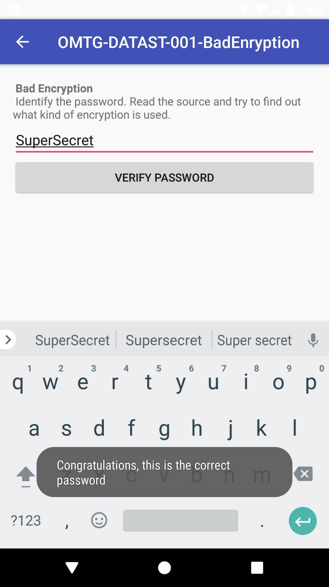
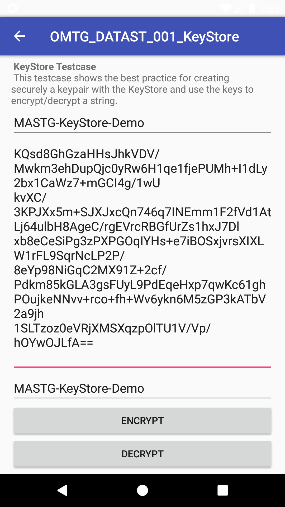
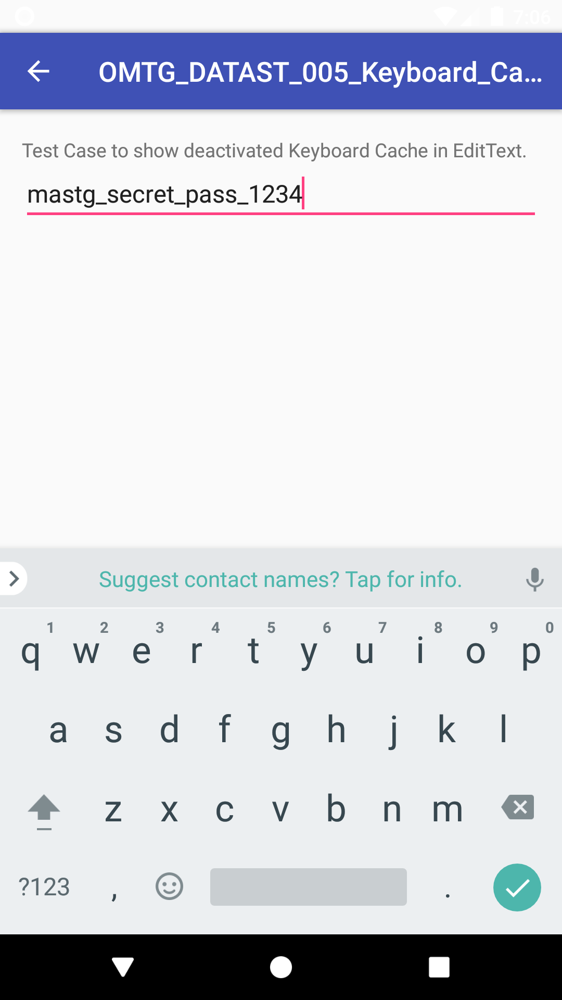
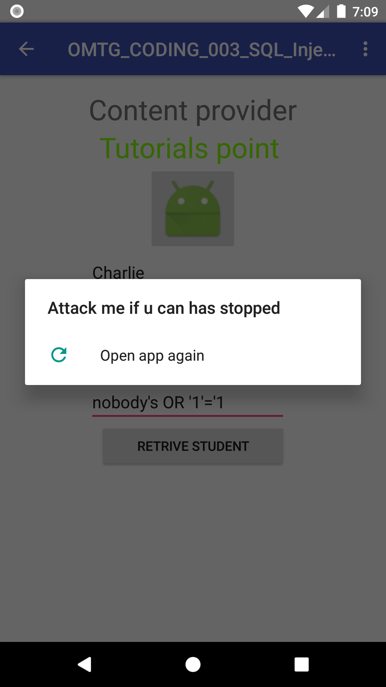
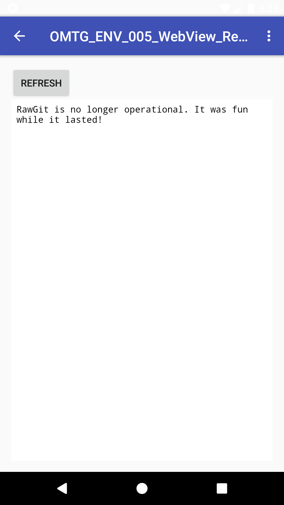
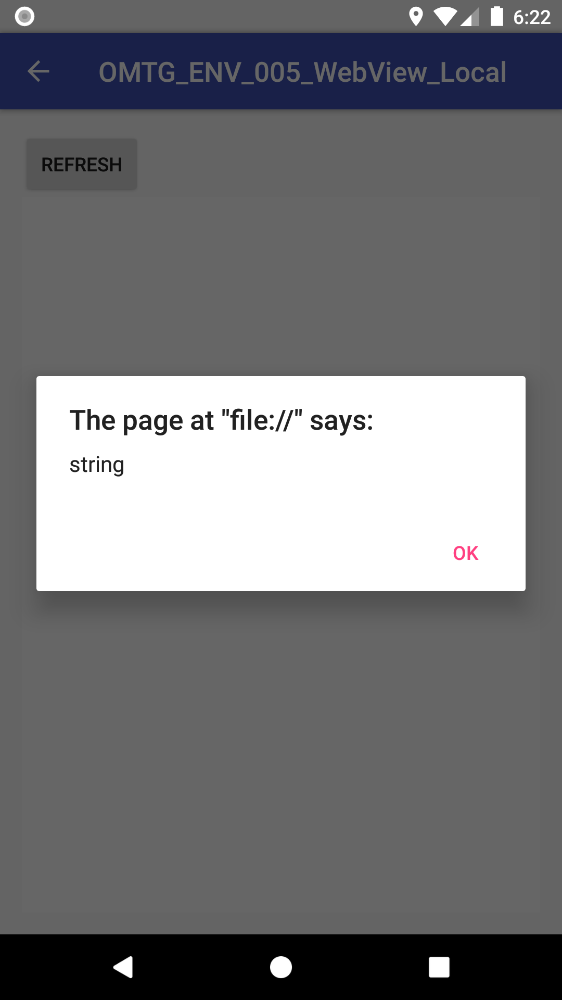
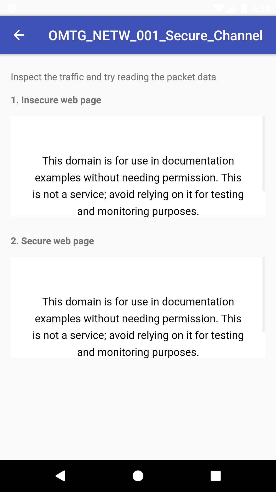
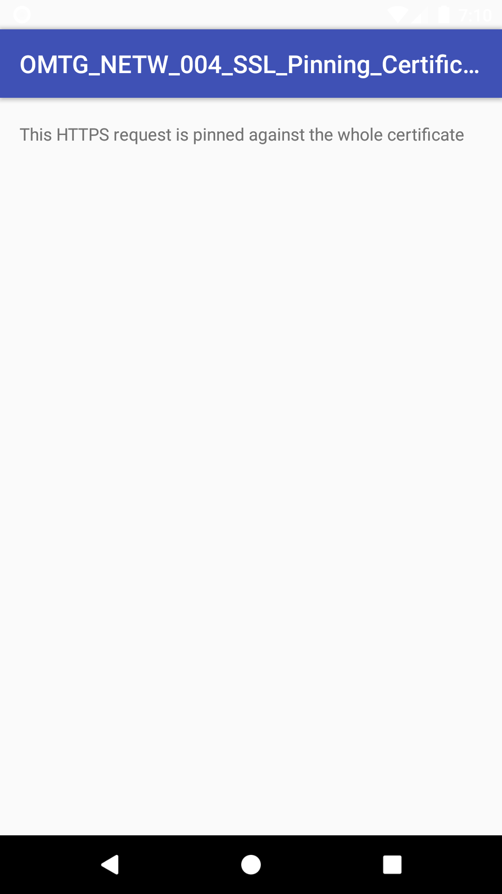

안드로이드 취약점 공부할 때 흔히 추천받는 교재 중 하나가 OWASP의 MASTG Hacking Playground입니다. MSTG(모바일 보안 테스트 가이드)에 나오는 저장소, 인젝션, WebView, 네트워크 취약점을 한 앱 안에 전부 심어 둔, 말 그대로 "공격해 보라고 만든" 연습용 앱입니다. 이번엔 이 앱을 에뮬레이터에 올려서 24개 테스트 케이스를 처음부터 끝까지 손으로 눌러 가며 터뜨려 봤습니다. 디컴파일로 코드만 읽고 끝내는 게 아니라, 실제로 값을 뽑고 로그인을 우회하고 코드를 실행시키는 것까지가 목표였습니다.

## 세 줄 요약

- 평문 저장, 로깅, SQL 인젝션, DexClassLoader 코드 실행, WebView JS 브릿지는 **전부 정적 분석 그대로 재현**됩니다. 심지어 비밀번호를 화면에 그대로 띄워 주는 테스트 케이스도 있었습니다(...).
- "피닝"이라는 이름을 달고 있어도 구현이 허술하면 **Frida 한 방에 걷힙니다**. 이 앱의 SSL 피닝은 사실 Burp Suite 기본 CA만 통과시키는 역설적인 구현이었습니다.
- API 26/API 23 두 세대를 같이 띄워 보니 **같은 레거시 취약점도 안드로이드 버전에 따라 재현 조건이 달라집니다.** 런타임 권한, SELinux, Frida의 구형 ART 미지원까지 전부 한 번씩 발목을 잡았습니다.

## 실습 환경

```
에뮬레이터: API 26 (Android 8.0 Oreo, Pixel) + API 23 (Android 6.0 Marshmallow, Pixel), 둘 다 Google APIs x86 이미지
앱: MASTG Hacking Playground MSTG-Android-Java.apk (OWASP 공식 릴리즈 1.1)
디컴파일: jadx 1.5.7
호스트: Windows 11 + platform-tools(adb) + frida-tools
우회: Frida 17.14.1 (frida-server 17.14.1, 두 에뮬레이터 모두 x86)
프록시: mitmproxy 12.3.1
```

먼저 재미있는 디테일 하나. 안드로이드 ABI별 빌드라면 보통 `app-x86-debug.apk`처럼 ABI 이름이 붙은 파일이 나올 거라 생각했는데, 막상 저장소의 `build.gradle`을 열어 보면 ABI별로 쪼개서 빌드하는 설정이 전부 주석 처리돼 있습니다. 즉 직접 빌드해도 그런 파일명은 안 나옵니다. 그래서 OWASP가 GitHub Releases에 올려 둔 공식 배포 APK를 그대로 썼는데, 이것도 나름 의미가 있습니다. **배포된 바이너리가 소스 저장소의 현재 상태와 다를 수 있다**는 걸 시작부터 확인한 셈이니까요.

두 에뮬레이터 모두 `userdebug` 빌드라 `adb root`가 바로 됩니다. 다만 **배포 APK 자체는 `debuggable`이 아니라서** `run-as`는 "package not debuggable"로 거부당하고, root로 우회해야 했습니다.

```bash
adb root
adb install -r MSTG-Android-Java.apk
adb shell cat /data/data/sg.vp.owasp_mobile.omtg_android/shared_prefs/key.xml
```

그리고 메뉴 화면입니다. 버튼이 20개 넘게 세로로 쭉 늘어서 있어서 스크롤하면서 하나씩 눌러야 합니다.


재미있는 사실 하나 더: 매니페스트를 까 보면 이 메뉴 액티비티만 `LAUNCHER` 인텐트 필터가 있어서 노출돼 있고, 나머지 20개 화면은 전부 비노출(`exported=false`)입니다. 그래서 `adb shell am start -n <패키지>/<액티비티>`로 바로 꽂으려고 하면 전부 `Permission Denial`로 튕겨 나갑니다. 결국 `uiautomator dump`로 버튼 좌표를 뽑고 `input tap`으로 사람처럼 눌러야 했습니다. 비노출 설정이 adb로 직통 진입만 막을 뿐, 메뉴를 거쳐 가는 정상 경로는 전혀 막지 못한다는 뜻이기도 합니다.

## 저장소에 평문으로 남는 것들

**SharedPreferences, 내부 저장소, SQLite**: 셋 다 같은 패턴입니다. 저장 직후 root 셸로 해당 파일을 그대로 열면 끝입니다.

```bash
adb shell cat /data/data/sg.vp.owasp_mobile.omtg_android/shared_prefs/key.xml
#   username: administrator / password: supersecret
adb shell cat /data/data/sg.vp.owasp_mobile.omtg_android/files/test_file
#   Credit Card Number is 1234 4321 5678 8765
adb shell sqlite3 /data/data/sg.vp.owasp_mobile.omtg_android/databases/privateNotSoSecure "select * from Accounts;"
#   admin|AdminPass
```

**외부 저장소**는 재현하다가 한 번 막혔습니다. `/sdcard/password.txt`를 쓰는 코드인데 처음엔 `FileNotFoundException: Permission denied`가 떴습니다. 이 앱이 `WRITE_EXTERNAL_STORAGE`를 매니페스트에만 선언하고 런타임에 요청하지 않아서, API 23 이후의 런타임 권한 모델에서는 기본 거부 상태였던 겁니다.

```bash
adb shell pm grant sg.vp.owasp_mobile.omtg_android android.permission.WRITE_EXTERNAL_STORAGE
adb shell cat /sdcard/password.txt
#   L33tS3cr3t
```

권한을 수동으로 한 번 승인해 주니 그제서야 평문 파일이 써졌습니다. 레거시 취약점이 최신 권한 모델을 만나면 재현 조건 자체가 바뀐다는 걸 보여주는 사례였습니다.

**자작 암호**: 비밀번호 검증 화면 설명에 "Read the source and try to find out what kind of encryption is used"라고 친절하게 쓰여 있습니다. 코드를 보니 XOR 16 한 다음 비트 반전하는, 자기만의 암호였습니다. 두 연산 다 자기 자신이 역함수라서 같은 순서로 한 번 더 돌리면 바로 복호화됩니다. Base64로 박혀 있던 타깃 값을 역연산하니 비밀번호가 나왔고, 실제로 입력해 보니 맞았습니다.



**SQLCipher 암호화 DB**: 이번엔 Java 코드에 키가 없습니다. 대신 `stringFromJNI()`라는 네이티브 함수가 키를 반환합니다. 그래서 네이티브 라이브러리(`libnative-lib.so`)에 `strings`만 돌렸습니다.

```bash
strings libnative-lib.so | grep -A1 -B1 Secr
#   S3cr3tString!!!
```

이 키가 진짜인지는 실제 DB 파일로 검증해야 믿을 만합니다. 그래서 테스트 케이스를 발화시켜 암호화 DB 파일을 만든 다음, 앱이 이미 로드해 둔 SQLCipher 엔진을 Frida로 그대로 재사용해서 열어 봤습니다.

```javascript
// Frida: 앱 프로세스 안에서 SQLCipher DB를 뽑아낸 키로 직접 열기
var db = SQLiteDatabase.openDatabase(path, "S3cr3tString!!!", null, 1);
var stmt = db.compileStatement("SELECT Password FROM Accounts LIMIT 1");
send(stmt.simpleQueryForString()); // -> AdminPassEnc
```

암호화된 바이너리가 그대로 열리고 `admin / AdminPassEnc`가 평문으로 나왔습니다. 네이티브 바이너리 안에 박아 둔 키 하나가 암호화 전체를 무력화하는 걸 실제 파일로 확인한 셈입니다.

**AES로 암호화한 메모리 상 비밀**: `OMTG_DATAST_011_Memory`는 AES-128(기밀성 키)과 HMAC-SHA256(무결성 키)을 둘 다 소스에 하드코딩해 두고, 그 키로 미리 암호화해 둔 문자열을 복호해서 메모리에만 들고 있습니다. 화면엔 아무것도 안 뜨지만, 똑같은 키와 암호문을 그대로 꺼내서 로컬에서 AES-CBC로 돌려 보니 `"U got the decrypted message. Well done."`가 나오고 HMAC 검증까지 통과했습니다. 메모리에만 있다고 안전한 게 아니라, 애초에 키가 바이너리에 있으면 메모리까지 갈 필요도 없다는 뜻이었습니다.

**KeyChain**: 이 테스트 케이스는 아예 설명 문구가 스포일러였습니다.


"Password is 1234." 디컴파일도 필요 없이 화면에 비밀번호가 그냥 적혀 있습니다. 당연히 1234를 넣으니 인증서가 바로 추출됐습니다.


**AndroidKeyStore(올바른 예시)**: 반대로 이 테스트 케이스는 비교 기준선으로 넣어 둔 것 같습니다. RSA 키페어를 `AndroidKeyStore`에 생성해서 암복호화에 쓰는데, 입력한 문자열을 암호화했다가 다시 복호화하니 원래 값이 그대로 돌아왔습니다.



여기서 private key는 `getEncoded()`를 호출해도 null만 돌아옵니다. 키 자체가 하드웨어에 가까운 영역에 묶여 있어서 파일만 뽑아선 쓸 수 없다는 뜻입니다. "안전한 저장소"가 실제로 막는 건 파일 탈취가 아니라 탈취한 파일을 읽는 것이라는 걸, 취약한 사례와 나란히 놓고 보니 더 분명해졌습니다.

다만 이 화면도 완전히 깨끗하진 않았습니다. logcat을 같이 보고 있었더니 `Log.e`로 공개키 값과 암호화된 바이트가 그대로 찍혔습니다. 개인키 자체는 못 뽑아도, "암복호화에 쓴 값이 전부 로그에 남는다"는 습관 자체는 굳이 없어도 될 구멍이었습니다.

**로깅**: 로그인 화면에 아이디/비밀번호를 넣고 제출하면 그대로 logcat에 찍힙니다.

```bash
adb logcat -d | grep OMTG_DATAST_002_Logging
#   User successfully logged in. User: mastg_tester Password: ...
```

**키보드 캐시**: 레이아웃을 뜯어 보니 이 필드엔 `android:inputType="textNoSuggestions"`가 이미 붙어 있었습니다. 실제로 입력해 봐도 예측 변환 줄에 아무것도 안 뜹니다.



다만 이게 "완전히 안전하다"는 뜻은 아닙니다. 서드파티 키보드 앱 자신의 학습 사전은 `/data/data/<키보드 패키지>` 안에 따로 있어서, 이번 실습에서는 거기까지 파고들진 못했습니다. 설정값까지는 확인했지만 실제 사전 파일을 꺼내는 건 다음 숙제로 남겨 둡니다.

**클립보드**: 설명 문구는 "deactivated Clipboard"라고 쓰여 있는데, 실제로 길게 눌러 보면 지극히 평범한 CUT/COPY/PASTE/SHARE 메뉴가 그대로 뜹니다. 전혀 비활성화돼 있지 않습니다(설명이 거짓말을 하고 있어요).


COPY를 누른 직후, 이 앱과 전혀 상관없는 다른 앱(시계 앱) 프로세스에 Frida로 들어가서 시스템 클립보드를 읽어 봤습니다.

```javascript
// Frida: 전혀 다른 앱 프로세스 안에서 시스템 클립보드를 그대로 읽기
var cm = Java.cast(ctx.getSystemService("clipboard"), ClipboardManager);
send(cm.getPrimaryClip().getItemAt(0).getText()); // -> 방금 복사한 값 그대로
```

우리가 복사한 값이 그대로 읽혔습니다. 참고로 테스트하다가 에뮬레이터가 Windows 호스트 클립보드랑 자동으로 동기화되고 있다는 것도 알게 됐는데, 처음엔 전혀 관계없는 호스트 PC 클립보드 내용이 읽혀서 깜짝 놀랐습니다. 민감한 내용 같아서 그 값은 기록하지 않았고, 복사 직후 바로 읽는 걸로 타이밍을 맞춰서 재현했습니다 :)

## 입력을 코드처럼 실행시키는 것들

**로컬 SQL 인젝션**: 로그인 쿼리가 문자열 결합입니다. 아이디 칸에 `x' OR '1'='1' --`을 넣고 비밀번호는 아무거나 넣으니 바로 로그인됩니다.


바로 옆에 "Best Practice" 테스트 케이스가 하나 더 있는데, 같은 로직을 파라미터 바인딩(`?`)으로 바꿔 둔 버전입니다. 똑같은 페이로드를 넣어 봤습니다.


문자열 결합이냐 파라미터 바인딩이냐, 코드 한 줄 차이가 인증 우회와 정상 거부를 가릅니다.

**ContentProvider SQL 인젝션**: 이쪽은 두 겹입니다. 먼저 ContentProvider 자체가 외부에 노출돼 있는지부터 확인했습니다.

```bash
adb root
adb shell content query --uri content://sg.vp.owasp_mobile.provider.College/students   # 성공 (root라서)
adb unroot
adb shell content query --uri content://sg.vp.owasp_mobile.provider.College/students
#   SecurityException: ... that is not exported from UID 10077
```

targetSdk 28 기준으로 `android:exported`를 따로 안 적으면 기본값이 false라서, 일반 비루팅 앱은 직접 못 들어갑니다. 그런데 진짜 구멍은 provider가 아니라 **이 provider를 호출하는 앱 자신의 검색 화면**에 있었습니다. 검색어를 `"name='" + 입력 + "'"`로 그냥 이어 붙여서 쿼리에 넘기고 있었거든요. 앱 화면에 직접 `zzzzz' OR '1'='1`을 넣고 조회 버튼을 눌러 봤습니다.


없는 이름(`zzzzz`)으로 검색했는데 저장해 둔 레코드가 그대로 나왔습니다. 괄호를 닫고 `UNION SELECT`까지 이어 붙이면 `sqlite_master` 테이블 스키마까지 긁어낼 수 있었습니다. 사실 이 테스트를 하다가 재미있는 사고가 하나 있었는데, 처음엔 안드로이드 키보드 자동완성이 끼어들어서 `nobody`를 `nobody's`로 멋대로 고쳐 버렸고, 그 바람에 따옴표 개수가 안 맞아서 SQL 구문 에러가 나면서 **앱이 그대로 죽어 버렸습니다.**



인젝션이 성공하면 정보가 새고, 깨지면 그냥 다운됩니다. 키보드 자동완성 하나로 보안 테스트 중에 멀쩡한 앱을 다운시켜 버린 경험이었습니다(사전 등록 안 된 글자로 다시 치니 멀쩡히 성공했습니다). 참고로 `_id` 경로 세그먼트 쪽 인젝션 포인트도 코드엔 있는데, `UriMatcher`가 숫자로만 된 세그먼트만 매치하도록 걸려 있어서 실제로는 도달이 안 되는 죽은 코드였습니다. 코드만 보고 바로 취약하다고 단정하면 안 되는 사례였습니다.

**DexClassLoader 코드 실행**: `/sdcard`에서 jar 파일을 읽어 `DexClassLoader`로 클래스를 로드하고 리플렉션으로 메서드를 호출하는 코드입니다. 직접 악성 jar를 만들어 봤습니다. 리플렉션으로 `ActivityThread.currentActivityThread()`를 타고 들어가면, 인자로 Context를 받지 않고도 현재 실행 중인 앱의 Context를 훔칠 수 있습니다.

```java
// 공격자가 심은 클래스: Context를 안 받아도 현재 앱의 SharedPreferences를 훔친다
Context ctx = (Context) activityThreadClass.getMethod("getApplication")
    .invoke(activityThreadClass.getMethod("currentActivityThread").invoke(null));
return ctx.getSharedPreferences("key", 0).getString("password", "?");
```

`javac` + `d8`로 dex를 뽑아 jar로 말아서 `/sdcard/libcodeinjection.jar`에 심고, 테스트 케이스를 발화시키니 logcat에 이렇게 찍혔습니다.

```
E Test : MASTG-DexClassLoader-PoC: arbitrary code executed inside host app
  (pkg=sg.vp.owasp_mobile.omtg_android), stole SharedPreferences creds: administrator/supersecret
```

/sdcard에 쓰기 권한만 있으면 다른 앱이든 adb든, 피해 앱 프로세스 안에서 코드가 돌고 그 앱의 자격증명까지 그대로 털립니다.

## WebView에서 벌어지는 일들

**JS 브릿지**: 리모트 WebView는 `rawgit.com`의 페이지를 불러오는데, 이 서비스는 2019년에 문을 닫았습니다.



페이지는 죽었어도 `addJavascriptInterface(..., "Android")`로 심어 둔 브릿지 객체는 WebView 인스턴스에 그대로 남아 있습니다. Frida로 살아 있는 WebView를 찾아서 JS를 직접 밀어 넣어 봤습니다.

```javascript
// Frida: 죽은 페이지 위에서도 JS 브릿지는 여전히 살아 있다
webview.evaluateJavascript("javascript:Android.returnString()", null);
// logcat: BRIDGE_OK:Secret String
```

원격 페이지가 죽어 있어도, 만약 공격자가 그 자리를 자기 페이지로 바꿔치기(또는 MITM)하기만 하면 똑같이 시크릿을 가져갈 수 있다는 뜻입니다.

**로컬 WebView와 getClass() RCE**: 로컬 WebView는 자산으로 들어 있는 HTML 파일을 로드하는데, 그 안에 옛날 방식 WebView RCE 페이로드가 이미 심어져 있습니다.

```javascript
window.jsinterface.getClass().forName('java.lang.Runtime')
  .getMethod('getRuntime', null).invoke(null, null).exec(cmd);
```

발화시켜 보니 `jsinterface.getSomeString()` 결과인 `"string"`이 alert로는 떴지만, `getClass()` 호출은 그대로 막혔습니다.



```
chromium: [INFO:CONSOLE] "Uncaught TypeError: window.jsinterface.getClass is not a function"
```

API 17부터 `@JavascriptInterface`를 붙인 메서드만 노출되도록 바뀐 덕분에, `getClass()`처럼 어노테이션이 없는 메서드는 아예 JS에서 보이지도 않습니다. `/storage/emulated/0/mstg.txt`도 당연히 생기지 않았습니다. 옛날 블로그에서 많이 보던 WebView RCE가 지금은 플랫폼 차원에서 막혀 있다는 걸 로그로 직접 확인한 순간이었습니다.

## 네트워크: 프록시와 피닝

**평문 전송(Secure Channel)**: 같은 화면에 `http://example.com`과 `https://example.com`을 나란히 띄워서 비교시킵니다.



평문 캡처를 위해 mitmproxy를 띄우고 디바이스 전역 프록시를 호스트 PC로 돌렸는데, 이 WebView가 **전역 프록시 설정을 그냥 무시**하는 걸 발견했습니다. Frida로 소켓을 직접 열어 보니 호스트까지의 TCP 연결 자체는 멀쩡해서, 네트워크 문제가 아니라 Chromium 기반 WebView가 레거시 전역 프록시 설정을 안 타는 게 원인이었습니다. 그래서 같은 URL을 WebView와 같은 프로세스 안에서 프록시를 명시적으로 지정해 요청해 봤습니다.

```
[REQUEST] http://example.com/
  Header: User-Agent: Dalvik/2.1.0 (Linux; U; Android 8.0.0; ...)
[RESPONSE] http://example.com/ -> 200
  Body: <!doctype html>...<title>Example Domain</title>...
```

요청 헤더(기기 정보 포함)와 응답 바디가 전부 평문으로 그대로 보입니다. 같은 방식으로 `https://`를 요청하면 `SSLHandshakeException: Trust anchor for certification path not found`로 막힙니다. mitmproxy의 CA를 기기에 심지 않는 한, HTTPS는 그냥 안 뚫립니다.

**SSL 피닝**: 이 테스트 케이스의 "피닝"은 독특합니다. 서버 인증서를 검증할 때 발급자 DN에 `",O=PortSwigger,"`라는 문자열이 포함되는지만 봅니다. PortSwigger는 Burp Suite가 기본으로 발급하는 CA 이름입니다. 즉 이 코드는 진짜 서버 인증서에 피닝된 게 아니라, **사실상 Burp 같은 특정 MITM 프록시의 기본 CA만 통과시키는 백도어성 구현**입니다.

```javascript
// Frida: 커스텀 TrustManager를 통째로 무력화
HardenedX509TrustManager.checkServerTrusted.implementation = function (chain, authType) {
    send("REAL_ISSUER:" + chain[0].getIssuerDN().getName());
    // 아무 것도 안 함 = 무조건 통과
};
```

실제로 후킹해 보니 서버가 내려준 진짜 인증서 발급자는 `CN=Cloudflare TLS Issuing ECC CA 3, O=SSL Corporation`이었습니다. 원래 코드대로라면 PortSwigger가 아니니 당연히 거부돼야 할 연결인데, Frida로 검증 함수 자체를 걷어내 버리니 그냥 통과했습니다. 느슨한 화이트리스트에, 그 화이트리스트 검사마저 한 번에 무력화되는 이중 약점이었습니다.

**정석대로 구현한 인증서 피닝**: 바로 옆 테스트 케이스는 실제 서버 인증서를 앱 안에 통째로 넣어 두고 피닝하는, 교과서적으로 맞는 구현입니다. 그런데 번들된 인증서를 까 보니 `CN=www.example.org`, 유효기간이 2015-11-03부터 **2018-11-28까지**였습니다. 지금 실제로 접속하면 서버가 전혀 다른(Cloudflare) 인증서를 내려주니, 구현이 맞든 틀리든 그냥 실패합니다.



```
CertPathValidatorException: Trust anchor for certification path not found.
```

코드는 멀쩡한데 시간이 지나서 깨진, 정직하게 짚고 넘어가야 할 케이스였습니다. 동적 테스트에서 실패가 뜬다고 바로 "취약점이다/아니다"로 단정하면 안 되는 또 다른 사례입니다.

## API 23으로 돌아가서: MODE_WORLD_READABLE

마지막 하나는 지금 쓴 API 26 에뮬레이터가 아니라, 따로 API 23(Android 6.0 Marshmallow) 에뮬레이터를 하나 더 띄워야 했습니다. `Context.MODE_WORLD_READABLE`은 API 24부터 상수 자체가 제거되고 호출하면 `SecurityException`이 던져지는, 공식적으로 죽은 기능입니다.

여기서 또 한 번 발목을 잡혔습니다. 최신 Frida(17.x)로 이 구형 ART를 후킹하려니 `Java.perform`이 `Error: Unable to find fields in java/lang/Thread`로 바로 실패했습니다. API 26에서는 멀쩡했던 똑같은 스크립트가 API 23에서만 깨진 겁니다. 최신 Frida의 Java 브릿지가 이렇게 오래된 ART 내부 구조까지는 더 이상 챙겨 주지 않는 모양입니다.

그래서 API 호출 자체 대신, 그 호출이 만드는 **결과물(파일 권한 비트)**을 직접 재현했습니다. `su`로 앱의 UID로 전환해서 파일 두 개를 만들었습니다.

```bash
su u0_a61 sh /sdcard/worldreadable_poc.sh
#   world_readable_poc.txt -> chmod 644  (MODE_WORLD_READABLE 흉내)
#   mode_private_poc.txt   -> chmod 600  (기본 MODE_PRIVATE)

su 10060 cat .../world_readable_poc.txt   # 성공, 전혀 다른 앱 UID인데 그냥 읽힘
su 10060 cat .../mode_private_poc.txt     # Permission denied
```

전혀 다른 앱 UID로 world-readable 파일은 그대로 읽히고, private 파일은 거부당했습니다. 다만 이 기기는 `getenforce`로 확인해 보니 SELinux가 Enforcing 상태인데도 이게 뚫렸는데, 이건 `su`가 실행되는 도메인이 테스트 빌드 특성상 폭넓게 허용돼 있기 때문일 가능성이 큽니다. 그래서 이 데모는 유닉스 권한(DAC) 레벨의 취약점은 확실히 보여주지만, 실제 서드파티 앱 프로세스가 SELinux까지 뚫고 들어오는 걸 재현한 건 아니라는 점은 정직하게 밝혀 둡니다.

## 24개 케이스 한눈에 보기

화면 수로는 20개인데 MASTG 쪽 공식 매핑 문서를 보면 화면 하나가 두 개 테스트 ID를 겸하는 경우가 있어서(저장소 테스트 한 화면이 저장과 암호화 두 항목을 동시에 채점하는 식입니다) 합산하면 24개가 됩니다. 아래 표는 화면(테스트 케이스) 기준으로 정리했습니다.

| 분류 | 테스트 케이스 | 결과 |
| --- | --- | --- |
| 저장 | SharedPreferences | 평문 (`administrator`/`supersecret`) |
| 저장 | 내부 저장소 | 평문 카드번호 |
| 저장 | 외부 저장소 | 평문, 단 런타임 권한 승인 필요 |
| 저장 | SQLite(평문) | 평문 (`admin`/`AdminPass`) |
| 저장 | SQLite(SQLCipher) | 네이티브에 하드코딩된 키로 복호 성공 |
| 저장 | 자작 암호 | XOR+NOT 역연산으로 비밀번호 복구 |
| 저장 | 메모리 암호화 | 하드코딩 AES/HMAC 키로 복호 성공 |
| 저장 | KeyChain | 비밀번호가 화면 설명에 그냥 적혀 있음 |
| 저장 | AndroidKeyStore | 올바른 예시(비교 기준선) |
| 저장 | 로깅 | 입력값이 logcat에 평문 노출 |
| 저장 | 키보드 캐시 | 예측 변환은 차단, 키보드 자체 사전은 미검증 |
| 저장 | 클립보드 | 설명과 달리 비활성화 안 됨, 타 앱에서 읽힘 |
| 코드 실행 | SQL 인젝션 | 인증 우회 성공 |
| 코드 실행 | SQL 인젝션(모범 사례) | 파라미터 바인딩으로 차단 확인 |
| 코드 실행 | ContentProvider SQLi | UNION으로 스키마 유출, 앱 크래시도 유발 |
| 코드 실행 | DexClassLoader | 임의 코드 실행 + 자격증명 탈취 |
| WebView | 원격 WebView/JS 브릿지 | 원격 페이지는 죽었지만 브릿지 시크릿 탈취 성공 |
| WebView | 로컬 WebView/getClass RCE | API17+ 정책으로 차단 확인 |
| 네트워크 | 평문 HTTP | mitmproxy로 완전 평문 캡처 |
| 네트워크 | SSL 피닝 | Burp CA 전용 백도어성 구현, Frida로 완전 우회 |
| 네트워크 | 인증서 피닝(정석) | 구현은 맞지만 인증서 만료로 테스트 자체가 깨짐 |
| 레거시(API23) | MODE_WORLD_READABLE | DAC 레벨에서 교차 UID 읽기 성공 |

실습 하나 끝낼 때마다 "이게 코드 문제인지, 플랫폼이 막아 둔 건지, 아니면 그냥 테스트가 낡아서 안 되는 건지"를 구분하는 게 생각보다 중요했습니다. 겉보기엔 셋 다 "안 뚫림"으로 보이거든요. MASTG Hacking Playground는 2018~2020년에 만들어진 앱이라 지금 기준으로 보면 권한 모델, WebView 정책, 인증서 유효기간까지 여기저기서 시간의 흔적이 묻어 있었는데, 오히려 그 덕분에 정적 분석 결과를 곧이곧대로 믿지 않고 하나하나 동적으로 확인해 보는 습관이 더 붙은 실습이었습니다 :)
